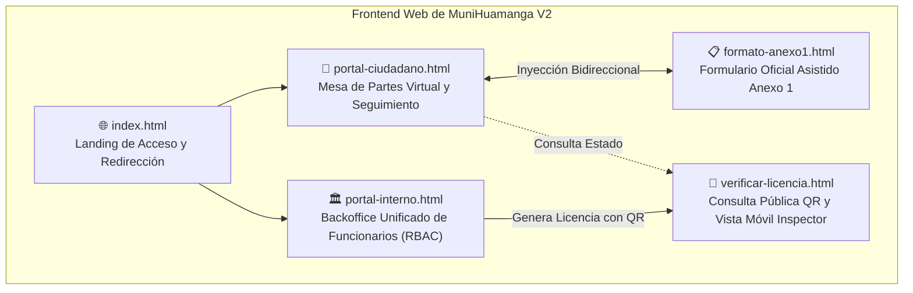
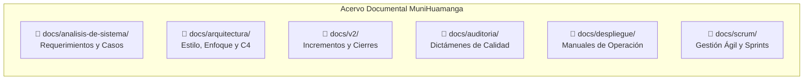
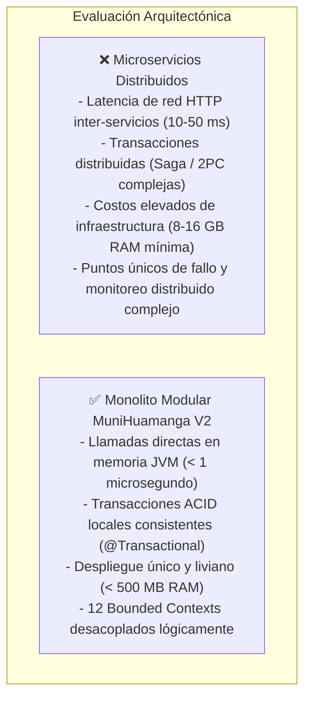
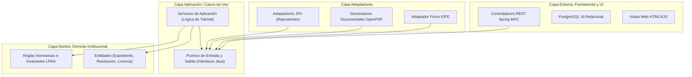
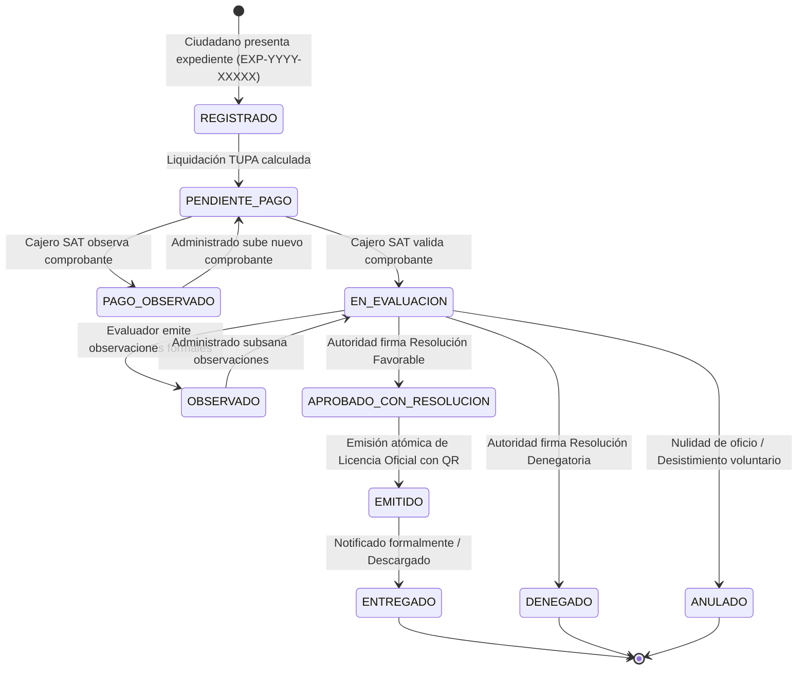
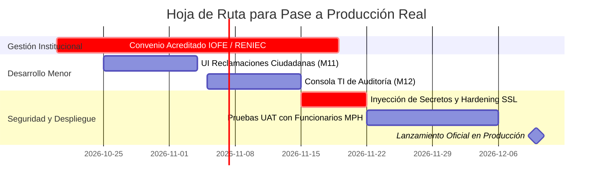

# 🏛️ DOCUMENTO MAESTRO DE AUDITORÍA Y ESTADO GENERAL DEL PROYECTO
## Sistema de Gestión Digital de Licencias de Funcionamiento — MuniHuamanga V2
### Municipalidad Provincial de Huamanga (Ayacucho, Perú)

> **Documento Canónico de Presentación y Dictamen General de Auditoría**  
> **Fecha de Emisión:** 17 de octubre de 2026  
> **Versión de Software:** `v2.0.0-rc1` | **Línea Base Verificada:** 310 pruebas automatizadas (100% aprobadas)  
> **Destinatarios:** Comisión de Evaluación, Gerencia de Licencias, Oficina de Tecnologías de Información (OTI), Evaluadores Técnicos y Auditores de Software.

---

## 📑 TABLA DE CONTENIDOS

1. [Resumen Ejecutivo y Ficha Técnica del Proyecto](#1-resumen-ejecutivo-y-ficha-técnica-del-proyecto)
2. [El Prototipo y la Experiencia de Usuario (UI/UX)](#2-el-prototipo-y-la-experiencia-de-usuario-uiux)
   - 2.1. Arquitectura de Interfaces Web
   - 2.2. Recorrido Visual de los 5 Módulos Frontend
   - 2.3. Sistema de Diseño Institucional y Accesibilidad
3. [Auditoría Documental Integral: Inventario y Razón de Ser de Cada `.md`](#3-auditoría-documental-integral-inventario-y-razón-de-ser-de-cada-md)
   - 3.1. Carpeta `docs/analisis-de-sistema/` (Requerimientos e Ingeniería de Software)
   - 3.2. Carpeta `docs/arquitectura/` (Estilo, Enfoque y Modelo C4)
   - 3.3. Carpeta `docs/v2/` (Incrementos, Bitácoras de Cierre y Guías Especializadas)
   - 3.4. Carpeta `docs/auditoria/` (Dictámenes de Calidad y Consolidación)
   - 3.5. Carpeta `docs/despliegue/` (Operaciones, Producción y Contingencia)
   - 3.6. Carpeta `docs/scrum/` (Gestión Ágil y Backlogs de Sprint)
   - 3.7. Documentos Históricos de Entregas y Normativa Raíz
4. [Fundamentación de Decisiones de Arquitectura e Ingeniería](#4-fundamentación-de-decisiones-de-arquitectura-e-ingeniería)
   - 4.1. Justificación del Estilo: ¿Por qué Monolito Modular y no Microservicios?
   - 4.2. Justificación del Enfoque: ¿Por qué Clean Architecture y Puertos Hexagonales?
   - 4.3. Registro Maestro de Decisiones de Arquitectura (ADR-01 a ADR-07)
5. [Requerimientos, Actores y Máquina de Estados](#5-requerimientos-actores-y-máquina-de-estados)
   - 5.1. Segregación de Roles (RBAC)
   - 5.2. Ciclo de Vida del Trámite: La Máquina de 10 Estados
   - 5.3. Generación In-Memory de Formatos Oficiales (Anexos 1, 3, 4 y Licencia)
6. [Balance de Avance Técnico: ¿Qué se Hizo? vs. ¿Qué le Hace Falta?](#6-balance-de-avance-técnico-qué-se-hizo-vs-qué-le-hace-falta)
   - 6.1. Lo que Está 100% Implementado y Comprobado (Logros)
   - 6.2. Lo que le Hace Falta para Producción Institucional (Brechas y Bloqueos)
   - 6.3. Hoja de Ruta Recomendada para el Pase a Producción
7. [Conclusiones del Dictamen de Auditoría](#7-conclusiones-del-dictamen-de-auditoría)

---

## 1. RESUMEN EJECUTIVO Y FICHA TÉCNICA DEL PROYECTO

### 1.1. Contexto y Problema que Resuelve
En la Municipalidad Provincial de Huamanga, el procedimiento administrativo para el otorgamiento de Licencias de Funcionamiento atravesaba deficiencias estructurales:
- **Tiempos de espera excesivos:** Trámites que legalmente debían resolverse en 1 a 15 días hábiles se extendían hasta por 45 días por extravío de expedientes físicos y burocracia manual.
- **Vulnerabilidad y Falsificación:** Circulación de licencias apócrifas con sellos escaneados y firmas falsas que no podían ser auditadas por inspectores en campo.
- **Riesgo en Datos Personales:** Falta de cumplimiento de la **Ley N° 29733**, exponiendo documentos de identidad y números telefónicos de administrados a cualquiera que viera el certificado comercial.
- **Desarticulación Operativa:** Desconexión entre la evaluación administrativa, la recaudación del SAT Huamanga, la zonificación PDU y las inspecciones de Defensa Civil (ITSE).

**MuniHuamanga V2** es una plataforma de Gobierno Digital desarrollada para digitalizar, transparentar y garantizar la validez jurídica indubitable del procedimiento administrativo de licencias de funcionamiento de punta a punta, bajo el principio de **cero papel**, **celeridad procedimental** y **seguridad criptográfica**.

### 1.2. Ficha Técnica Consolidada

| Parámetro | Especificación Real de la Solución |
|---|---|
| **Entidad Beneficiaria** | Municipalidad Provincial de Huamanga (Ayacucho, Perú) |
| **Lenguaje Base** | [Java 21 LTS](https://adoptium.net/) (Long Term Support) con soporte para Virtual Threads |
| **Framework Backend** | [Spring Boot 3.3.4](https://spring.io/projects/spring-boot) |
| **Seguridad y Tokens** | Spring Security 6.x y [JJWT 0.12.6](https://github.com/jwtk/jjwt) (Tokens stateless con RBAC y mitigación IDOR/BOLA) |
| **Persistencia** | PostgreSQL 16.x (ACID) con [Hibernate 6.x](https://hibernate.org/) y Spring Data JPA |
| **Migraciones de Esquema** | [Flyway](https://flywaydb.org/) mediante scripts SQL versionados (`V2.0.0` y `V2.1.0`) |
| **Renderizado Documental** | [OpenPDF 2.0.3](https://github.com/LibrePDF/OpenPDF) (Generación 100% in-memory sin tocar disco físico) |
| **Generación QR y Barras** | [ZXing 3.5.3](https://github.com/zxing/zxing) (Códigos QR dinámicos y Code 128 para vouchers de recaudación) |
| **Georreferenciación** | [Leaflet 1.9.4](https://leafletjs.com/) y OpenStreetMap (Captura y visualización cartográfica) |
| **Frontend Web** | HTML5 semántico, CSS3 Vanilla estructurado en variables/tokens y JavaScript Vanilla moderno (cero dependencias de frameworks SPA pesados) |
| **Pruebas Automatizadas** | 310 pruebas unitarias, de integración, seguridad y concurrencia (100% passing) |
| **Marco Legal Cumplido** | Ley N° 28976, TUO D.S. N° 046-2017-PCM, D.S. N° 002-2018-PCM, D.S. N° 163-2020-PCM, Ley N° 27444, Ley N° 27269 y Ley N° 29733 |

---

## 2. EL PROTOTIPO Y LA EXPERIENCIA DE USUARIO (UI/UX)

### 2.1. Arquitectura de Interfaces Web
El frontend del sistema está alojado en el subdirectorio de recursos estáticos del backend ([`servicio-expedientes/src/main/resources/static/`](file:///d:/ArqSoftware/MuniHuamanga/servicio-expedientes/src/main/resources/static/)), lo que permite que el artefacto `.jar` del Monolito Modular sirva tanto la API REST como las interfaces de usuario desde el puerto `8081`, facilitando un despliegue sin dependencias externas de servidores web adicionales.

---

### 2.2. Recorrido Visual de los 5 Módulos Frontend

#### A. Portal Ciudadano (`portal-ciudadano.html` / `portal-ciudadano.js`)
- **Propósito:** Ventanilla virtual integral para que personas naturales y empresas tramiten sus licencias sin acudir a la municipalidad.
- **Capacidades Clave:**
  1. **Gestión de Cuentas y Múltiples Locales:** Permite autenticarse (`POST /api/auth/login`), registrarse y gestionar distintos locales comerciales asociados a un mismo titular o RUC.
  2. **Wizard Asistido de 4 Pasos:**
     - *Paso 1 (Titular):* DNI, RUC, razón social, correo de notificación y teléfono.
     - *Paso 2 (Establecimiento y Ubicación Leaflet):* Selector de establecimiento previo o nuevo local comercial, mapa interactivo Leaflet con pin arrastrable para capturar latitud y longitud georreferenciada.
     - *Paso 3 (Documentación y Carga Drag & Drop):* Subida de requisitos con cálculo local de hash criptográfico **SHA-256** mediante la API `window.crypto.subtle.digest()`, barra de progreso y checklist normativo en caliente.
     - *Paso 4 (Revisión y Presentación):* Declaración jurada, liquidación referencial TUPA y botón con protección estricta contra doble clic e idempotencia que genera el número formal `EXP-YYYY-XXXXX`.
  3. **Panel de Borradores:** Bandeja para continuar la edición de borradores autoguardados o descartarlos.
  4. **Seguimiento Público:** Consulta en línea por correlativo con historial de eventos y botón para subsanar observaciones documentales.

#### B. Formulario Asistido Ministerial Anexo 1 (`formato-anexo1.html` / `formato-anexo1.js`)
- **Propósito:** Digitalización exhaustiva del formato ministerial aprobado por el D.S. N° 163-2020-PCM (Declaración Jurada para Licencia de Funcionamiento).
- **Capacidades Clave:**
  1. **Sincronización Bidireccional:** Detecta el parámetro de URL `?borradorId=...` o la sesión activa en el navegador. Al pulsar el botón `[📎 Adjuntar a mi Borrador]`, el formulario pre-carga los datos del borrador, permite completarlo y lo inyecta como PDF oficial firmado bajo el tipo `DECLARACION_JURADA_ANEXO1`.
  2. **Calculadora Automática de Riesgo ITSE:** Evalúa en el navegador el tipo de giro comercial, el área ocupada ($m^2$) y el aforo, sugiriendo de inmediato si corresponde inspección *Ex-Ante* (Riesgo Alto/Muy Alto) o *Ex-Post* (Riesgo Bajo/Medio).
  3. **Validaciones en Tiempo Real:** Validación algorítmica de DNI (8 dígitos) y RUC (11 dígitos, verificación de prefijos 10 o 20).

#### C. Portal Interno de Funcionarios (`portal-interno.html` / `portal-interno.js`)
- **Propósito:** Centro de control administrativo y resolutivo de la Municipalidad de Huamanga, adaptado dinámicamente según el rol RBAC del funcionario autenticado.
- **Pestañas y Funcionalidades Segregadas por Rol:**
  - **Bandeja de Pagos SAT (`ROLE_CAJERO`):** Visualización exclusiva de vouchers pendientes de verificación. Modal de auditoría `#modalHistorialPago` para registrar la calificación (`VALIDADO_MANUALMENTE`, `OBSERVADO`, `RECHAZADO`) con justificación obligatoria mínima de 10 caracteres.
  - **Bandeja de Expedientes (`ROLE_EVALUADOR`, `ROLE_ADMIN`):** Filtros por estado, vista de los 10 estados V2, calificación de admisibilidad y derivación a inspección técnica ITSE.
  - **Evaluación y Zonificación (`ROLE_EVALUADOR`):** Registro de compatibilidad de uso del suelo según el Plan de Desarrollo Urbano (PDU) de Huamanga y emisión de informes técnicos previos.
  - **Resoluciones Administrativas (`ROLE_ADMIN`):** Generación formal del acto administrativo con correlativo anual atómico (`RES-YYYY-XXXXX`). Activación del proceso de firma digital institucional bajo política *fail-closed*.
  - **Emisión de Licencias Oficiales (`ROLE_ADMIN`):** Generación atómica del certificado (`LIC-YYYY-XXXXX`) con doble marco ornamental, sellos institucionales y código QR dinámico.
  - **Tarifario TUPA (`ROLE_ADMIN`):** Modificación en caliente de tasas y conceptos tributarios con persistencia en base de datos.
  - **Administración de Operadores (`ROLE_ADMIN`):** Registro de nuevos funcionarios, asignación de roles y delegaciones normativas.

#### D. Módulo de Verificación Móvil y Escaneo QR (`verificar-licencia.html` / `verificar-licencia.js`)
- **Propósito:** Punto de acceso abierto para que cualquier ciudadano o autoridad verifique la legitimidad de un negocio escaneando el código QR impreso en el establecimiento comercial.
- **Comportamiento Dual Diferenciado (Cumplimiento de la Ley N° 29733):**
  - **Vista Pública (Público General anónimo):** Consume `GET /api/public/licencias/{token}`. Expone de manera minimalista únicamente: Nombre comercial, razón social, giro de negocio autorizado, dirección pública y estado de vigencia. **Oculta estrictamente** DNI, RUC, teléfonos personales y ubicación en coordenadas cartográficas para prevenir extorsiones y fraudes.
  - **Vista de Inspector Municipal (Autenticado con `ROLE_INSPECTOR`):** Dispone de un botón de inicio de sesión institucional. Tras validarse, invoca `GET /api/licencias/inspeccion/{token}`, desplegando:
    - Coordenadas geográficas exactas (latitud y longitud).
    - Mapa interactivo integrado con **Leaflet 1.9.4**.
    - Marcador de localización para cotejar si el local comercial físico inspeccionado coincide con la ubicación catastral autorizada en el expediente.
    - Auditoría inmutable de la consulta realizada (hora, usuario inspector y dispositivo).

#### E. Landing Page de Bienvenida (`index.html`)
- Página de bienvenida institucional que orienta al usuario entre la tramitación ciudadana, la consulta de expedientes, la verificación de licencias y el acceso al portal de funcionarios.

---

### 2.3. Sistema de Diseño Institucional y Accesibilidad

El diseño del frontend se basa en una guía de estilo formal consagrada en [`docs/v2/GUIA_INTERFACES_FRONTEND.md`](file:///d:/ArqSoftware/MuniHuamanga/docs/v2/GUIA_INTERFACES_FRONTEND.md):
- **Paleta de Colores Huamanga:**
  - Azul Marino Institucional (`--primary: #003366`) y Azul Profundo (`--primary-dark: #001f3f`).
  - Rojo Carmesí Huamanga (`--huamanga-red: #991b1b`) para acentos y elementos de alta jerarquía.
  - Dorado Heráldico (`--huamanga-gold: #d97706`) para líneas divisorias y estados de atención.
  - Colores semánticos de estado: Verde Éxito (`#059669`), Rojo Peligro (`#dc2626`), Ámbar Advertencia (`#eab308`).
- **Tipografía:** Sistema de fuentes moderno y de alta legibilidad (`Segoe UI`, `system-ui`, `-apple-system`, `sans-serif`) con escala modular armónica.
- **Accesibilidad:** Cumplimiento de **WCAG 2.1 nivel AA** con ratios de contraste superiores a 4.5:1 en todos los textos interactivos, soporte para navegación por teclado, roles ARIA y captura de eventos en modales.

---

## 3. AUDITORÍA DOCUMENTAL INTEGRAL: INVENTARIO Y RAZÓN DE SER DE CADA `.md`

A continuación, se detalla la auditoría de cada uno de los archivos que conforman el acervo documental del proyecto, explicando su justificación, contenido normativo y por qué resulta indispensable para el ciclo de vida del software.

---

### 3.1. Carpeta `docs/analisis-de-sistema/` (Ingeniería de Requerimientos y Fundamentos)

Esta carpeta contiene la especificación de ingeniería formal del sistema, elaborada según los estándares de análisis de sistemas del Estado Peruano:

1. [`01-actores.md`](file:///d:/ArqSoftware/MuniHuamanga/docs/analisis-de-sistema/01-actores.md):
   - **Por qué existe:** Define con precisión los 5 actores humanos y los 3 sistemas externos que interactúan con la plataforma, delimitando las fronteras del sistema.
   - **Qué contiene:** Matriz de roles del sistema (`ROLE_CIUDADANO`, `ROLE_CAJERO`, `ROLE_EVALUADOR`, `ROLE_ADMIN`, `ROLE_INSPECTOR`), descripción de responsabilidades, permisos asignados y actores externos (SAT Huamanga, IOFE/RENIEC, Servidor SMTP).
2. [`02-historias-del-usuario.md`](file:///d:/ArqSoftware/MuniHuamanga/docs/analisis-de-sistema/02-historias-del-usuario.md):
   - **Por qué existe:** Traduce las necesidades de negocio en requerimientos ágiles bajo el formato estándar de Historias de Usuario (*Como... Quiero... Para...*).
   - **Qué contiene:** Catálogo completo de historias (US-01 a US-23) que abarcan desde el registro ciudadano, autoguardado de borradores, cálculo de tasa TUPA, validación en caja SAT, hasta la resolución administrativa, firma fail-closed y consulta QR para inspectores con criterios de aceptación Gherkin (*Dado... Cuando... Entonces...*).
3. [`03-requisitos-funcionales.md`](file:///d:/ArqSoftware/MuniHuamanga/docs/analisis-de-sistema/03-requisitos-funcionales.md):
   - **Por qué existe:** Es la especificación canónica y contractual de lo que el software debe hacer obligatoriamente.
   - **Qué contiene:** Catálogo estructurado de requisitos funcionales (RF-01 a RF-15), la definición formal de los 10 estados de la máquina finita del expediente con diagrama de transiciones, y la matriz de trazabilidad cruzada frente a las clases de prueba automatizada.
4. [`04-atributos-de-calidad.md`](file:///d:/ArqSoftware/MuniHuamanga/docs/analisis-de-sistema/04-atributos-de-calidad.md):
   - **Por qué existe:** Define los requerimientos no funcionales (RNF) bajo la norma internacional **ISO/IEC 25010**.
   - **Qué contiene:** Métricas cuantitativas de rendimiento (tiempos de respuesta $< 500$ ms en consultas y $< 2$ s en generación de PDFs), seguridad criptográfica (hash SHA-256 inmutable, mitigación IDOR/BOLA), concurrencia ($\ge 150$ transacciones simultáneas sin bloqueos) y disponibilidad operativa.
5. [`05-restricciones.md`](file:///d:/ArqSoftware/MuniHuamanga/docs/analisis-de-sistema/05-restricciones.md):
   - **Por qué existe:** Establece las fronteras infranqueables y los límites normativos y tecnológicos que el equipo de desarrollo debió acatar sin excepción.
   - **Qué contiene:** Restricciones de marco legal peruano (Ley 28976, Ley 27269 de firmas, Ley 29733 de datos personales), restricción de hardware institucional (servidores locales limitados a 4-8 GB de RAM que obligan a un consumo $< 500$ MB), y delimitación explícita de procesos que se gestionan fuera de la plataforma (ADR-06).
6. [`06-driver-arquitectonicos.md`](file:///d:/ArqSoftware/MuniHuamanga/docs/analisis-de-sistema/06-driver-arquitectonicos.md):
   - **Por qué existe:** Sintetiza los factores de máxima prioridad que guiaron cada decisión técnica de alto nivel.
   - **Qué contiene:** Mapeo de drivers de negocio (celeridad administrativa, transparencia tributaria, cero papel) y drivers técnicos (modularidad, inmutabilidad probatoria, independencia de infraestructura y costo cero en licenciamiento de software propietario).
7. [`07-mantenibilidad.md`](file:///d:/ArqSoftware/MuniHuamanga/docs/analisis-de-sistema/07-mantenibilidad.md):
   - **Por qué existe:** Evalúa cómo la solución puede evolucionar, corregirse y adaptarse en el tiempo sin degradar su calidad técnica.
   - **Qué contiene:** Análisis de modularidad Maven, métricas de acoplamiento eferente/aferente, directrices para refactorizaciones seguras, cobertura de pruebas con 310 tests como red de seguridad y guía para la incorporación de nuevos trámites municipales.
8. [`08-decisiones-arquitectonicas.md`](file:///d:/ArqSoftware/MuniHuamanga/docs/analisis-de-sistema/08-decisiones-arquitectonicas.md):
   - **Por qué existe:** Es el puente histórico de trazabilidad entre las decisiones iniciales de Fase 1 y el registro consolidado de V2.
   - **Qué contiene:** Registro histórico de los primeros 9 ADRs formulados durante la concepción del sistema y su enlace referencial hacia el documento canónico definitivo [`docs/v2/DECISIONES_ARQUITECTURA.md`](file:///d:/ArqSoftware/MuniHuamanga/docs/v2/DECISIONES_ARQUITECTURA.md).

---

### 3.2. Carpeta `docs/arquitectura/` (Estilo, Enfoque y Modelo C4)

Esta carpeta contiene el diseño técnico y arquitectónico formal del sistema:

1. [`estilo-arquitectonico.md`](file:///d:/ArqSoftware/MuniHuamanga/docs/arquitectura/estilo-arquitectonico.md):
   - **Por qué existe:** Sustenta la topología global de despliegue y distribución de componentes físicos del software.
   - **Qué contiene:** Explicación técnica del por qué se eligió el **Monolito Modular** frente a microservicios distribuidos, mapa de empaquetamiento único en `servicio-expedientes.jar`, descomposición lógica en 12 Bounded Contexts, y eliminación de fallos de red y sobrecostos de serialización JSON.
2. [`enfoque-arquitectonico.md`](file:///d:/ArqSoftware/MuniHuamanga/docs/arquitectura/enfoque-arquitectonico.md):
   - **Por qué existe:** Define la estructura interna del código fuente y la orientación de las dependencias.
   - **Qué contiene:** Implementación de **Clean Architecture** (Robert C. Martin) y **Ports & Adapters (Hexagonal)** (Alistair Cockburn). Detalla la Regla de Dependencia, la protección del núcleo de negocio frente a frameworks y los puertos de integración (`FirmaDigitalPort`, `SatPort`, `EdificacionesPort`, `DefensaCivilPort`).
3. [`c4-model.md`](file:///d:/ArqSoftware/MuniHuamanga/docs/arquitectura/c4-model.md):
   - **Por qué existe:** Modela visualmente la arquitectura del sistema en distintos niveles de granularidad según la metodología C4 de Simon Brown.
   - **Qué contiene:** Diagramas Mermaid formalizados para:
     - *Nivel 1 (Contexto del Sistema):* Actores y sistemas externos en el ecosistema municipal.
     - *Nivel 2 (Contenedores):* Despliegue de Single Page Application, Backend Spring Boot y Base de Datos PostgreSQL.
     - *Nivel 3 (Componentes):* Controladores REST, Servicios de Aplicación, Entidades de Dominio, Repositorios Spring Data JPA y Adaptadores Portuarios.
     - *Nivel 4 (Código Crítico):* Diagrama de secuencia del flujo de emisión resolutiva y validación criptográfica *fail-closed*.
4. [`diseno-arquitectonico-monolito-modular-clean-architecture.md`](file:///d:/ArqSoftware/MuniHuamanga/docs/arquitectura/diseno-arquitectonico-monolito-modular-clean-architecture.md):
   - **Por qué existe:** Consolida la visión de ingeniería de software fusionando la topología modular con los patrones de código limpio para los equipos de desarrollo.
   - **Qué contiene:** Contratos de interfaz, manejo de transacciones locales `@Transactional`, estrategia de excepciones de negocio RFC-7807 y directrices de persistencia relacional.

---

### 3.3. Carpeta `docs/v2/` (Incrementos, Bitácoras de Cierre y Guías Especializadas)

Constituye la bitácora viviente de la versión 2 del proyecto, documentando paso a paso cada sprint de ingeniería:

1. [`DECISIONES_ARQUITECTURA.md`](file:///d:/ArqSoftware/MuniHuamanga/docs/v2/DECISIONES_ARQUITECTURA.md):
   - **Fuente Canónica Maestra de Decisiones (ADR-01 a ADR-07).** Fundamenta por qué se desacoplaron las cuentas de los expedientes, por qué se adoptó la política fail-closed en firmas, por qué la validación SAT es manual y por qué los correlativos usan bloqueos pesimistas.
2. [`ESTADO_ACTUAL_SISTEMA.md`](file:///d:/ArqSoftware/MuniHuamanga/docs/v2/ESTADO_ACTUAL_SISTEMA.md):
   - **Informe de Situación Operativa Consolidado.** Reporta el estado exacto de los 12 módulos, los 310 tests automáticos ejecutados y los bloqueos institucionales vigentes.
3. [`GUIA_MODIFICACIONES_MODULARES.md`](file:///d:/ArqSoftware/MuniHuamanga/docs/v2/GUIA_MODIFICACIONES_MODULARES.md):
   - **Catálogo Maestro de Módulos (M01 a M12).** Describe cada Bounded Context, sus paquetes Java correspondientes, sus tablas de base de datos asociadas y sus reglas de negocio particulares.
4. [`GUIA_INTERFACES_FRONTEND.md`](file:///d:/ArqSoftware/MuniHuamanga/docs/v2/GUIA_INTERFACES_FRONTEND.md):
   - **Manual de Diseño e Integración UI/UX.** Paleta cromática de Huamanga, estándares WCAG 2.1 AA, componentes web y protocolos de llamada asíncrona hacia las APIs REST.
5. [`MATRIZ_BRECHAS.md`](file:///d:/ArqSoftware/MuniHuamanga/docs/v2/MATRIZ_BRECHAS.md) y [`PLAN_IMPLEMENTACION.md`](file:///d:/ArqSoftware/MuniHuamanga/docs/v2/PLAN_IMPLEMENTACION.md):
   - Identificación de diferencias entre la Fase 1 heredada y la versión V2, junto con el plan secuencial para cerrar dichas brechas incremento por incremento.
6. [`PRUEBAS_Y_VALIDACION.md`](file:///d:/ArqSoftware/MuniHuamanga/docs/v2/PRUEBAS_Y_VALIDACION.md):
   - Registro minucioso de la estrategia de pruebas, comandos de ejecución de Maven Surefire y evidencias de cobertura técnica.
7. **Documentos de Implementación y Cierre (`IMPLEMENTACION_I02.md` a `I09.md` y `CIERRE_I02_1.md` a `CIERRE_I10.md`):**
   - Bitácoras inmutables de cada uno de los incrementos iterativos, que acreditan formalmente qué código se construyó, qué pruebas se añadieron y cómo se verificó cada hito.

---

### 3.4. Carpeta `docs/auditoria/` (Dictámenes de Calidad y Consolidación)

1. [`AUDITORIA_INTEGRAL.md`](file:///d:/ArqSoftware/MuniHuamanga/docs/auditoria/AUDITORIA_INTEGRAL.md):
   - Dictamen exhaustivo inicial que detectó 101 observaciones de calidad en el código legado, sirviendo como punto de partida para la reingeniería a V2.
2. [`CONSOLIDACION_DOCUMENTAL_V2.md`](file:///d:/ArqSoftware/MuniHuamanga/docs/auditoria/CONSOLIDACION_DOCUMENTAL_V2.md):
   - Informe formal de consolidación que purgó documentos duplicados, normalizó la nomenclatura a *kebab-case*, verificó la sintaxis Mermaid y consagró fuentes canónicas únicas de verdad.
3. [`REPORTE_QA.md`](file:///d:/ArqSoftware/MuniHuamanga/docs/auditoria/REPORTE_QA.md):
   - Reporte técnico de control de calidad sobre cobertura de código, pruebas de estrés y cumplimiento de directrices SonarQube / Clean Code.

---

### 3.5. Carpeta `docs/despliegue/` (Operaciones, Producción y Contingencia)

1. [`GUIA_DESPLIEGUE.md`](file:///d:/ArqSoftware/MuniHuamanga/docs/despliegue/GUIA_DESPLIEGUE.md):
   - Manual paso a paso para la puesta en marcha del sistema utilizando Docker Compose o despliegue bare-metal con PostgreSQL 16 y Java 21 LTS.
2. [`CHECKLIST_PRODUCCION.md`](file:///d:/ArqSoftware/MuniHuamanga/docs/despliegue/CHECKLIST_PRODUCCION.md):
   - Lista de verificación obligatoria previa al pase a producción: sustitución de secretos demo, validación de certificados SSL/TLS, verificación de puertos cerrados y pruebas de contingencia.
3. [`PLAN_ROLLBACK.md`](file:///d:/ArqSoftware/MuniHuamanga/docs/despliegue/PLAN_ROLLBACK.md):
   - Procedimiento de emergencia para restaurar versiones previas de base de datos y contenedores ante incidencias operacionales críticas sin pérdida de información de expedientes.

---

### 3.6. Carpeta `docs/scrum/` (Gestión Ágil y Backlogs de Sprint)

1. [`product-backlog.md`](file:///d:/ArqSoftware/MuniHuamanga/docs/scrum/product-backlog.md): Backlog global priorizado de historias de usuario y deudas técnicas.
2. [`sprint-0-backlog.md`](file:///d:/ArqSoftware/MuniHuamanga/docs/scrum/sprint-0-backlog.md) a [`sprint-4-backlog.md`](file:///d:/ArqSoftware/MuniHuamanga/docs/scrum/sprint-4-backlog.md): Planificación y desglose de tareas de cada iteración del desarrollo ágil.

---

### 3.7. Documentos Históricos de Entregas y Normativa Raíz

- [`normativa-legal.md`](file:///d:/ArqSoftware/MuniHuamanga/docs/normativa-legal.md): Compendio del marco jurídico peruano aplicable (Leyes 28976, 27444, 27269, 29733 y D.S. de la PCM).
- [`v0.1-inventario-matriz-campos.md`](file:///d:/ArqSoftware/MuniHuamanga/docs/v0.1-inventario-matriz-campos.md): Mapeo inicial de los 45 campos del Anexo 1 frente a las columnas de base de datos.
- `entrega-fase-01.md` a `entrega-fase-04-consolidado.md`: Informes contractuales de entrega de hitos pasados, preservados como evidencia histórica de auditoría.
- [`README.md` (Raíz)](file:///d:/ArqSoftware/MuniHuamanga/README.md): Portada y manual de inducción técnica principal del repositorio.

---

## 4. FUNDAMENTACIÓN DE DECISIONES DE ARQUITECTURA E INGENIERÍA

Uno de los aspectos más destacados de la auditoría técnica de MuniHuamanga V2 radica en la **justificación razonada y pragmática** de cada decisión de diseño de software adoptada:

### 4.1. Justificación del Estilo: ¿Por qué Monolito Modular y no Microservicios?

Es común en la industria caer en la trampa de adoptar microservicios de manera prematura. En MuniHuamanga V2, la adopción del **Monolito Modular** responde a una evaluación técnica y financiera rigurosa:

1. **Eficiencia y Consumo de Recursos:** La Municipalidad Provincial de Huamanga cuenta con infraestructura de servidores limitada. Un conjunto de 6 a 8 microservicios independientes con Spring Boot requeriría un mínimo de 8 a 16 GB de RAM solo para mantenerse en ejecución ociosa. El Monolito Modular opera de manera óptima con **menos de 500 MB de RAM**, permitiendo ejecutarse en servidores modestos o máquinas virtuales sin sobrecostos presupuestarios.
2. **Consistencia Transaccional ACID:** Los trámites de licencias exigen que la numeración correlativa anual (`EXP-YYYY-XXXXX`, `RES-YYYY-XXXXX`, `LIC-YYYY-XXXXX`) sea estrictamente atómica y sin huecos ni colisiones. En microservicios, esto requeriría protocolos de transacciones distribuidas (Saga, Two-Phase Commit) altamente propensos a estados inconsistentes ante caídas de red. En el Monolito Modular, la base de datos PostgreSQL resuelve esto mediante transacciones locales atómicas y bloqueos pesimistas (`PESSIMISTIC_WRITE`).
3. **Latencia Cero en Comunicación Interna:** Las consultas entre expedientes, cuentas, tarifarios y zonificación se resuelven en microsegundos mediante llamadas a métodos Java en la misma memoria JVM, evitando la sobrecarga de serialización/deserialización JSON y saltos de red HTTP.
4. **Facilidad Operativa:** Un solo artefacto desplegable (`servicio-expedientes.jar` o un contenedor Docker) simplifica las tareas de respaldo, actualización, monitoreo y contingencia por parte del equipo de TI municipal.

---

### 4.2. Justificación del Enfoque: ¿Por qué Clean Architecture y Puertos Hexagonales?

Para evitar que el Monolito Modular se degrade en una "Gran Bola de Lodo" (*Big Ball of Mud*), se implementó **Clean Architecture** estructurada en capas concéntricas y el patrón **Ports & Adapters**:

1. **Independencia Tecnológica:** El núcleo del negocio (reglas de cálculo del riesgo ITSE, plazos de observaciones de la Ley 27444, requisitos de admisibilidad) está escrito en Java puro y no conoce detalles de la base de datos ni de los controladores web.
2. **Puertos Desacoplados (Ports):** Las integraciones con agentes externos se definen mediante interfaces abstractas:
   - `FirmaDigitalPort`: Permite cambiar de proveedor de firma acreditado (RENIEC, ONPE, INDECOPI) simplemente implementando una nueva clase adaptadora sin tocar una sola línea de la lógica de licencias.
   - `SatPort`: Desacopla la recaudación tributaria para soportar hoy validación manual de cajero y mañana integración por API bancaria o pasarela de pagos.
3. **Testabilidad Incomparable:** La arquitectura permite someter a prueba la lógica de negocio en milisegundos utilizando bases de datos en memoria (H2) y simulaciones controladas de adaptadores, lo que explica la existencia de **310 pruebas automatizadas** que se ejecutan en menos de 40 segundos.

---

### 4.3. Registro Maestro de Decisiones de Arquitectura (ADR-01 a ADR-07)

Consagradas en [`docs/v2/DECISIONES_ARQUITECTURA.md`](file:///d:/ArqSoftware/MuniHuamanga/docs/v2/DECISIONES_ARQUITECTURA.md):

- **ADR-01 (Monolito Modular con Clean Architecture):** Preservación de un artefacto único con separación estricta de responsabilidades internas.
- **ADR-02 (Autorización Centralizada en Backend y Protección IDOR/BOLA):** Cero confianza en validaciones del navegador. La capa de servicio y Spring Security (`@PreAuthorize`) verifican la legítima propiedad del recurso sobre cada endpoint.
- **ADR-03 (Normalización de Entidades y Repositorio Inmutable con SHA-256):** Desacoplamiento de `Cuenta` (1:N) `Establecimiento` (1:N) `Expediente` (1:N) `Documento`. Cada archivo adjunto almacena su hash SHA-256 para garantizar inmutabilidad probatoria.
- **ADR-04 (Firma Digital Institucional y Bloqueo de Emisión Falsa - Fail-Closed):** Prohibición terminante de insertar sellos o firmas simuladas en pantalla. Si no hay firma digital IOFE válida, el sistema bloquea la emisión de la licencia.
- **ADR-05 (Verificación QR con Minimización de Datos - Ley N° 29733):** Token dinámico no enumerable. Vista pública anónima sin datos sensibles; vista ampliada en mapa Leaflet solo para inspectores acreditados.
- **ADR-06 (Procesos Externos Manuales sin Acoplamiento Dañino):** Reconocimiento de que en esta fase el SAT, Edificaciones y Defensa Civil operan mediante procedimientos administrativos manuales de ventanilla, evitando acoplamientos técnicos ficticios.
- **ADR-07 (Acto Resolutivo Separado y Correlativo Atómico Pesimista):** Separación jurídica entre informe técnico preliminar y Resolución de Gerencia. Bloqueo pesimista en base de datos para correlativos anuales (`RES-YYYY-XXXXX` y `LIC-YYYY-XXXXX`).

---

## 5. REQUERIMIENTOS, ACTORES Y MÁQUINA DE ESTADOS

### 5.1. Segregación de Roles (RBAC)

El sistema garantiza una estricta segregación de funciones administrativas para prevenir conflictos de interés y actos de corrupción:

| Rol del Sistema | Actor Institucional | Responsabilidad y Permisos Exclusivos |
|---|---|---|
| `ROLE_CIUDADANO` | Administrado / Titular / Apoderado | Registro de cuentas y locales, redacción de borradores, cálculo de Anexo 1, subida de documentos con SHA-256 y seguimiento de sus propios trámites. |
| `ROLE_CAJERO` | Cajero del SAT Huamanga | Acceso exclusivo a la bandeja de pagos. Calificación manual de vouchers (`VALIDADO_MANUALMENTE`, `OBSERVADO`, `RECHAZADO`). Bloqueado de emitir licencias o resoluciones. |
| `ROLE_EVALUADOR` | Técnico de la Subgerencia de Licencias | Verificación técnica de requisitos, dictamen de compatibilidad de zonificación PDU, emisión de observaciones LPAG y redacción de informes previos. |
| `ROLE_ADMIN` | Subgerente / Gerente de Desarrollo Económico | Emisión formal de Resoluciones Administrativas con correlativo atómico, proceso de firma digital IOFE, expedición de licencias oficiales y edición del TUPA. |
| `ROLE_INSPECTOR` | Inspector Municipal en Campo | Escaneo de licencias en la vía pública, autenticación móvil para visualización de coordenadas y cotejo cartográfico en mapa interactivo Leaflet. |

---

### 5.2. Ciclo de Vida del Trámite: La Máquina de 10 Estados

El corazón procedimental del sistema está gobernado por una máquina de estados finita formalizada en `EstadoExpediente.java` y validada por `EstadoExpedienteValidator.java`:

---

### 5.3. Generación In-Memory de Formatos Oficiales (Anexos 1, 3, 4 y Licencia)

La plataforma incorpora motores de renderizado documental con **OpenPDF 2.0.3**:
1. **Rendimiento y Seguridad en Memoria:** Los documentos oficiales se generan directamente en flujos de bytes volátiles (`ByteArrayOutputStream`) en memoria RAM sin crear archivos temporales en el disco duro del servidor, eliminando fugas de información y acelerando los tiempos de respuesta a menos de 500 milisegundos.
2. **Formatos Soportados:**
   - **Anexo 1 (D.S. N° 163-2020-PCM):** Declaración Jurada oficial de 2 páginas con los 45 campos reglamentarios.
   - **Anexo 3:** Reporte Oficial de Nivel de Riesgo ITSE (2 páginas).
   - **Anexo 4:** Declaración Jurada de Condiciones de Seguridad en Edificaciones (4 páginas con la matriz completa de 23 ítems técnicos).
   - **Certificado Oficial de Licencia:** Documento ornamental con doble marco institucional (azul y dorado), marcas de agua vectoriales, escudo oficial de Huamanga, citas del Art. 3° de la Ley 28976 y código QR criptográfico.

---

## 6. BALANCE DE AVANCE TÉCNICO: ¿QUÉ SE HIZO? VS. ¿QUÉ LE HACE FALTA?

Este capítulo responde a la pregunta central de la auditoría sobre el avance real del proyecto:

### 6.1. Lo que Está 100% Implementado y Comprobado (Logros)

| Componente / Módulo | Estado | Evidencia de Calidad y Pruebas |
|---|:---:|---|
| **Línea Base y Arquitectura** | ✅ 100% | Monolito Modular compilando limpiamente en Java 21 LTS y Spring Boot 3.3.4. Estructura multi-módulo Maven (`common-domain` y `servicio-expedientes`). |
| **M01: Cuentas y Operadores** | ✅ 100% | Registro de titulares, operadores institucionales y locales comerciales desacoplados. |
| **M02: Solicitudes Borrador** | ✅ 100% | Autoguardado progresivo, validación previa de checklist y presentación atómica idempotente. |
| **M03: Expedientes y Documentos** | ✅ 100% | Máquina de 10 estados finita, versionado inmutable de documentos con hash SHA-256 y renderizado OpenPDF de Anexos 1, 3 y 4. |
| **M04: Pagos SAT** | ✅ 100% | Liquidación TUPA, emisión de vouchers con código de barras y bandeja de validación manual para cajeros con trazabilidad histórica inmutable. |
| **M05: Tarifario TUPA Dinámico** | ✅ 100% | Mantenimiento en caliente por API REST (`PUT /api/tupa/tarifas/{id}`) con fallback resiliente. |
| **M06: Zonificación y Rectificación** | ✅ 100% | Dictamen de compatibilidad de uso PDU y flujo de solicitudes de rectificación de ubicación. |
| **M07: Evaluación e Informes** | ✅ 100% | Elaboración de informes técnicos previos desglosados y notificaciones por correo. |
| **M08: Resoluciones y Firma Digital** | ✅ 100% | Correlativo atómico anual pesimista (`RES-YYYY-XXXXX`), puerto `FirmaDigitalPort` y política *fail-closed*. |
| **M09: Licencias Oficiales** | ✅ 100% | Emisión atómica de certificado (`LIC-YYYY-XXXXX`), doble marco ornamental, marcas de agua y notas legales. |
| **M10: Verificación QR y Móvil** | ✅ 100% | Token criptográfico no enumerable, vista pública con minimización estricta (Ley 29733) y vista inspector con georreferenciación Leaflet. |
| **Frontend Ciudadano (Fase C.1)** | ✅ 100% | Wizard interactivo de 4 pasos, carga Drag & Drop con SHA-256 en cliente, mapa Leaflet y sincronización con Anexo 1. |
| **Frontend Interno (Fase C.2)** | ✅ 100% | Consola unificada con adaptación dinámica por rol (RBAC), bandeja de pagos SAT y gestión de estados V2. |
| **Batería de Pruebas Automatizadas** | ✅ 100% | **310 pruebas automatizadas** ejecutándose con 0 errores y 0 omisiones en Maven Surefire. |

---

### 6.2. Lo que le Hace Falta para Producción Institucional (Brechas y Bloqueos)

A pesar de que el software se encuentra desarrollado y verificado a nivel de código y pruebas automatizadas, **el sistema NO debe pasar a producción todavía** debido a los siguientes bloqueos institucionales y técnicos pendientes:

1. **Convenio y Proveedor Real de Firma Digital (IOFE):**
   - *Situación actual:* El sistema opera con un adaptador de prueba (`FirmaDigitalAdapterService`) que simula la firma digital institucional para entornos de desarrollo y pruebas.
   - *Qué falta:* La Municipalidad Provincial de Huamanga debe formalizar el convenio o contratación con una Entidad de Certificación acreditada ante la IOFE / INDECOPI (como RENIEC u otro prestador acreditado), proveyendo los certificados y credenciales PKI institucionales de producción.
2. **Frontends Especializados para M11 y M12:**
   - *M11 (Reclamaciones Administrativas):* El backend está completado al 100% (entidades, servicios, DTOs y pruebas). Falta incorporar la pantalla visual en el `portal-ciudadano.html` para que el administrado ingrese sus recursos de reclamación de forma asistida.
   - *M12 (Consola Gráfica de Auditoría para TI):* La auditoría inmutable *append-only* y las trazas de seguridad están registradas al 100% en backend. Falta una interfaz gráfica en el `portal-interno.html` para que los auditores u oficiales de seguridad de la información consulten visualmente los eventos del sistema.
3. **Gestión de Secretos y Variables de Entorno de Producción:**
   - *Situación actual:* Existen valores predeterminados en `application.yml` y scripts de inicialización (`UsuarioDataInitializer.java`, `docker/postgres/init/`) con credenciales demo (`admin123`, `caja123`, `jwt.secret` predeterminado).
   - *Qué falta:* En el servidor de producción institucional, se deben configurar variables de entorno seguras en el sistema operativo o gestor de secretos (`JWT_SECRET`, `SPRING_DATASOURCE_PASSWORD`, credenciales SMTP reales), revocando los usuarios de prueba.
4. **Pruebas de Aceptación de Usuarios (UAT) y Capacitación en Campo:**
   - Realizar sesiones de homologación con funcionarios reales del SAT Huamanga, evaluadores de licencias e inspectores en la vía pública con terminales móviles reales para validar la usabilidad operativa bajo la red municipal.

---

### 6.3. Hoja de Ruta Recomendada para el Pase a Producción

---

## 7. CONCLUSIONES DEL DICTAMEN DE AUDITORÍA

1. **Madurez Técnica Excepcional:** MuniHuamanga V2 exhibe un estándar de ingeniería de software de alto nivel. La combinación de **Monolito Modular** y **Clean Architecture** garantiza un consumo óptimo de recursos ($< 500$ MB RAM), eliminando las fragilidades operativas de microservicios prematuros.
2. **Garantía Probatoria y Legal:** El sistema no solo es un gestor de formularios; es una plataforma jurídica digital que respeta la Ley N° 28976, la LPAG (Ley N° 27444) y la Ley de Firmas Digitales (Ley N° 27269). La política *fail-closed* asegura que ninguna licencia apócrifa pueda ser expedida sin firma institucional válida.
3. **Protección de Datos Personales:** El cumplimiento de la Ley N° 29733 mediante códigos QR con enlaces dinámicos no enumerables y vistas diferenciadas para ciudadanos e inspectores sitúa a la Municipalidad Provincial de Huamanga a la vanguardia del Gobierno Digital en el Perú.
4. **Respaldado por Pruebas:** Con **310 pruebas automatizadas sin fallos**, la solución cuenta con una red de seguridad integral que certifica la estabilidad de sus 12 Bounded Contexts.
5. **Veredicto Final:** El proyecto se encuentra **en estado de versión candidata a lanzamiento (`v2.0.0-rc1`)**, con su ingeniería y código fuente completamente maduros, requiriendo únicamente las gestiones institucionales y de seguridad de entorno indicadas en el apartado 6.2 para su entrada triunfal en producción.

---
*Fin del Documento Maestro de Auditoría y Estado General del Proyecto.*
