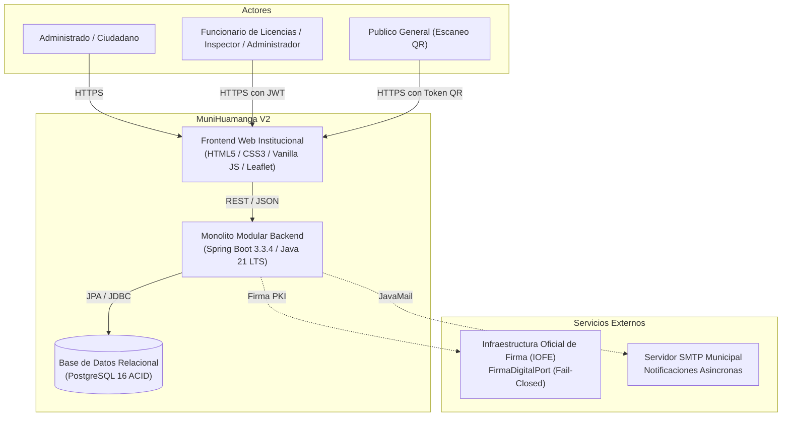
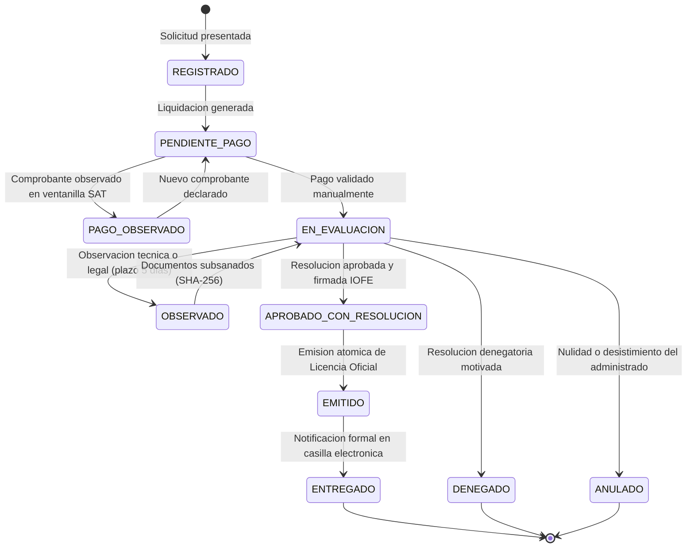

# MuniHuamanga V2 — Sistema de Gestión Digital de Licencias de Funcionamiento
### Municipalidad Provincial de Huamanga (Ayacucho, Perú)

> **Plataforma de Gobierno Digital para la Tramitación, Evaluación, Acto Resolutivo y Verificación de Licencias de Funcionamiento con Firma Digital Institucional, Códigos QR Dinámicos y Monolito Modular con Clean Architecture.**


---

## 1. Problema que Resuelve y Objetivo

En la provincia de Huamanga, la tramitación tradicional de licencias de funcionamiento enfrentaba demoras administrativas de hasta 45 días hábiles, duplicidad en la captura de datos, expedientes físicos extraviados, opacidad tributaria y vulnerabilidad ante licencias comerciales falsificadas o adulteradas.

**MuniHuamanga V2** resuelve esta problemática digitalizando el ciclo de vida del trámite de punta a punta:
- **Cero Papel y Celeridad:** Reducción del plazo legal de atención de 45 días a 1 día hábil para riesgo Bajo/Medio y máximo 15 días hábiles para riesgo Alto/Muy Alto (Ley N° 28976 y D.S. N° 002-2018-PCM).
- **Validez Jurídica Indubitable:** Emisión de resoluciones administrativas formales (`RES-YYYY-XXXXX`) y licencias oficiales (`LIC-YYYY-XXXXX`) mediante secuencias atómicas pesimistas y firma digital institucional acreditada ante la IOFE (Ley N° 27269).
- **Protección de Datos Personales (Ley N° 29733):** Código QR dinámico con minimización estricta de datos para la ciudadanía general y vista protegida con mapa interactivo (Leaflet) para inspectores municipales en campo.
- **Eficiencia Operativa:** Unificación en un **Monolito Modular** de alta cohesión que elimina la latencia de red de los microservicios, consume menos de 500 MB de RAM y renderiza formatos oficiales (Anexos 1, 2, 3, 4 y licencias) en memoria volátil en menos de 500 ms.
- **Transparencia y Quejas Ciudadanas:** Integración del Libro de Reclamaciones conforme al D.S. N° 042-2011-PCM y consola de auditoría inmutable de operaciones del sistema.

---

## 2. Tecnologías y Versiones Reales

| Componente | Tecnología | Versión | Rol en la Arquitectura |
|---|---|:---:|---|
| **Lenguaje de Programación** | Java SE (LTS) | `21` | Plataforma base con soporte a largo plazo y Virtual Threads |
| **Framework Backend** | Spring Boot | `3.3.4` | Inversión de control, inyección de dependencias y configuración |
| **Seguridad y Tokens** | Spring Security & JJWT | `6.x` / `0.12.6` | Autenticación stateless y autorización RBAC consolidada en 4 roles |
| **Motor de Base de Datos** | PostgreSQL | `16.x` | Base de datos relacional ACID con transacciones locales |
| **Persistencia ORM** | Spring Data JPA / Hibernate | `6.x` | Mapeo objeto-relacional y bloqueos pesimistas `PESSIMISTIC_WRITE` |
| **Renderizado Documental** | OpenPDF | `2.0.3` | Generación in-memory de Anexos 1 a 4 y resoluciones oficiales en PDF |
| **Generación QR y Barras** | ZXing (Zebra Crossing) | `3.5.3` | Códigos QR dinámicos y código de barras Code 128 para vouchers |
| **Georreferenciación Móvil** | Leaflet & OpenStreetMap | `1.9.4` | Renderizado interactivo de mapas para inspectores en campo |
| **Gestor de Construcción** | Apache Maven | `3.9.x` | Compilación multi-módulo (`common-domain` y `servicio-expedientes`) |
| **Contenedores** | Docker Engine & Compose | $\ge 24.0$ | Empaquetamiento multi-stage sobre `eclipse-temurin:21-jre-alpine` |

---

## 3. Arquitectura del Sistema

### 3.1. Estilo Arquitectónico: Monolito Modular
El sistema está construido bajo el estilo **Monolito Modular (Modular Monolith)**. Todos los módulos operativos se ejecutan en un único proceso JVM (`servicio-expedientes.jar`), eliminando la sobrecarga operacional, los saltos de red HTTP interservicios y la consistencia eventual, garantizando transacciones locales ACID y llamadas en memoria de microsegundos.
Consulta el documento canónico: [Estilo arquitectónico](docs/arquitectura/estilo-arquitectonico.md).

### 3.2. Enfoque Arquitectónico: Clean Architecture y Puertos Hexagonales
La lógica de negocio se aísla de frameworks y bases de datos mediante **Clean Architecture** estructurada en capas concéntricas (Dominio -> Aplicación -> Adaptadores -> Infraestructura), complementada con el patrón **Ports & Adapters (Hexagonal)**:
- `ProveedorActor`: Puerto de dominio que entrega la identidad y roles del actor autenticado en curso, evitando el acoplamiento a repositorios de persistencia en capas de negocio.
- `FirmaDigitalPort`: Puerto desacoplado para servicios criptográficos IOFE con política *fail-closed*.
- `SatPort`: Puerto de verificación de recaudación tributaria.
- `DefensaCivilPort`: Puerto para registro de inspecciones técnicas de seguridad.
- `EdificacionesPort`: Puerto de consulta de compatibilidad urbanística PDU.

Consulta el documento canónico: [Enfoque arquitectónico](docs/arquitectura/enfoque-arquitectonico.md).

### 3.3. Modelo C4 Resumido
El sistema se documenta formalmente mediante el modelo C4 hasta el nivel de componentes y código crítico:
- **Nivel 1 (Contexto):** Ciudadanos, Funcionarios de Licencias, Inspectores, Administradores TI, IOFE/RENIEC y Servidor SMTP.
- **Nivel 2 (Contenedores):** Frontend Web SPA, Monolito Modular Spring Boot y Base de Datos PostgreSQL 16.
- **Nivel 3 (Componentes):** Controladores REST, Servicios de Aplicación, Entidades de Dominio, Repositorios JPA y Adaptadores de Salida.
- **Nivel 4 (Código):** Diagrama de secuencia del flujo crítico *fail-closed* de resolución y firma digital.

Consulta el modelo completo: [Modelo C4](docs/arquitectura/c4-model.md).



---

## 4. Módulos del Sistema (M01 a M12)

MuniHuamanga V2 organiza sus capacidades en doce (12) Bounded Contexts lógicos con responsabilidades delimitadas:

| Módulo | Nombre | Responsabilidad Principal | Estado |
|:---:|---|---|:---:|
| **M01** | **Núcleo y Expedientes** | Máquina de estados finita (10 estados), cálculo de plazos de 1 a 15 días hábiles según nivel de riesgo ITSE y orquestación transaccional. | Completo |
| **M02** | **Identidad y Acceso** | Modelo RBAC consolidado en 4 roles (`ROLE_CIUDADANO`, `ROLE_FUNCIONARIO_LICENCIAS`, `ROLE_ADMIN`, `ROLE_INSPECTOR`), tokens JWT y representación legal. | Completo |
| **M03** | **Borradores y Mesa de Partes** | Autoguardado continuo de solicitudes preliminares, validación de checklist normativo y generación atómica del correlativo `EXP-YYYY-XXXXX`. | Completo |
| **M04** | **Documentos e Inmutabilidad** | Gestión inmutable de anexos y requisitos con verificación obligatoria de hash SHA-256 en servidor e historial de versiones por documento. | Completo |
| **M05** | **Pagos SAT y TUPA** | Declaración manual de pago posterior a la categorización de riesgo, validación por ventanilla del SAT y tarifario TUPA dinámico editable en caliente. | Completo |
| **M06** | **Zonificación y Catastro** | Evaluación vinculante de compatibilidad de uso con el Plan de Desarrollo Urbano (PDU) y rectificación cartográfica de locales. | Completo |
| **M07** | **Inspección ITSE** | Clasificación de riesgo (Bajo, Medio, Alto, Muy Alto) conforme al D.S. N° 002-2018-PCM, actas de inspección previa o posterior. | Completo |
| **M08** | **Resolución y Licencias** | Emisión atómica de Resoluciones (`RES-YYYY-XXXXX`) y Licencias (`LIC-YYYY-XXXXX`) con firma digital institucional fail-closed (Ley N° 27269). | Completo |
| **M09** | **Notificación Electrónica** | Casilla electrónica del administrado y cómputo legal de plazos de notificación conforme al TUO de la Ley N° 27444. | Completo |
| **M10** | **Fiscalización Posterior** | Muestreo aleatorio automatizado del 10% de expedientes simplificados para control posterior de veracidad de declaraciones juradas. | Completo |
| **M11** | **Libro de Reclamaciones** | Formulario ciudadano para quejas y reclamos normativos (D.S. N° 042-2011-PCM) y bandeja de resolución motivada en el portal interno. | Completo |
| **M12** | **Auditoría TI y Seguridad** | Registro inmutable unificado en `AuditoriaOperacion` (*append-only*), monitoreo forense, mitigación anti-IDOR y consola TI para el Administrador. | Completo |

Consulta la especificación detallada: [Guía de Módulos (M01–M12)](docs/v2/GUIA_MODIFICACIONES_MODULARES.md).

---

## 5. Máquina de Estados del Expediente

El ciclo de vida administrativo se gobierna estrictamente mediante una máquina de diez (10) estados normativos gobernados por `Expediente.aplicar()`:



---

## 6. Estructura del Repositorio

```text
MuniHuamanga/
├── pom.xml                                  # POM Padre Multi-Módulo Maven (Java 21 / SB 3.3.4)
├── Dockerfile                               # Empaquetado Multi-Stage (Maven 3.9 + Temurin 21 JRE no-root)
├── docker-compose.yml                       # Orquestación local: PostgreSQL 16 y Spring Boot
├── .env.example                             # Plantilla de variables de entorno seguras
│
├── common-domain/                           # Módulo Bounded Context: Contratos y DTOs compartidos
│   └── src/main/java/.../common/
│       ├── dto/                             # 41 DTOs de contrato inmutables
│       ├── enums/                           # 19 Enums de negocio (EstadoExpediente, NivelRiesgo, RolUsuario)
│       └── exception/                       # Excepciones de dominio tipadas
│
├── servicio-expedientes/                    # Módulo de Aplicación y Persistencia (Monolito Modular)
│   ├── src/main/java/.../expedientes/
│   │   ├── borradores/                      # M03: Gestión de Solicitudes Borrador y Mesa de Partes
│   │   ├── cuentas/                         # M02: Cuentas, Representación Legal y Operadores
│   │   ├── documentos/                      # M04: Inmutabilidad Documental y Hash SHA-256 en servidor
│   │   ├── establecimientos/                # Locales Comerciales Desacoplados y Cartografía
│   │   ├── evaluacion/                      # M06/M07: Evaluación Técnica, Checklist e Informes Administrativos
│   │   ├── integracion/                     # M08: Puertos y Adaptadores de Salida (FirmaDigitalPort)
│   │   ├── licencias/                       # M08/M10: Emisión Atómica de Licencias y Consulta QR
│   │   ├── model/                           # Entidades JPA (AuditoriaOperacion, Expediente, Licencia, etc.)
│   │   ├── nucleo/                          # M01: Agregado Expediente, Máquina de Estados y Puerto ProveedorActor
│   │   ├── pagos/                           # M05: Pagos SAT y Tarifario TUPA Dinámico
│   │   ├── reclamaciones/                   # M11: Libro de Reclamaciones (D.S. N° 042-2011-PCM)
│   │   ├── rectificacion/                   # M06: Rectificación de Ubicación Georreferenciada
│   │   ├── repository/                      # 36 Repositorios Spring Data JPA (AuditoriaOperacionRepository, etc.)
│   │   ├── resoluciones/                    # M08: Resoluciones con Secuencia Atómica y Desacoplamiento de Actor
│   │   ├── security/                        # M02/M12: Seguridad JWT, RBAC Consolidado (4 Roles) y Anti-IDOR
│   │   ├── service/                         # Servicios de Dominio:
│   │   │   ├── AbstractPdfMunicipalGenerator.java  # Clase base institucional compartida (Anexos 1 a 4)
│   │   │   ├── Anexo1PdfGenerator.java             # Declaración Jurada Ministerial (Ley 28976)
│   │   │   ├── Anexo2ItsePdfGenerator.java         # Información para Nivel de Riesgo ITSE
│   │   │   ├── Anexo3PdfGenerator.java             # Reporte de Nivel de Riesgo ITSE (CENEPRED)
│   │   │   ├── Anexo4PdfGenerator.java             # Declaración de Cumplimiento de Condiciones de Seguridad
│   │   │   ├── AuditoriaService.java               # Trazabilidad cronológica inmutable
│   │   │   └── QrCodeService.java                  # Generación de códigos QR seguros con ZXing
│   │   └── zonificacion/                    # M06: Evaluación de Zonificación y Compatibilidad PDU
│   ├── src/main/resources/
│   │   ├── static/                          # Frontend Web Unificado (HTML5, CSS3, Vanilla JS)
│   │   │   ├── css/                         # Tokens de estilo y diseño institucional Huamanga
│   │   │   ├── js/                          # Lógica cliente, validaciones y mapas Leaflet:
│   │   │   │   ├── portal-ciudadano.js      # Wizard 4 pasos, autoguardado y Libro de Reclamaciones
│   │   │   │   ├── portal-interno.js        # Bandejas, evaluación, resolución, reclamos y consola TI
│   │   │   │   └── verificar-licencia.js    # Verificación pública QR y portal móvil de inspector
│   │   │   ├── portal-ciudadano.html        # Mesa de partes virtual y seguimiento ciudadano (Pestañas 1 a 4)
│   │   │   ├── formato-anexo1.html          # Formulario ministerial asistido Anexo 1
│   │   │   ├── portal-interno.html          # Backoffice unificado de operadores municipales
│   │   │   └── verificar-licencia.html      # Verificación pública QR y móvil de inspector
│   │   └── application.yml                  # Configuración de perfiles (dev, prod, local)
│   └── src/test/java/                       # Suite de pruebas automatizadas (Unitarias, Integración, RBAC)
│
├── docker/postgres/init/                    # Scripts SQL de inicialización en limpio (01 a 08)
└── docs/                                    # Repositorio integral de documentación técnica
    ├── arquitectura/                        # Estilo, Enfoque, C4 y Diseño Detallado
    ├── analisis-de-sistema/                 # Actores, Historias, RF, RNF, Restricciones, ADRs
    ├── auditoria/                           # Informes de QA y Consolidación Documental
    ├── despliegue/                          # Guía de Despliegue, Checklist y Rollback
    ├── scrum/                               # Product Backlog y Sprints
    └── v2/                                  # Instrumentos rectores, Cierres I02..I09 y Estado Actual
```

---

## 7. Requisitos de Instalación y Ejecución Local

### 7.1. Prerrequisitos
- **Java SE Development Kit (JDK):** Versión 21 LTS (Eclipse Temurin o Amazon Corretto).
- **Apache Maven:** Versión $\ge 3.9.0$.
- **PostgreSQL:** Versión 16 (local o mediante Docker).
- **Docker Engine y Compose (opcional para ejecución contenedorizada):** $\ge 24.0$.

### 7.2. Compilación y Suite de Pruebas
Para compilar los módulos multi-proyecto y verificar la integridad de todos los componentes:

```bash
mvn clean test
```

Salida esperada:
```text
[INFO] -------------------------------------------------------
[INFO]  T E S T S   S U M M A R Y
[INFO] -------------------------------------------------------
[INFO] Tests run: 301, Failures: 0, Errors: 0, Skipped: 0
[INFO] -------------------------------------------------------
[INFO] BUILD SUCCESS
```

### 7.3. Ejecución Local del Backend
```bash
# Iniciar base de datos con Docker
docker compose up -d postgres

# Ejecutar el backend con perfil de desarrollo
mvn spring-boot:run -pl servicio-expedientes -Dspring-boot.run.profiles=dev
```

El portal ciudadano estará disponible en `http://localhost:8081/portal-ciudadano.html`, el portal interno en `http://localhost:8081/portal-interno.html` y la verificación pública en `http://localhost:8081/verificar-licencia.html`.

---

## 8. Seguridad Institucional y Autorización RBAC

1. **Modelo de Autorización Consolidado en 4 Roles:**
   - `ROLE_CIUDADANO`: Administrado o titular de la solicitud. Acceso a mesa de partes, carga de requisitos, declaración de pagos y registro de reclamos.
   - `ROLE_FUNCIONARIO_LICENCIAS`: Servidor municipal competente para evaluar expedientes, validar pagos de ventanilla SAT, formular informes y emitir resoluciones gerenciales.
   - `ROLE_INSPECTOR`: Funcionario técnico en campo autorizado para validar autenticidad QR y coordenadas geográficas.
   - `ROLE_ADMIN`: Administrador institucional de tecnologías de la información con acceso a la consola de auditoría TI y gestión de usuarios.
2. **Autorización Backend Centralizada (ADR-02):** Prohibido confiar en controles de JavaScript. Cada método protegido evalúa la relación de propiedad o rol en el servidor (`@PreAuthorize("@expedienteSecurity.esTitularOApoderado(#id) or hasRole('FUNCIONARIO_LICENCIAS')")`).
3. **Poda de Dependencias de Identidad:** Los servicios de negocio no consultan directamente `UsuarioRepository`, sino que consumen el puerto de dominio `ProveedorActor.actual()`, manteniendo la separación de responsabilidades (Clean Architecture).
4. **Política Fail-Closed de Firma Digital (ADR-04, ADR-07):** Prohibidas las firmas simuladas en producción. Si la infraestructura IOFE no responde, el expediente pasa a `ERROR_FIRMA` y el sistema **bloquea la expedición de licencias oficiales y la activación del código QR público**.
5. **Minimización de Datos en QR Público (ADR-05):** Cumplimiento estricto de la Ley N° 29733. La consulta anónima no expone DNI, RUC ni coordenadas privadas del local comercial.

---

## 9. Restricciones Institucionales (ADR-06)

- **SAT Huamanga:** El sistema no realiza cobros en línea con pasarelas web no auditadas. Los pagos se abonan en ventanillas del SAT y un cajero municipal valida manualmente el abono.
- **Defensa Civil (ITSE):** El administrado suscribe de puño y letra los Anexos 3 y 4 y los presenta físicamente ante la Subgerencia de Gestión del Riesgo de Desastres.
- **Exclusión de Fiscalización Sancionadora:** La herramienta móvil de inspectores se limita a la verificación de autenticidad y ubicación física; no contiene módulos de multas, actas de control ni clausuras.

---

## 10. Matriz de Cumplimiento Legal y Normativo

| Marco Legal / Norma | Disposición Relevante | Componente que Garantiza su Cumplimiento |
| :--- | :--- | :--- |
| **Ley N° 28976** | Celeridad en licencias y trámite simplificado de 1 a 15 días hábiles. | `Expediente.java`, `ReglaVencimiento.java`, `Anexo1PdfGenerator.java`. |
| **TUO Ley N° 27444** | Notificación formal en casilla electrónica, plazos de eficacia y motivación de actos. | `NotificacionExpediente.java`, `ResolucionAdministrativaService.java`. |
| **D.S. N° 002-2018-PCM** | Clasificación de riesgo ITSE y matriz de funciones CENEPRED. | `MatrizRiesgoItse.java`, `Anexo2ItsePdfGenerator.java`, `Anexo3PdfGenerator.java`. |
| **D.S. N° 042-2011-PCM** | Obligatoriedad del Libro de Reclamaciones en entidades públicas. | `Reclamacion.java`, `ReclamacionController.java`, `portal-ciudadano.js`. |
| **Ley N° 27269** | Validez y eficacia jurídica de la firma digital con certificado digital. | `FirmaDigitalPort.java`, `FirmaDigitalLicenciaService.java`. |
| **Ley N° 29733** | Protección de datos personales y minimización en consultas públicas. | `verificar-licencia.js`, `LicenciaService.java` (vista ciudadana vs inspector). |

---

## 11. Índice Completo de Documentación Técnica

Todos los documentos se encuentran enlazados mediante rutas relativas compatibles con el repositorio:

### Arquitectura de Software
- [Estilo arquitectónico (Monolito Modular)](docs/arquitectura/estilo-arquitectonico.md)
- [Enfoque arquitectónico (Clean Architecture & Ports)](docs/arquitectura/enfoque-arquitectonico.md)
- [Modelo C4 (Niveles 1 al 4)](docs/arquitectura/c4-model.md)
- [Diseño Detallado de Componentes e Integración V2](docs/arquitectura/diseno-arquitectonico-monolito-modular-clean-architecture.md)

### Análisis del Sistema
- [01. Actores y Roles RBAC Consolidado](docs/analisis-de-sistema/01-actores.md)
- [02. Historias de Usuario (US-01 a US-23)](docs/analisis-de-sistema/02-historias-del-usuario.md)
- [03. Requisitos Funcionales (RF-01 a RF-15)](docs/analisis-de-sistema/03-requisitos-funcionales.md)
- [04. Atributos de Calidad (ISO/IEC 25010)](docs/analisis-de-sistema/04-atributos-de-calidad.md)
- [05. Restricciones Técnicas y Legales](docs/analisis-de-sistema/05-restricciones.md)
- [06. Drivers Arquitectónicos](docs/analisis-de-sistema/06-driver-arquitectonicos.md)
- [07. Mantenibilidad del Sistema](docs/analisis-de-sistema/07-mantenibilidad.md)
- [08. Índice de Decisiones Arquitectónicas (ADR)](docs/analisis-de-sistema/08-decisiones-arquitectonicas.md)

### Gestión de Incrementos V2
- [Índice Especializado de Incrementos V2](docs/v2/README.md)
- [Estado Actual del Sistema](docs/v2/ESTADO_ACTUAL_SISTEMA.md)
- [Guía de Módulos (M01 – M12)](docs/v2/GUIA_MODIFICACIONES_MODULARES.md)
- [Guía de Interfaces Frontend](docs/v2/GUIA_INTERFACES_FRONTEND.md)
- [Registro Maestro de Decisiones de Arquitectura (ADR-01 a ADR-07)](docs/v2/DECISIONES_ARQUITECTURA.md)
- [Reporte de Pruebas y Validación](docs/v2/PRUEBAS_Y_VALIDACION.md)

### Gestión Ágil (Scrum)
- [Product Backlog V2](docs/scrum/product-backlog.md)

### Auditoría y Calidad
- [Informe de Consolidación Documental V2](docs/auditoria/CONSOLIDACION_DOCUMENTAL_V2.md)
- [Auditoría Integral de Código](docs/auditoria/AUDITORIA_INTEGRAL.md)
- [Reporte de Calidad y Pruebas QA](docs/auditoria/REPORTE_QA.md)

### Despliegue y Operaciones
- [Manual de Despliegue y Operaciones](docs/despliegue/GUIA_DESPLIEGUE.md)
- [Lista de Verificación Pre-Pase a Producción (Checklist)](docs/despliegue/CHECKLIST_PRODUCCION.md)
- [Plan de Contingencia y Rollback](docs/despliegue/PLAN_ROLLBACK.md)
