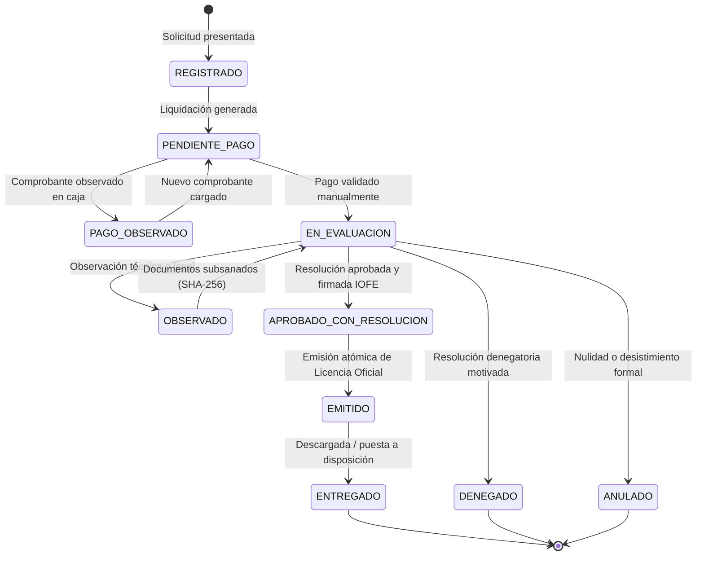

# 🏛️ MuniHuamanga V2 — Sistema de Gestión Digital de Licencias de Funcionamiento
### Municipalidad Provincial de Huamanga (Ayacucho, Perú)

> **Plataforma de Gobierno Digital para la Tramitación, Evaluación, Acto Resolutivo y Verificación de Licencias de Funcionamiento con Firma Digital Institucional, Códigos QR Dinámicos y Monolito Modular con Clean Architecture.**


-brightgreen?style=flat-square)


---

## 1. Problema que Resuelve y Objetivo

En la provincia de Huamanga, la tramitación tradicional de licencias de funcionamiento enfrentaba demoras administrativas de hasta 45 días hábiles, duplicidad en la captura de datos, expedientes físicos extraviados, opacidad tributaria y vulnerabilidad ante licencias comerciales falsificadas o adulteradas.

**MuniHuamanga V2** resuelve esta problemática digitalizando el ciclo de vida del trámite de punta a punta:
- **Cero Papel y Celeridad:** Reducción del plazo legal de atención de 45 días a 1 día hábil para riesgo Bajo/Medio y máximo 15 días hábiles para riesgo Alto/Muy Alto.
- **Validez Jurídica Indubitable:** Emisión de resoluciones administrativas formales (`RES-YYYY-XXXXX`) y licencias oficiales (`LIC-YYYY-XXXXX`) mediante secuencias atómicas pesimistas y firma digital institucional acreditada ante la IOFE (Ley N° 27269).
- **Protección de Datos Personales (Ley N° 29733):** Código QR dinámico con minimización estricta de datos para la ciudadanía general y vista protegida con mapa interactivo (Leaflet) para inspectores municipales en campo.
- **Eficiencia Operativa:** Unificación en un **Monolito Modular** de alta cohesión que elimina la latencia de red de los microservicios, consume menos de 500 MB de RAM y renderiza formatos oficiales (Anexos 1, 3, 4 y licencias) en memoria volátil en menos de 500 ms.

---

## 2. Tecnologías y Versiones Reales

| Componente | Tecnología | Versión | Rol en la Arquitectura |
|---|---|:---:|---|
| **Lenguaje de Programación** | Java SE (LTS) | `21` | Plataforma base con soporte a largo plazo y Virtual Threads |
| **Framework Backend** | Spring Boot | `3.3.4` | Inversión de control, inyección de dependencias y configuración |
| **Seguridad y Tokens** | Spring Security & JJWT | `6.x` / `0.12.6` | Autenticación stateless y autorización RBAC con protección IDOR/BOLA |
| **Motor de Base de Datos** | PostgreSQL | `16.x` | Base de datos relacional ACID con transacciones locales |
| **Persistencia ORM** | Spring Data JPA / Hibernate | `6.x` | Mapeo objeto-relacional y bloqueos pesimistas `PESSIMISTIC_WRITE` |
| **Renderizado Documental** | OpenPDF | `2.0.3` | Generación in-memory de Anexos 1, 3, 4 y licencias oficiales en PDF |
| **Generación QR y Barras** | ZXing (Zebra Crossing) | `3.5.3` | Códigos QR dinámicos y código de barras Code 128 para vouchers |
| **Georreferenciación Móvil** | Leaflet & OpenStreetMap | `1.9.4` | Renderizado interactivo de mapas para inspectores en campo |
| **Gestor de Construcción** | Apache Maven | `3.9.x` | Compilación multi-módulo (`common-domain` y `servicio-expedientes`) |
| **Contenedores** | Docker Engine & Compose | $\ge 24.0$ | Empaquetamiento multi-stage sobre `eclipse-temurin:21-jre-alpine` |

---

## 3. Arquitectura del Sistema

### 3.1. Estilo Arquitectónico: Monolito Modular
El sistema está construido bajo el estilo **Monolito Modular (Modular Monolith)**. Todos los módulos operativos se ejecutan en un único proceso JVM (`servicio-expedientes.jar`), eliminando la sobrecarga operacional, los saltos de red HTTP interservicios y la consistencia eventual, garantizando transacciones locales ACID y llamadas en memoria de microsegundos.
👉 Consulta el documento canónico: **[Estilo arquitectónico](docs/arquitectura/estilo-arquitectonico.md)**.

### 3.2. Enfoque Arquitectónico: Clean Architecture y Puertos Hexagonales
La lógica de negocio se aísla de frameworks y bases de datos mediante **Clean Architecture** estructurada en capas concéntricas (Dominio ➔ Aplicación ➔ Adaptadores ➔ Infraestructura), complementada con el patrón **Ports & Adapters (Hexagonal)**:
- `FirmaDigitalPort`: Puerto desacoplado para servicios criptográficos IOFE con política *fail-closed*.
- `SatPort`: Puerto de verificación de recaudación tributaria.
- `DefensaCivilPort`: Puerto para registro de inspecciones técnicas de seguridad.
- `EdificacionesPort`: Puerto de consulta de compatibilidad urbanística PDU.

👉 Consulta el documento canónico: **[Enfoque arquitectónico](docs/arquitectura/enfoque-arquitectonico.md)**.

### 3.3. Modelo C4 Resumido
El sistema se documenta formalmente mediante el modelo C4 hasta el nivel de componentes y código crítico:
- **Nivel 1 (Contexto):** Ciudadanos, Administradores, Evaluadores, Cajeros SAT, Inspectores, IOFE/RENIEC y Servidor SMTP.
- **Nivel 2 (Contenedores):** Frontend Web SPA, Monolito Modular Spring Boot y Base de Datos PostgreSQL 16.
- **Nivel 3 (Componentes):** Controladores REST, Servicios de Aplicación, Entidades de Dominio, Repositorios JPA y Adaptadores Portuarios.
- **Nivel 4 (Código):** Diagrama de secuencia del flujo crítico *fail-closed* de resolución y firma digital.

👉 Consulta el modelo completo: **[Modelo C4](docs/arquitectura/c4-model.md)**.

```mermaid
graph TD
    subgraph Actores
        CIU["👤 Administrado / Ciudadano"]
        OPE["👤 Evaluador / Cajero / Inspector / Admin"]
        PUB["🌐 Público General (Escaneo QR)"]
    end

    subgraph MuniHuamanga V2
        UI["💻 Frontend Web<br>(HTML5 / CSS3 / JS / Leaflet)"]
        APP["🏛️ Monolito Modular Backend<br>(Spring Boot 3.3.4 / Java 21 LTS)"]
        DB[("🗄️ Base de Datos Relacional<br>(PostgreSQL 16 ACID)")]
    end

    subgraph Servicios Externos
        IOFE["🔑 Infraestructura Oficial de Firma (IOFE)<br>FirmaDigitalPort (Fail-Closed)"]
        SMTP["✉️ Servidor SMTP Municipal<br>Notificaciones Asíncronas"]
    end

    CIU -->|HTTPS| UI
    OPE -->|HTTPS (JWT)| UI
    PUB -->|HTTPS (Token QR)| UI
    UI -->|REST / JSON| APP
    APP -->|JPA / JDBC| DB
    APP -.->|Firma PKI| IOFE
    APP -.->|JavaMail| SMTP
```

---

## 4. Módulos del Sistema (M01 a M12)

MuniHuamanga V2 organiza sus capacidades en doce (12) Bounded Contexts lógicos:

| Módulo | Nombre | Responsabilidad Principal | Estado |
|:---:|---|---|:---:|
| **M01** | **Cuentas y Operadores** | Registro de titulares, operadores institucionales y locales multi-establecimiento. | ✅ Completo |
| **M02** | **Solicitudes Borrador** | Autoguardado de trámites progresivos y validación previa de checklist. | ✅ Completo* |
| **M03** | **Expedientes y Documentos** | Máquina de 10 estados, generación in-memory de Anexos 1, 3, 4 y hash SHA-256. | ✅ Completo |
| **M04** | **Pagos SAT** | Liquidación TUPA, emisión de vouchers y validación manual de comprobantes en caja. | ✅ Completo |
| **M05** | **Tarifario TUPA** | Mantenimiento dinámico en caliente de tasas (`PUT /api/tupa/tarifas/{id}`). | ✅ Completo |
| **M06** | **Zonificación PDU** | Compatibilidad de uso del suelo y rectificación cartográfica de locales. | ✅ Completo |
| **M07** | **Evaluación e Informes** | Evaluación técnica, emisión de informes previos y alertas por correo. | ✅ Completo |
| **M08** | **Resoluciones Administrativas** | Acto formal con secuencia atómica anual (`RES-YYYY-XXXXX`) y firma digital fail-closed. | ✅ Completo |
| **M09** | **Licencias Oficiales** | Emisión atómica de licencia (`LIC-YYYY-XXXXX`), doble marco y código QR. | ✅ Completo |
| **M10** | **Verificación QR y Móvil** | Vista pública minimizada (Ley 29733) y vista inspector con mapa Leaflet. | ✅ Completo |
| **M11** | **Reclamaciones** | Registro y resolución motivada de recursos y controversias ciudadanas. | 🟡 Backend Listo |
| **M12** | **Auditoría y Seguridad** | Auditoría inmutable *append-only*, tokens JWT y mitigación IDOR/BOLA. | 🟡 Backend Listo |

*\* Nota: En M02, el backend está completado y probado; el frontend ciudadano está en proceso de reconexión directa.*
👉 Consulta la especificación detallada: **[Guía de Módulos (M01–M12)](docs/v2/GUIA_MODIFICACIONES_MODULARES.md)**.

---

## 5. Máquina de Estados del Expediente

El ciclo de vida administrativo se gobierna estrictamente mediante una máquina de diez (10) estados finitos (`EstadoExpediente.java`):



---

## 6. Estructura del Repositorio

```text
MuniHuamanga/
├── pom.xml                                  # POM Padre Multi-Módulo Maven (Java 21 / SB 3.3.4)
├── Dockerfile                               # Empaquetado Multi-Stage (Maven 3.9 + Temurin 21 JRE no-root)
├── docker-compose.yml                       # Orquestación local: PostgreSQL 16 y Spring Boot
├── .env.example                             # Plantilla de variables de entorno seguras
│
├── common-domain/                           # Módulo Bounded Context: Contratos y DTOs compartidos
│   └── src/main/java/.../common/
│       ├── dto/                             # 41 DTOs de contrato inmutables
│       ├── enums/                           # 19 Enums de negocio (EstadoExpediente, NivelRiesgo, etc.)
│       └── exception/                       # Excepciones de dominio
│
├── servicio-expedientes/                    # Módulo de Aplicación y Persistencia (Monolito)
│   ├── src/main/java/.../expedientes/
│   │   ├── borradores/                      # M02: Gestión de Solicitudes Borrador
│   │   ├── cuentas/                         # M01: Cuentas y Operadores
│   │   ├── documentos/                      # M03: Documentos Adjuntos y Versionado
│   │   ├── establecimientos/                # M01: Locales Comerciales Desacoplados
│   │   ├── evaluacion/                      # M07: Evaluación e Informes Administrativos
│   │   ├── integracion/                     # M08: Puertos y Adaptadores (FirmaDigitalPort)
│   │   ├── licencias/                       # M09: Emisión y Consulta de Licencias
│   │   ├── pagos/                           # M04: Pagos SAT y Validación Manual
│   │   ├── reclamaciones/                   # M11: Reclamaciones Administrativas
│   │   ├── rectificacion/                   # M06: Rectificación de Ubicación Georreferenciada
│   │   ├── resoluciones/                    # M08: Resoluciones con Secuencia Atómica
│   │   ├── security/                        # M12: Seguridad JWT, RBAC y Anti-IDOR
│   │   ├── service/                         # Servicios de Aplicación y Generación OpenPDF/ZXing
│   │   └── zonificacion/                    # M06: Evaluación de Zonificación PDU
│   ├── src/main/resources/
│   │   ├── static/                          # Frontend Web: HTML5, CSS y JavaScript Vanilla
│   │   │   ├── css/                         # Tokens de estilo y diseño institucional
│   │   │   ├── js/                          # Lógica cliente y mapas Leaflet
│   │   │   ├── portal-ciudadano.html        # Mesa de partes y seguimiento ciudadano
│   │   │   ├── formato-anexo1.html          # Formulario ministerial asistido Anexo 1
│   │   │   ├── portal-interno.html          # Backoffice unificado de operadores municipales
│   │   │   └── verificar-licencia.html      # Verificación pública QR y móvil de inspector
│   │   └── application.yml                  # Configuración de perfiles (dev, prod)
│   └── src/test/java/                       # 301 Pruebas automatizadas (Unitarias, MockMvc, Seguridad)
│
├── docker/postgres/init/                    # Scripts SQL de inicialización en limpio (01 a 08)
└── docs/                                    # Repositorio integral de documentación técnica
    ├── arquitectura/                        # Estilo, Enfoque, C4 y Diseño Detallado
    ├── analisis-de-sistema/                 # Actores, Historias, RF, RNF, Restricciones, ADRs
    ├── auditoria/                           # Informes de QA y Consolidación Documental
    ├── despliegue/                          # Guía de Despliegue, Checklist y Rollback
    ├── scrum/                               # Product Backlog y Sprints
    └── v2/                                  # Instrumentos rectores, Cierres I02..I09 y Estado Actual
```

---

## 7. Requisitos de Instalación y Ejecución Local

### 7.1. Prerrequisitos
- **Java SE Development Kit (JDK):** Versión 21 LTS (Eclipse Temurin o Amazon Corretto).
- **Apache Maven:** Versión $\ge 3.9.0$.
- **PostgreSQL:** Versión 16 (local o mediante Docker).
- **Docker Engine y Compose (opcional para ejecución contenedorizada):** $\ge 24.0$.

### 7.2. Compilación y Ejecución de Pruebas
Para compilar los módulos y ejecutar la batería completa de **301 pruebas automatizadas**:

```bash
mvn clean verify
```

Salida esperada:
```text
[INFO] -------------------------------------------------------
[INFO]  T E S T S   S U M M A R Y
[INFO] -------------------------------------------------------
[INFO] Tests run: 301, Failures: 0, Errors: 0, Skipped: 0
[INFO] -------------------------------------------------------
[INFO] BUILD SUCCESS
```

### 7.3. Ejecución Local del Backend
```bash
# Iniciar base de datos con Docker
docker compose up -d postgres

# Ejecutar el backend con perfil de desarrollo
mvn spring-boot:run -pl servicio-expedientes -Dspring-boot.run.profiles=dev
```

El sistema estará disponible en `http://localhost:8081`.

---

## 8. Seguridad Institucional y Política Fail-Closed

1. **Autorización Backend Centralizada (ADR-02):** Prohibido confiar en controles de JavaScript. Cada método protegido evalúa la relación de propiedad entre el usuario autenticado y el recurso (`@PreAuthorize("@expedienteSecurity.isOwner(authentication, #id)")`).
2. **Política Fail-Closed de Firma Digital (ADR-04, ADR-07):** Prohibidas las firmas simuladas. Si la infraestructura IOFE no responde, el expediente pasa a `ERROR_FIRMA` y el sistema **bloquea la expedición de licencias oficiales y la activación del código QR público**.
3. **Minimización de Datos en QR Público (ADR-05):** Cumplimiento estricto de la Ley N° 29733. La consulta anónima no expone DNI, RUC ni coordenadas del local comercial.

---

## 9. Restricciones Institucionales (ADR-06)

- **SAT Huamanga:** El sistema no realiza cobros en línea con pasarelas web no auditadas. Los pagos se abonan en ventanillas del SAT y un cajero municipal valida manualmente el abono.
- **Defensa Civil (ITSE):** El administrado suscribe de puño y letra los Anexos 3 y 4 y los presenta físicamente ante la Subgerencia de Gestión del Riesgo de Desastres.
- **Exclusión de Fiscalización Sancionadora:** La herramienta móvil de inspectores se limita a la verificación de autenticidad y ubicación física; no contiene módulos de multas, actas de control ni clausuras.

---

## 10. Índice Completo de Documentación Técnica

Todos los documentos se encuentran enlazados mediante rutas relativas compatibles con GitHub:

### Arquitectura de Software
- [Estilo arquitectónico (Monolito Modular)](docs/arquitectura/estilo-arquitectonico.md)
- [Enfoque arquitectónico (Clean Architecture & Ports)](docs/arquitectura/enfoque-arquitectonico.md)
- [Modelo C4 (Niveles 1 al 4)](docs/arquitectura/c4-model.md)
- [Diseño Detallado de Componentes e Integración V2](docs/arquitectura/diseno-arquitectonico-monolito-modular-clean-architecture.md)

### Análisis del Sistema
- [01. Actores y Roles RBAC](docs/analisis-de-sistema/01-actores.md)
- [02. Historias de Usuario (US-01 a US-23)](docs/analisis-de-sistema/02-historias-del-usuario.md)
- [03. Requisitos Funcionales (RF-01 a RF-15)](docs/analisis-de-sistema/03-requisitos-funcionales.md)
- [04. Atributos de Calidad (ISO/IEC 25010)](docs/analisis-de-sistema/04-atributos-de-calidad.md)
- [05. Restricciones Técnicas y Legales](docs/analisis-de-sistema/05-restricciones.md)
- [06. Drivers Arquitectónicos](docs/analisis-de-sistema/06-driver-arquitectonicos.md)
- [07. Mantenibilidad del Sistema](docs/analisis-de-sistema/07-mantenibilidad.md)
- [08. Índice de Decisiones Arquitectónicas (ADR)](docs/analisis-de-sistema/08-decisiones-arquitectonicas.md)

### Gestión de Incrementos V2
- [Índice Especializado de Incrementos V2](docs/v2/README.md)
- [Estado Actual del Sistema (Corte I10 Fase A)](docs/v2/ESTADO_ACTUAL_SISTEMA.md)
- [Guía de Módulos (M01 – M12)](docs/v2/GUIA_MODIFICACIONES_MODULARES.md)
- [Guía de Interfaces Frontend](docs/v2/GUIA_INTERFACES_FRONTEND.md)
- [Registro Maestro de Decisiones de Arquitectura (ADR-01 a ADR-07)](docs/v2/DECISIONES_ARQUITECTURA.md)
- [Reporte de Pruebas y Validación (301 Tests)](docs/v2/PRUEBAS_Y_VALIDACION.md)

### Gestión Ágil (Scrum)
- [Product Backlog V2](docs/scrum/product-backlog.md)

### Auditoría y Calidad
- [Informe de Consolidación Documental V2](docs/auditoria/CONSOLIDACION_DOCUMENTAL_V2.md)
- [Auditoría Integral de Código](docs/auditoria/AUDITORIA_INTEGRAL.md)
- [Reporte de Calidad y Pruebas QA](docs/auditoria/REPORTE_QA.md)

### Despliegue y Operaciones
- [Manual de Despliegue y Operaciones](docs/despliegue/GUIA_DESPLIEGUE.md)
- [Lista de Verificación Pre-Pase a Producción (Checklist)](docs/despliegue/CHECKLIST_PRODUCCION.md)
- [Plan de Contingencia y Rollback](docs/despliegue/PLAN_ROLLBACK.md)

---

## 11. Estado del Roadmap y Pendientes

1. **Incrementos I01 a I09:** Implementados y verificados formalmente con actas de cierre y pruebas continuas.
2. **Incremento I10 (Fase A):** Diagnóstico de integración visual y consolidación arquitectónica completada con éxito.
3. **Incremento I10 (Fase B):** Demostración funcional en servidor local en vivo y validación E2E en navegador (*Pendiente de autorización en siguiente etapa*).
4. **Pendientes Técnicos para Producción:**
   - Suscripción e integración con proveedor real de firma digital acreditado ante IOFE (sustituir mock adapter de pruebas).
   - Reemplazo de credenciales y semillas por defecto en PostgreSQL 16 por secretos de alta entropía.
   - Reconexión del script `portal-ciudadano.js` para consumir la API de borradores autoguardados V2.
