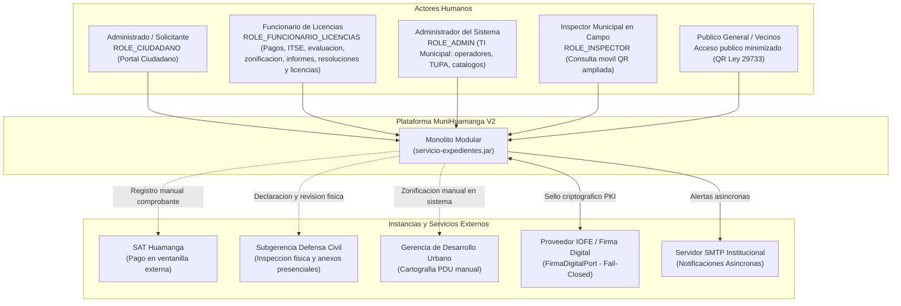

# 01. Actores del Sistema
## Sistema de Gestión Documentaria de Licencia de Funcionamiento
### Municipalidad Provincial de Huamanga (Ayacucho, Perú) — Versión 2.0

> **Marco Normativo:** Ley N° 28976 / TUO D.S. N° 046-2017-PCM / D.S. N° 002-2018-PCM / Ley N° 27444 / Ley N° 27269 / Ley N° 29733
> **Plataforma:** Java 21 LTS, Spring Boot 3.3.4, PostgreSQL 16, Spring Security 6 (RBAC Stateless)
> **Ubicación:** `docs/analisis-de-sistema/01-actores.md`
> **Estado:** Documento Canónico Vigente V2

---

## 1. Introducción

En el marco del procedimiento administrativo para el otorgamiento de **Licencias de Funcionamiento** e **Inspecciones Técnicas de Seguridad en Edificaciones (ITSE)** en la Municipalidad Provincial de Huamanga, intervienen actores humanos (ciudadanos y funcionarios) así como sistemas institucionales y servicios de infraestructura técnica.

El modelo de actores se consolidó deliberadamente en **4 roles reales** para reducir la complejidad operativa frente a una oficina de licenciamiento de tamaño municipal: un rol anterior de 9 roles (Mesa de Partes, Evaluador, Supervisor de Licencias, Autoridad Resolutiva, Cajero, Inspector, Auditor, Administrado y Administrador) resultaba más fino de lo que el personal real de la Subgerencia de Licencias puede sostener en la práctica. El control de acceso sigue siendo estrictamente **RBAC (Role-Based Access Control)** con autorización centralizada en backend (`@PreAuthorize`) y protección contra manipulación de identificadores (IDOR/BOLA, ADR-02).

---

## 2. Diagrama General de Actores

---

## 3. Catálogo Detallado de Actores Humanos

### 3.1. Administrado / Solicitante (Ciudadano / Representante Legal)
* **Descripción:** Persona natural con DNI o representante legal de persona jurídica con RUC que tramita una licencia comercial en la provincia de Huamanga.
* **Canal de Acceso:** Portal Web Ciudadano (`portal-ciudadano.html`), que desde esta versión es también la página de entrada por defecto del sistema (`index.html` lo prioriza como acción principal).
* **Rol RBAC:** `ROLE_CIUDADANO` (autenticado) y acceso anónimo para registro inicial y seguimiento público por código de expediente.
* **Responsabilidades:**
  1. Gestionar su cuenta ciudadana, personas jurídicas y establecimientos comerciales.
  2. Completar formularios normativos Anexo 1 (45 atributos normativos) y los anexos ITSE (1, 2 y 4) directamente desde el asistente del portal.
  3. Registrar comprobantes de pago de la tasa TUPA abonados en ventanillas del SAT Huamanga, una vez validado el ITSE.
  4. Descargar formatos en PDF y subsanar observaciones notificadas dentro del plazo legal.
  5. Consultar y descargar el Certificado Oficial de Licencia una vez firmada la resolución.

### 3.2. Funcionario de Licencias (Subgerencia de Comercio y Licencias)
* **Descripción:** Personal de la Subgerencia de Licencias que concentra, en un único actor, la admisibilidad, la validación de pagos SAT, la revisión del ITSE y de los documentos, la evaluación técnica y de zonificación, la elaboración y aprobación de informes administrativos, y la emisión de resoluciones y licencias con firma digital. Reemplaza a los antiguos roles separados de Mesa de Partes, Cajero, Evaluador, Supervisor de Licencias, Autoridad Resolutiva y Auditor.
* **Canal de Acceso:** Portal Interno de Gestión (`portal-interno.html`), accesible mediante un enlace institucional discreto (no se promociona como acceso público en la página de entrada); la protección real sigue siendo el token JWT y `@PreAuthorize` en el backend, no la falta de un enlace visible.
* **Rol RBAC:** `ROLE_FUNCIONARIO_LICENCIAS`.
* **Responsabilidades:**
  1. Admitir la solicitud presentada y recibir actuaciones presenciales en ventanilla.
  2. Cotejar y validar manualmente los comprobantes de pago de la tasa TUPA (proceso manual institucional con el SAT Huamanga, ADR-06).
  3. Revisar los 4 anexos ITSE cargados, observarlos o validarlos fijando el nivel de riesgo oficial.
  4. Evaluar la compatibilidad de zonificación según el Plano de Desarrollo Urbano (PDU) de Huamanga.
  5. Emitir observaciones formales otorgando el plazo improrrogable de subsanación.
  6. Redactar y aprobar el **Informe Administrativo Técnico**, y resolver solicitudes de rectificación de ubicación.
  7. Aprobar y firmar digitalmente la **Resolución Administrativa** (`RES-YYYY-XXXXX`) mediante `FirmaDigitalPort`, y habilitar la emisión atómica de la **Licencia de Funcionamiento** (`LIC-YYYY-XXXXX`) tras verificar la firma válida.
* **Nota de diseño — segregación de funciones:** el RBAC ya no impide que la misma cuenta redacte, valide y firme una misma actuación, a diferencia del modelo anterior de 6 roles separados. La trazabilidad no se pierde: cada transición queda registrada con el nombre real del funcionario en el historial de auditoría inmutable, de modo que la municipalidad puede exigir administrativamente que distintas personas ejecuten cada etapa, sin que eso dependa de un control de software.

### 3.3. Administrador del Sistema (TI Municipal)
* **Descripción:** Personal de la Subgerencia de Tecnologías de la Información. No tiene facultades sobre la tramitación de expedientes.
* **Canal de Acceso:** Portal Interno, configuración del sistema y endpoints de gestión.
* **Rol RBAC:** `ROLE_ADMIN`.
* **Responsabilidades:**
  1. Crear y administrar cuentas de operadores institucionales (`/api/cuentas/operadores`).
  2. Mantenimiento del tarifario TUPA dinámico en base de datos.
  3. Monitoreo de auditoría inmutable, logs y salud de la plataforma (Spring Actuator).
  4. Configuración de parámetros de conexión institucional y firma digital.

### 3.4. Inspector Municipal en Campo
* **Descripción:** Personal que realiza inspecciones operativas y verificaciones in situ en locales comerciales. No opera el portal interno de gestión: su única interacción con el sistema es validar la autenticidad de una licencia en campo.
* **Canal de Acceso:** Módulo de Verificación Móvil (`verificar-licencia.html`) con credenciales institucionales.
* **Rol RBAC:** `ROLE_INSPECTOR`.
* **Responsabilidades:**
  1. Escanear el código QR impreso en el certificado de licencia mediante dispositivo móvil.
  2. Iniciar sesión para desbloquear la **Vista de Inspector**, que incluye coordenadas geográficas exactas, mapa interactivo (Leaflet) y fecha de autorización.
  3. Verificar en campo si el giro real y la ubicación física coinciden con lo autorizado.
  4. *Nota técnica (ADR-06):* El sistema actúa como herramienta de consulta de autenticidad y ubicación; no incluye módulos de fiscalización sancionadora ni levantamiento de actas de clausura.

### 3.5. Público General / Vecinos / Consumidores
* **Descripción:** Cualquier persona que escanea el código QR de un certificado comercial o ingresa al portal de verificación pública.
* **Canal de Acceso:** `verificar-licencia.html?token=...` (acceso anónimo).
* **Rol RBAC:** Público (sin autenticación requerida).
* **Responsabilidades / Alcance:**
  1. Visualizar la **Vista Ciudadana Minimizada** (Ley N° 29733 de Protección de Datos Personales, ADR-05): Razón social, nombre comercial, giro autorizado, dirección pública, estado de vigencia y validez de firma.
  2. Restricción estricta: No se exponen DNI, RUC ni coordenadas geográficas en esta vista.

---

## 4. Matriz de Control de Acceso Basado en Roles (RBAC V2)

| Módulo / Acción en el Sistema | Público Anónimo | `ROLE_CIUDADANO` | `ROLE_FUNCIONARIO_LICENCIAS` | `ROLE_INSPECTOR` | `ROLE_ADMIN` |
|---|:---:|:---:|:---:|:---:|:---:|
| Registro de Solicitud / Borrador | No | Sí (propio) | No | No | No |
| Consulta Pública de Expediente (Código) | Sí | Sí | Sí | Sí | Sí |
| Gestión de Cuentas y Establecimientos | No | Sí (propios) | Sí (consulta) | No | Sí (todos) |
| Validación Manual de Pagos SAT | No | No | Sí | No | No |
| Evaluación Técnica y Zonificación PDU | No | No | Sí | No | No |
| Emisión de Informes Técnicos | No | No | Sí | No | No |
| Emisión y Firma Digital de Resolución | No | No | Sí | No | No |
| Emisión Oficial de Licencia con QR | No | No | Sí (post-firma) | No | No |
| Verificación QR: Vista Pública (Minimizada) | Sí | Sí | Sí | Sí | Sí |
| Verificación QR: Vista Inspector (Mapa/Geo) | No | No | No | Sí | No |
| Administración de Operadores y TUPA | No | No | No | No | Sí |
| Auditoría Inmutable del Sistema | No | No | No | No | Sí |

---

## 5. Referencias Normativas y Arquitectónicas

1. **Ley N° 28976:** Ley Marco de Licencia de Funcionamiento y sus modificatorias.
2. **Ley N° 27269:** Ley de Firmas y Certificados Digitales.
3. **Ley N° 29733:** Ley de Protección de Datos Personales (minimización en QR público).
4. **ADR-02:** Autorización centralizada en Backend y protección IDOR/BOLA.
5. **ADR-05:** Verificación pública QR con enlace dinámico y minimización de datos.
6. **ADR-06:** Procesos externos manuales para SAT, Defensa Civil y Edificaciones (sin acoplamiento).
7. **ADR-07:** Acto administrativo resolutivo, correlativo atómico y bloqueo de emisión sin firma digital.
