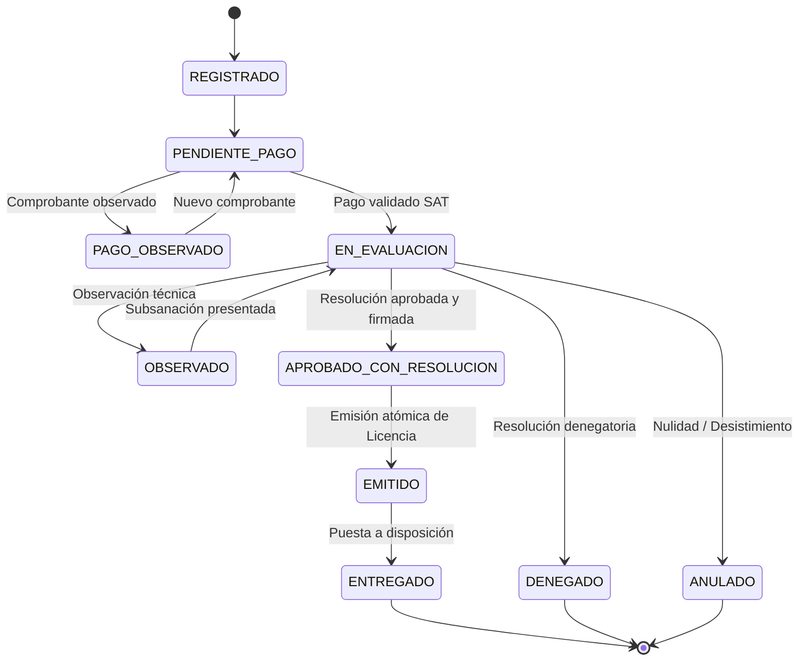

# 03. Requisitos Funcionales (RF)
## Sistema de Gestión Documentaria de Licencia de Funcionamiento
### Municipalidad Provincial de Huamanga (Ayacucho, Perú) — Versión 2.0

> **Marco Normativo:** Ley N° 28976 / TUO D.S. N° 046-2017-PCM / D.S. N° 002-2018-PCM / Ley N° 27444 / Ley N° 27269 / Ley N° 29733
> **Plataforma:** Java 21 LTS, Spring Boot 3.3.4, PostgreSQL 16, Spring Security 6
> **Ubicación:** `docs/analisis-de-sistema/03-requisitos-funcionales.md`
> **Estado:** Documento Canónico Vigente V2

---

## 1. Introducción y Alcance Funcional

Los **Requisitos Funcionales (RF)** definen las capacidades operativas, reglas de negocio, transiciones de estado, servicios documentales y políticas de seguridad que el sistema MuniHuamanga V2 ejecuta obligatoriamente. Están organizados en concordancia con los módulos M01 a M12 del Monolito Modular y los ADR consolidados.

---

## 2. Clasificación de Requisitos por Módulo V2

```mermaid
graph TD
    RF["Requisitos Funcionales V2"]
    RF --> M01["M01: Cuentas y Establecimientos (RF-01, RF-14)"]
    RF --> M02["M02: Borradores y Solicitudes (RF-02, RF-15)"]
    RF --> M03["M03: Expedientes y Documentos (RF-03, RF-07, RF-08, RF-16)"]
    RF --> M04["M04: Pagos SAT y Comprobantes (RF-04, RF-17)"]
    RF --> M05["M05: Tarifario TUPA Dinámico (RF-10, RF-11)"]
    RF --> M06["M06: Zonificación y Rectificación (RF-05, RF-18)"]
    RF --> M07["M07: Evaluación e Informes Técnicos (RF-06, RF-19)"]
    RF --> M08["M08: Resoluciones y Firma Digital (RF-20, RF-21)"]
    RF --> M09["M09: Licencias Oficiales (RF-09, RF-22)"]
    RF --> M10["M10: Verificación QR Diferenciada (RF-23, RF-24)"]
    RF --> M11["M11: Reclamaciones Ciudadanas (RF-25)"]
    RF --> M12["M12: Auditoría y Seguridad (RF-12, RF-13)"]
```

---

## 3. Catálogo Detallado de Requisitos Funcionales

### RF-01: Gestión de Cuentas y Múltiples Establecimientos (M01)
* **Descripción:** Permitir el registro de cuentas ciudadanas (`Cuenta`) desacopladas de las solicitudes y asociar uno o más locales comerciales (`Establecimiento`) bajo titularidad de la misma persona natural o jurídica.
* **Seguridad:** Autorización centralizada (`@PreAuthorize`); un ciudadano solo accede a sus establecimientos (ADR-02).

### RF-02: Gestión de Solicitudes Borrador (M02)
* **Descripción:** Permitir al administrado crear borradores de solicitud, actualizar formularios seccionales, autoguardar avances y formalizar la presentación (`POST /api/borradores/{id}/presentar`) únicamente cuando el checklist de requisitos esté satisfecho.
* **Salida:** Creación del expediente formal con código único anual `EXP-YYYY-XXXXX`.

### RF-03: Ciclo de Vida y Máquina de Estados Finita del Expediente (M03)
* **Descripción:** El sistema debe gobernar las mutaciones de estado del expediente mediante una máquina de estados finita estricta con soporte para los 10 estados formales de V2 (`EstadoExpediente.java`) y compatibilidad con transiciones legadas (`EstadoExpedienteValidator.java`).
* **Estados Formales V2:**
  1. `REGISTRADO`: Expediente admitido en mesa de partes virtual.
  2. `PENDIENTE_PAGO`: Liquidación TUPA calculada a la espera del comprobante de abono SAT.
  3. `PAGO_OBSERVADO`: Comprobante observado por caja SAT, pendiente de subsanación de pago.
  4. `EN_EVALUACION`: Pago validado; en revisión administrativa y zonificación.
  5. `OBSERVADO`: Observaciones técnicas o documentales emitidas, con plazo de 5 días hábiles.
  6. `APROBADO_CON_RESOLUCION`: Resolución administrativa aprobada y firmada digitalmente.
  7. `EMITIDO`: Licencia de funcionamiento oficial generada atómicamente con correlativo anual.
  8. `ENTREGADO`: Certificado descargado o puesto a disposición formal del titular.
  9. `DENEGADO`: Trámite denegado motivadamente por resolución administrativa denegatoria.
  10. `ANULADO`: Acto administrativo o solicitud cancelada por desistimiento o nulidad de oficio.

### RF-04: Validación Manual de Pagos SAT (M04)
* **Descripción:** Los pagos por derechos TUPA se abonan en ventanillas SAT Huamanga (ADR-06). El administrado registra el número de comprobante y monto; el cajero municipal (`ROLE_CAJERO`) califica el pago con los estados: `EN_REVISION`, `VALIDADO_MANUALMENTE`, `OBSERVADO` o `RECHAZADO`.

### RF-05: Calificación de Nivel de Riesgo ITSE y Zonificación PDU (M06, M07)
* **Descripción:** Determinación objetiva del riesgo ITSE (`BAJO`, `MEDIO`, `ALTO`, `MUY_ALTO`) según función de edificación, área y aforo (D.S. N° 002-2018-PCM). Evaluación técnica manual de compatibilidad de zonificación según Plano de Desarrollo Urbano (PDU) de Huamanga realizada por el evaluador (`ROLE_EVALUADOR`).

### RF-06: Rectificación de Ubicación Georreferenciada (M06)
* **Descripción:** Permitir al titular solicitar la rectificación de coordenadas geográficas o dirección física de un establecimiento, con revisión y resolución fundamentada del evaluador técnico.

### RF-07: Generación en Memoria de Anexos Oficiales en PDF (M03)
* **Descripción:** Renderizado en memoria volátil (`ByteArrayOutputStream`) sin escribir en disco:
  - **Anexo 1:** Declaración Jurada oficial (D.S. N° 163-2020-PCM) en 2 páginas A4 con 45 atributos normativos.
  - **Anexo 3:** Reporte de Nivel de Riesgo ITSE (2 páginas).
  - **Anexo 4:** Declaración Jurada de Condiciones de Seguridad (4 páginas con matriz de 23 ítems técnicos).

### RF-08: Subsanación de Observaciones con Inmutabilidad SHA-256 (M03)
* **Descripción:** Registro de documentos subsanados incrementando versión correlativa (`version = version_previa + 1`), estado `SUBSANADO`, cálculo de hash criptográfico SHA-256 e inmutabilidad histórica probatoria (ADR-03).

### RF-09: Tarifario TUPA Dinámico (M05)
* **Descripción:** Mantenimiento de tarifas en base de datos PostgreSQL con actualización en caliente (`PUT /api/tupa/tarifas/{id}`) protegida para `ROLE_ADMIN`, y mecanismo de fallback resiliente a `application.yml`.

### RF-10: Elaboración de Informes Técnicos Administrativos (M07)
* **Descripción:** El evaluador elabora informes técnicos con dictamen favorable o desfavorable. Por principio de legalidad (ADR-07), el informe técnico es un acto preparatorio de instrucción interna que no otorga por sí mismo la licencia.

### RF-11: Emisión de Resolución Administrativa y Firma Digital Fail-Closed (M08)
* **Descripción:**
  1. La autoridad resolutiva (`ROLE_ADMIN`) emite la resolución administrativa con correlativo anual atómico pesimista (`RES-YYYY-XXXXX`).
  2. La resolución pasa a proceso de firma institucional mediante `FirmaDigitalPort`.
  3. **Regla Fail-Closed (ADR-04, ADR-07):** Si la firma digital falla o no está configurada, el estado pasa a `ERROR_FIRMA` y el sistema bloquea estrictamente la emisión de la licencia oficial y la activación del QR público.

### RF-12: Emisión Oficial de Licencia de Funcionamiento con QR (M09)
* **Descripción:** Generación de la licencia con numeración atómica anual (`LIC-YYYY-XXXXX`), doble marco ornamental (azul `#1A365D` y dorado `#C69214`), escudo institucional, notas legales del Art. 3° Ley 28976 y código QR dinámico de alta resolución.

### RF-13: Verificación QR Diferenciada y Minimización de Datos (M10)
* **Descripción:** Cumplimiento de la Ley N° 29733 de Protección de Datos Personales (ADR-05):
  - **Vista Pública:** Token dinámico no enumerable; expone únicamente razón social, nombre comercial, giro autorizado, dirección pública y vigencia. No expone DNI, RUC ni coordenadas geográficas.
  - **Vista Móvil de Inspector:** Accesible con autenticación (`ROLE_INSPECTOR`); expone geolocalización, coordenadas y renderizado en mapa interactivo Leaflet para comprobaciones in situ.

### RF-14: Gestión de Reclamaciones Ciudadanas (M11)
* **Descripción:** Registro y atención de recursos o reclamaciones sobre expedientes observados o denegados, con asignación y resolución fundamentada.

### RF-15: Auditoría Inmutable y Seguridad RBAC (M12)
* **Descripción:** Registro cronológico no modificable de todas las operaciones administrativas críticas, actores intervinientes, timestamps y hashes documentales. Autenticación JWT stateless con 5 roles formalizados.

---

## 4. Matriz de Cobertura de Requisitos frente a Pruebas Automatizadas

| Requisito Funcional | Módulo | Suite de Pruebas Automatizadas | Estado |
|---|:---:|---|:---:|
| **RF-01 (Cuentas/Establecimientos)** | M01 | `CuentaServiceTest`, `EstablecimientoServiceTest` | ✅ Verificado |
| **RF-02 (Borradores V2)** | M02 | `BorradorServiceTest`, `BorradorControllerTest` | ✅ Verificado |
| **RF-03 (Expedientes 10 Estados)** | M03 | `ExpedienteServiceTest`, `EstadoExpedienteValidatorTest` | ✅ Verificado |
| **RF-04 (Pagos SAT)** | M04 | `PagoServiceTest`, `PagoControllerTest` | ✅ Verificado |
| **RF-05 / RF-06 (Zonificación)** | M06 | `ZonificacionServiceTest`, `RectificacionUbicacionTest` | ✅ Verificado |
| **RF-07 / RF-08 (Documentos)** | M03 | `DocumentoServiceTest`, `SubsanacionTest` | ✅ Verificado |
| **RF-09 (TUPA Dinámico)** | M05 | `TarifaTupaServiceTest`, `CalculadoraDeTasaTest` | ✅ Verificado |
| **RF-10 (Evaluación e Informes)** | M07 | `EvaluacionServiceTest`, `InformeAdministrativoTest` | ✅ Verificado |
| **RF-11 (Resoluciones y Firma)** | M08 | `ResolucionServiceTest`, `FirmaDigitalAdapterTest` | ✅ Verificado |
| **RF-12 (Licencias Oficiales)** | M09 | `LicenciaServiceTest`, `LicenciaPdfGeneratorTest` | ✅ Verificado |
| **RF-13 (QR Diferenciado / Móvil)** | M10 | `VerificacionPublicaTest`, `VerificacionQrI09Test` | ✅ Verificado |
| **RF-14 (Reclamaciones)** | M11 | `ReclamacionServiceTest` | ✅ Verificado |
| **RF-15 (Seguridad y Auditoría)** | M12 | `ExpedienteSecurityAuthorizationTest`, `SecurityConfigProdTest` | ✅ Verificado |
