# 04. Atributos de Calidad (Requisitos No Funcionales)
## Sistema de Gestión Documentaria de Licencia de Funcionamiento
### Municipalidad Provincial de Huamanga (Ayacucho, Perú) — Versión 2.0

> **Estándar de Calidad:** ISO/IEC 25010 (System and Software Quality Models)
> **Metodología de Escenarios:** Software Engineering Institute (SEI / ATAM)
> **Plataforma:** Java 21 LTS, Spring Boot 3.3.4, PostgreSQL 16, Spring Security 6
> **Ubicación:** `docs/analisis-de-sistema/04-atributos-de-calidad.md`
> **Estado:** Documento Canónico Vigente V2

---

## 1. Introducción

Los **Atributos de Calidad** (o Requisitos No Funcionales - RNF) establecen los criterios objetivos con los cuales se juzga la operación, robustez, eficiencia y elegancia del sistema MuniHuamanga V2, estructurados bajo el estándar internacional **ISO/IEC 25010**.

```mermaid
graph TD
    ISO["ISO/IEC 25010: Modelo de Calidad V2"]
    ISO --> PE["1. Eficiencia de Desempeño (Performance)"]
    ISO --> SE["2. Seguridad (Security)"]
    ISO --> MA["3. Mantenibilidad (Maintainability)"]
    ISO --> RE["4. Fiabilidad (Reliability)"]
    ISO --> US["5. Usabilidad (Usability)"]
    ISO --> OP["6. Portabilidad y Operabilidad"]

    PE --> PE1["Latencia P95 ≤ 200 ms en Verificación QR"]
    PE --> PE2["Concurrencia ≥ 150 transacciones simultáneas"]
    PE --> PE3["Renderizado PDF en memoria ≤ 500 ms"]

    SE --> SE1["JWT Stateless HMAC-SHA256 y RBAC"]
    SE --> SE2["Protección IDOR/BOLA en Backend (ADR-02)"]
    SE --> SE3["Firma Digital IOFE Fail-Closed (ADR-04)"]
    SE --> SE4["Minimización QR Ley 29733 (ADR-05)"]

    MA --> MA1["Monolito Modular + Clean Architecture"]
    MA --> MA2["TUPA Dinámico en caliente (sin redeploy)"]
    MA --> MA3["Batería de 301 tests automatizados (0 fallas)"]

    RE --> RE1["Transacciones locales ACID en PostgreSQL 16"]
    RE --> RE2["Secuencias atómicas pesimistas anuales (ADR-07)"]

    US --> US1["Wizard 3 pasos + Autoguardado borradores"]
    US --> US2["Consulta móvil con mapa Leaflet para inspectores"]

    OP --> OP1["Despliegue autónomo JAR / Docker Compose"]
```

---

## 2. Catálogo de Atributos de Calidad según ISO/IEC 25010

### 2.1. Eficiencia de Desempeño (Performance Efficiency)

* **RNF-01 (Latencia en Verificación QR Pública):**
  - *Métrica:* El endpoint público `GET /api/public/licencias/{codigoQr}` procesa la consulta y responde en un percentil $P_{95} \le 200\text{ ms}$.
* **RNF-02 (Capacidad de Concurrencia Simultánea):**
  - *Métrica:* Soporte de un mínimo de **150 transacciones concurrentes** simultáneas sin degradación del servicio ni interbloqueos (*deadlocks*) en PostgreSQL 16, gestionado mediante pool HikariCP.
* **RNF-03 (Velocidad de Renderizado Documental PDF):**
  - *Métrica:* Generación en memoria volátil de formatos Anexo 1, Anexo 3, Anexo 4, resoluciones y licencias oficiales en menos de $500\text{ ms}$ mediante OpenPDF 2.0.3 y ZXing 3.5.3 sin tocar disco.

---

### 2.2. Seguridad (Security)

* **RNF-04 (Autenticación Criptográfica Stateless):**
  - *Métrica:* JWT firmado con HMAC-SHA256, vigencia configurable (24 horas) y validación en filtro `OncePerRequestFilter`.
* **RNF-05 (Autorización Centralizada y Mitigación IDOR/BOLA - ADR-02):**
  - *Métrica:* Cero confianza en controles de frontend. Cada método sensible valida la relación de propiedad entre el `Principal` autenticado y el recurso (`@PreAuthorize("@expedienteSecurity.isOwner(...)")`).
* **RNF-06 (Firma Digital Institucional Fail-Closed - ADR-04, ADR-07):**
  - *Métrica:* Prohibición absoluta de firmas gráficas falsas o simuladas. Si la infraestructura IOFE no responde, el sistema bloquea la emisión de la licencia oficial y la publicación del QR.
* **RNF-07 (Minimización de Datos en Consulta Pública - ADR-05):**
  - *Métrica:* La vista ciudadana del QR cumple la Ley N° 29733 (Ley de Protección de Datos Personales), omitiendo DNI, RUC y coordenadas cartográficas exactas.
* **RNF-08 (Inmutabilidad Documental y Auditoría):**
  - *Métrica:* Cálculo de hash SHA-256 para cada versión de documento adjunto; tabla de auditoría cronológica inmutable (*append-only*).

---

### 2.3. Mantenibilidad (Maintainability)

* **RNF-09 (Modularidad y Puertos Hexagonales):**
  - *Métrica:* Estructuración modular en paquetes M01–M12 respetando la regla de dependencias concéntricas hacia el Dominio y puertos desacoplados (`FirmaDigitalPort`).
* **RNF-10 (Modificabilidad en Caliente de Tasas TUPA):**
  - *Métrica:* Actualización en caliente de tarifas mediante `PUT /api/tupa/tarifas/{id}` en menos de 1 segundo sin reinicio del servicio.
* **RNF-11 (Testeabilidad y Cobertura Automatizada V2):**
  - *Métrica:* Mantenimiento de una suite exhaustiva de **301 pruebas automatizadas exitosas** (unitarias, integración MockMvc, seguridad `@WithMockUser`, concurrencia y generación PDF) ejecutadas mediante `mvn clean verify` con cero fallos y cero regresiones.

---

### 2.4. Fiabilidad (Reliability)

* **RNF-12 (Integridad Transaccional ACID en PostgreSQL 16):**
  - *Métrica:* Delimitación de transacciones con `@Transactional`, aislamiento por defecto y secuencias atómicas pesimistas (`PESSIMISTIC_WRITE`) para correlativos anuales de resoluciones y licencias.
* **RNF-13 (Resiliencia por Fallback):**
  - *Métrica:* Mecanismo de fallback automático en `CalculadoraDeTasa` hacia `application.yml` en caso de indisponibilidad de la tabla de tarifas.
* **RNF-14 (Disponibilidad Operativa):**
  - *Métrica:* Disponibilidad del 99.5% en horario de atención municipal hábil.

---

### 2.5. Usabilidad (Usability)

* **RNF-15 (Asistente Guiado y Borradores V2):**
  - *Métrica:* Formulario interactivo por pasos, validación sintáctica en cliente, autoguardado de borradores y checklist interactivo antes de la presentación formal.
* **RNF-16 (Verificación Móvil con Mapa para Inspectores):**
  - *Métrica:* Integración de mapas interactivos Leaflet con renderizado fluido en navegadores móviles para inspectores en campo.

---

### 2.6. Portabilidad y Operabilidad

* **RNF-17 (Empaquetamiento Autónomo):**
  - *Métrica:* Ejecución en contenedor Docker oficial `eclipse-temurin:21-jre-alpine` o archivo JAR autónomo `servicio-expedientes.jar` en Linux o Windows Server.
