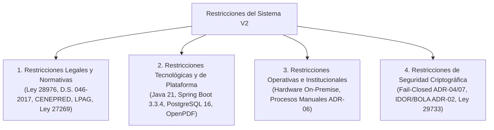

# 05. Restricciones del Sistema
## Sistema de Gestión Documentaria de Licencia de Funcionamiento
### Municipalidad Provincial de Huamanga (Ayacucho, Perú) — Versión 2.0

> **Marco Normativo:** Ley N° 28976 / TUO D.S. N° 046-2017-PCM / D.S. N° 002-2018-PCM / Ley N° 27444 / Ley N° 27269 / Ley N° 29733
> **Plataforma:** Java 21 LTS, Spring Boot 3.3.4, PostgreSQL 16, Spring Security 6
> **Ubicación:** `docs/analisis-de-sistema/05-restricciones.md`
> **Estado:** Documento Canónico Vigente V2

---

## 1. Introducción

Las **Restricciones** representan las fronteras no negociables impuestas al diseño, desarrollo, implementación y operación de MuniHuamanga V2. Vienen dictadas por el marco normativo peruano, los acuerdos interinstitucionales de la Municipalidad Provincial de Huamanga y los recursos tecnológicos disponibles.

---

## 2. Restricciones Legales y Normativas

### 2.1. Cumplimiento Estricto del TUO de la Ley Marco de Licencias (Ley N° 28976 / D.S. N° 046-2017-PCM)
- **Vigencia Indeterminada Obligatoria:** De conformidad con el Artículo 3° de la Ley N° 28976, toda licencia de funcionamiento definitiva tiene **vigencia indeterminada**. Queda prohibido introducir vencimientos forzados; en el certificado impreso, el campo "VENCE" figura taxativamente como `**/**/****`.
- **Plazos Máximos de Resolución:**
  - Riesgo **Bajo** o **Medio**: Emisión inmediata o en máximo 1 día hábil (con ITSE posterior).
  - Riesgo **Alto** o **Muy Alto**: Plazo legal improrrogable de **hasta 15 días hábiles** (Art. 8° Ley 28976).
- **Inalterabilidad de Formatos Oficiales:** Anexos 1, 3 y 4 en PDF replican estrictamente las matrices aprobadas por D.S. N° 163-2020-PCM y D.S. N° 002-2018-PCM.

### 2.2. Restricción del Procedimiento de Inspección Física (Defensa Civil - CENEPRED)
- **Suscripción Manuscrita y Presentación Física:** Conforme al D.S. N° 002-2018-PCM, el administrado imprime los Anexos 3 y 4, los suscribe físicamente y los presenta en la Subgerencia de Gestión del Riesgo de Desastres para la inspección técnica ocular en campo. El sistema no simula dictámenes técnicos automáticos de Defensa Civil (ADR-06).

### 2.3. Ley de Firmas y Certificados Digitales (Ley N° 27269) y Política Fail-Closed (ADR-04, ADR-07)
- **Prohibición de Firmas Simuladas:** Queda terminantemente prohibido estampar sellos gráficos o marcas simuladas que pretendan suplantar la firma digital acreditada ante la IOFE.
- **Bloqueo Fail-Closed:** Si el servicio institucional de firma no está disponible o falla, el sistema bloquea de forma estricta la expedición de licencias oficiales y la activación del código QR público.

### 2.4. Delimitación de Procesos Institucionales (ADR-06)
- **SAT Huamanga:** El sistema no realiza conciliación bancaria directa ni cobro con pasarelas web no integradas; la confirmación del pago se efectúa mediante validación manual por parte del cajero municipal.
- **Inspección y Fiscalización:** El sistema opera como herramienta de consulta móvil de autenticidad y ubicación en campo. **Queda terminantemente prohibido incorporar módulos de fiscalización sancionadora, actas de control o imposición de multas o clausuras** (ADR-06).

---

## 3. Restricciones Tecnológicas y de Plataforma

### 3.1. Ecosistema de Desarrollo
- **Runtime:** Exclusivamente **Java 21 LTS**.
- **Framework:** **Spring Boot 3.3.4** sobre Spring Framework 6.x y Jakarta EE 10.
- **Gestor de Construcción:** **Apache Maven** multi-módulo (`muni-licencias-parent`), integrando `common-domain` y `servicio-expedientes`.

### 3.2. Generación Documental In-Memory
- **OpenPDF 2.0.3** y **ZXing 3.5.3** procesados en memoria volátil de la JVM (`ByteArrayOutputStream`), sin almacenamiento de archivos temporales en el sistema de archivos del servidor.

### 3.3. Persistencia y Transaccionalidad
- **Motor Primario:** **PostgreSQL 16** para desarrollo y producción; motor **H2 in-memory** reservado exclusivamente para la ejecución veloz de pruebas automatizadas continuas (`mvn test`).
- **Garantía Transaccional:** Transacciones ACID obligatorias con `@Transactional` y bloqueo pesimista `PESSIMISTIC_WRITE` para secuencias correlativas anuales.

### 3.4. Topología Arquitectónica
- **Prohibición de Microservicios:** La solución se consolida bajo el estilo **Monolito Modular** en un único artefacto ejecutable (`servicio-expedientes.jar`), eliminando sobrecostos de red, brokers de mensajería o mallas de servicios complejas.

---

## 4. Restricciones de Infraestructura y Operación Municipal

- **Hardware On-Premise:** Operable en servidores municipales de 4 a 8 GB de RAM (límite de Heap JVM: 1024 MB).
- **Despliegue Simple:** Despliegue atómico mediante `docker compose up -d` o comando autónomo `java -jar`.
- **Scripts de Base de Datos:** Los scripts en `docker/postgres/init/` (`01-init-databases.sql` a `08-v2-...sql`) son scripts de **inicialización de entornos limpios**, y no deben emplearse como mecanismo automático de migración sobre bases de datos en producción con datos preexistentes.

---

## 5. Restricciones de Seguridad y Privacidad

- **Protección de Datos Personales (Ley N° 29733 - ADR-05):** El QR público minimiza datos: no expone DNI, RUC ni coordenadas geográficas.
- **Autorización Backend Centralizada (ADR-02):** Prohibido confiar en controles visuales de JavaScript; validación de propiedad de recursos en backend con Spring Security (`@PreAuthorize`).
- **Criptografía:** Contraseñas protegidas con **BCrypt** (costo 10); tokens JWT con **HMAC-SHA256** (JJWT 0.12.6).
