# 06. Drivers Arquitectónicos (Architectural Drivers)
## Sistema de Gestión Documentaria de Licencia de Funcionamiento
### Municipalidad Provincial de Huamanga (Ayacucho, Perú) — Versión 2.0

> **Marco Metodológico:** ADD (Attribute-Driven Design - SEI) / ISO/IEC 25010
> **Ubicación:** `docs/analisis-de-sistema/06-driver-arquitectonicos.md`
> **Estado:** Documento Canónico Vigente V2

---

## 1. Introducción y Concepto

Los **Drivers Arquitectónicos** son los factores determinantes que condicionan, moldean y justifican las decisiones estructurales del sistema MuniHuamanga V2. Representan fuerzas clave de negocio, técnicas, de calidad y restricciones que influyen directamente en la topología de monolito modular, la segregación de puertos y adaptadores y la estrategia de seguridad institucional.

```mermaid
graph TD
    classDef rootNode fill:#1A365D,stroke:#0f233d,color:#ffffff,stroke-width:2px;
    classDef catNode fill:#2B6CB0,stroke:#1A365D,color:#ffffff,stroke-width:1px;
    classDef leafNode fill:#EDF2F7,stroke:#CBD5E0,color:#2D3748;

    ROOT["🎯 Drivers Arquitectónicos V2"]:::rootNode

    BIZ["🏢 1. Drivers de Negocio"]:::catNode
    ROOT --> BIZ
    BIZ --> B1["Cumplimiento TUO Ley 28976"]:::leafNode
    BIZ --> B2["Cero Emisión de Licencias Falsas (Firma IOFE)"]:::leafNode
    BIZ --> B3["Celeridad: 1 a 15 días hábiles"]:::leafNode
    BIZ --> B4["Protección de Datos Personales (Ley 29733)"]:::leafNode

    TECH["⚙️ 2. Drivers Técnicos"]:::catNode
    ROOT --> TECH
    TECH --> T1["Java 21 LTS y Spring Boot 3.3.4"]:::leafNode
    TECH --> T2["Clean Architecture y Ports & Adapters"]:::leafNode
    TECH --> T3["FirmaDigitalPort Fail-Closed (ADR-04)"]:::leafNode
    TECH --> T4["Persistencia PostgreSQL 16 con ACID y Secuencias Atómicas"]:::leafNode
    TECH --> T5["Autorización Backend IDOR/BOLA (ADR-02)"]:::leafNode

    QUAL["⭐ 3. Drivers de Calidad"]:::catNode
    ROOT --> QUAL
    QUAL --> Q1["Latencia P95 ≤ 200 ms en Verificación QR"]:::leafNode
    QUAL --> Q2["Concurrencia ≥ 150 usuarios simultáneos"]:::leafNode
    QUAL --> Q3["Mantenibilidad: 301 tests automatizados"]:::leafNode
    QUAL --> Q4["Inmutabilidad Documental con SHA-256"]:::leafNode

    CONST["🔒 4. Restricciones Institucionales"]:::catNode
    ROOT --> CONST
    CONST --> C1["Monolito Modular (Proceso JVM único)"]:::leafNode
    CONST --> C2["Procesos Manuales SAT y Defensa Civil (ADR-06)"]:::leafNode
    CONST --> C3["Exclusión de Fiscalización Sancionadora (ADR-06)"]:::leafNode
```

---

## 2. Clasificación Exhaustiva de Drivers Arquitectónicos V2

### 2.1. Drivers de Negocio (Business Drivers)

| ID | Driver de Negocio | Descripción y Motivación | Impacto en la Arquitectura |
|---|---|---|---|
| **DB-01** | **Cumplimiento Vinculante de la Ley N° 28976** | La municipalidad debe emitir licencias con vigencia indeterminada bajo plazos perentorios de 1 a 15 días hábiles. | Máquina de estados de 10 transiciones que controla plazos y alertas de silencio administrativo. |
| **DB-02** | **Erradicación Total de Licencias Falsas** | Evitar la falsificación o clonación de licencias mediante firma digital institucional y código QR dinámico. | Implementación de `FirmaDigitalPort` con bloqueo *fail-closed* y verificación QR diferenciada (ADR-04, ADR-05, ADR-07). |
| **DB-03** | **Protección de Datos Personales (Ley N° 29733)** | Prohibición de exponer DNI, teléfonos o geolocalización exacta a cualquier persona que escanee el QR comercial. | Minimización estricta de datos en la consulta pública y vista ampliada protegida para inspectores (ADR-05). |
| **DB-04** | **Transparencia Tributaria y Recaudación SAT** | Asegurar que ningún trámite avance sin la validación documental y manual del abono de la tasa TUPA. | Módulo de pagos desacoplado con estados `EN_REVISION`, `VALIDADO_MANUALMENTE`, `OBSERVADO` y `RECHAZADO` (ADR-06). |

---

### 2.2. Drivers Técnicos (Technical Drivers)

| ID | Driver Técnico | Justificación Técnica | Decisión Arquitectónica Asociada |
|---|---|---|---|
| **DT-01** | **Java 21 LTS y Spring Boot 3.3.4** | Soporte empresarial a largo plazo, Virtual Threads y modernización sobre Jakarta EE 10. | Estandarización unificada del backend multi-módulo Maven (`common-domain` y `servicio-expedientes`). |
| **DT-02** | **Puertos y Adaptadores Hexagonales** | Desacoplamiento de la lógica de negocio respecto a infraestructura externa cambiante. | `FirmaDigitalPort`, `SatPort`, `DefensaCivilPort`, `EdificacionesPort` (ADR-01, ADR-04). |
| **DT-03** | **Política Fail-Closed de Firma Digital** | Si el proveedor IOFE falla, no emitir documentos con sellos apócrifos ni habilitar el QR. | Estado `ERROR_FIRMA` y bloqueo preventivo de emisión oficial de licencias (ADR-04, ADR-07). |
| **DT-04** | **Transaccionalidad y Secuencias Atómicas en PostgreSQL 16** | Generación de resoluciones (`RES-YYYY-XXXXX`) y licencias (`LIC-YYYY-XXXXX`) sin duplicados ni colisiones concurrentes. | Bloqueo pesimista `PESSIMISTIC_WRITE` en tablas de secuencias anuales dedicadas (ADR-07). |
| **DT-05** | **Autorización Centralizada en Backend (Anti IDOR/BOLA)** | Cero confianza en controles visuales de frontends estáticos. | Anotaciones `@PreAuthorize("@expedienteSecurity.isOwner(...)")` en todos los métodos de consulta y mutación (ADR-02). |
| **DT-06** | **Inmutabilidad y Versionado Documental con SHA-256** | Valor probatorio y trazabilidad de recaudos subsanados. | Tabla `documentos_adjuntos` versionada con cálculo de hash SHA-256 (ADR-03). |

---

### 2.3. Drivers de Calidad (Quality Attribute Drivers - ISO/IEC 25010)

| ID | Atributo de Calidad | Meta Cuantitativa | Decisión Arquitectónica Asociada |
|---|---|---|---|
| **DQ-01** | **Eficiencia de Desempeño (Latencia QR)** | $P_{95} \le 200\text{ ms}$ en la consulta pública de licencias. | Consulta indexada por token QR aleatorio no enumerable y minimización de payload JSON. |
| **DQ-02** | **Concurrencia Simultánea** | Soportar $\ge 150$ transacciones simultáneas sin deadlocks. | Optimización de HikariCP y eliminación de saltos de red interservicios (Monolito Modular). |
| **DQ-03** | **Mantenibilidad y Calidad de Código** | Suite de **301 pruebas automatizadas** en verde. | Pruebas unitarias de dominio, integración MockMvc, seguridad y generación documental. |
| **DQ-04** | **TUPA Dinámico en Caliente** | Modificación de tarifas en $< 1$ segundo sin reinicio del servidor. | Servicio `TarifaTupaService` con actualización en caliente y fallback a `application.yml`. |

---

### 2.4. Restricciones Institucionales (Constraints)

| ID | Restricción Institucional | Realidad Operativa Municipal | Impacto en el Diseño |
|---|---|---|---|
| **CO-01** | **Infraestructura de Servidores Modesta** | Servidores municipales con 4 a 8 GB de RAM disponibles. | Descarte de microservicios distribuidos; adopción de Monolito Modular en un único proceso JVM. |
| **CO-02** | **Procesos Manuales SAT y Defensa Civil** | SAT opera en ventanillas físicas y Defensa Civil requiere inspección ocular presencial. | Prohibición de acoplamientos automáticos no probados; soporte de flujos de validación manual (ADR-06). |
| **CO-03** | **Exclusión de Fiscalización Sancionadora** | El sistema de licencias no debe invadir competencias sancionadoras. | Herramienta móvil limitada a consulta y geolocalización, sin módulos de sanciones ni clausuras (ADR-06). |

---

## 3. Matriz de Trazabilidad Drivers ➡️ Decisiones Arquitectónicas V2

| Driver Primario | Fuerza Condicionante | Decisión Canónica Vinculante |
|---|---|---|
| **CO-01 + DQ-02** | Servidores modestos y alta concurrencia | **ADR-01:** Monolito Modular con Clean Architecture |
| **DT-05 + DB-03** | Prevención de fuga de datos personales e IDOR/BOLA | **ADR-02:** Autorización Centralizada en Backend |
| **DT-06 + DB-01** | Multi-establecimientos e inmutabilidad probatoria | **ADR-03:** Cuentas, Establecimientos y Documentos Inmutables |
| **DB-02 + DT-03** | Erradicación de firmas falsas y política fail-closed | **ADR-04:** Firma Digital Port y Bloqueo de Emisión Falsa |
| **DB-03 + DQ-01** | Privacidad ciudadana y geolocalización para inspectores | **ADR-05:** Verificación QR con Minimización de Datos |
| **CO-02 + CO-03** | Operatividad municipal y delimitación institucional | **ADR-06:** Procesos Externos Manuales SAT / Defensa Civil |
| **DT-04 + DB-02** | Validez jurídica resolutiva y correlativos atómicos | **ADR-07:** Acto Administrativo Resolutivo y Secuencias Atómicas |
