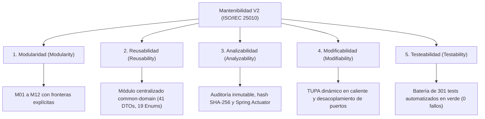

# 07. Mantenibilidad del Sistema
## Sistema de Gestión Documentaria de Licencia de Funcionamiento
### Municipalidad Provincial de Huamanga (Ayacucho, Perú) — Versión 2.0

> **Estándar de Referencia:** ISO/IEC 25010 — Subcaracterísticas de Mantenibilidad
> **Principios de Diseño:** SOLID, Clean Architecture, Ports & Adapters, Modular Monolith
> **Plataforma:** Java 21 LTS, Spring Boot 3.3.4, PostgreSQL 16, Maven multi-módulo
> **Ubicación:** `docs/analisis-de-sistema/07-mantenibilidad.md`
> **Estado:** Documento Canónico Vigente V2

---

## 1. Introducción y Relevancia Institucional

La **Mantenibilidad** es la capacidad del software para ser modificado con eficacia y eficiencia ante cambios normativos, correcciones de errores, adaptaciones operativas y evolución funcional en el tiempo.

Para la Municipalidad Provincial de Huamanga, donde las ordenanzas municipales, las directivas de PCM y los costos del TUPA cambian periódicamente, la mantenibilidad es un atributo de calidad de primer orden. Un sistema rígido o con acoplamiento espagueti requeriría semanas de reprogramación ante cada nueva disposición legal, elevando los costos de mantenimiento y exponiendo a la administración a fallos o incumplimiento de plazos.

---

## 2. Las 5 Subcaracterísticas de Mantenibilidad (ISO/IEC 25010)

Bajo la norma **ISO/IEC 25010**, la mantenibilidad se descompone en cinco subcaracterísticas fundamentales:



---

## 3. Implementación Práctica de la Mantenibilidad en MuniHuamanga V2

### 3.1. Modularidad: Monolito Modular con 12 Módulos Lógicos
El sistema se organiza en módulos lógicos fuertemente cohesivos y débilmente acoplados:
- **Encapsulamiento por Bounded Contexts:** Cada módulo (M01 Cuentas, M02 Borradores, M03 Expedientes, M04 Pagos, M05 TUPA, M06 Zonificación, M07 Evaluación, M08 Resoluciones, M09 Licencias, M10 Verificación, M11 Reclamaciones, M12 Seguridad/Auditoría) posee sus propias entidades, servicios, controladores y repositorios.
- **Barreras Arquitectónicas:** Ningún módulo accede a las tablas internas de otro eludiendo su capa de servicio. La comunicación ocurre a través de llamadas de métodos fuertemente tipados en memoria de la JVM.
- **Eliminación de Acoplamiento Fantasma:** La unificación en un Monolito Modular eliminó microservicios dispersos y duplicaciones de código, centralizando contratos en `common-domain`.

### 3.2. Reusabilidad: El Módulo Maven `common-domain`
Todos los contratos de datos, enumeraciones de estado y excepciones se concentran en el módulo reutilizable `common-domain`:
- **19 Enums de Negocio:** `EstadoExpediente` (10 estados formales), `NivelRiesgo`, `EstadoBorrador`, `EstadoCuenta`, `EstadoResolucion`, `EstadoLicencia`, `EstadoValidacionPago`, `EstadoRevisionDocumento`, etc.
- **41 DTOs de Contrato Inmutables:** Utilizados por los controladores REST y los servicios de aplicación (`CrearExpedienteDto`, `ExpedienteResponseDto`, `SolicitudBorradorDto`, `ResolucionAdministrativaDto`, `VerificacionPublicaQrDto`, etc.).
- **Beneficio:** Garantiza la coherencia semántica en todo el ciclo de vida del trámite sin dispersión de definiciones.

### 3.3. Analizabilidad y Trazabilidad Inmutable
La capacidad de diagnóstico, auditoría y trazabilidad legal se garantiza mediante:
1. **Entidad `AuditoriaExpediente`:** Registra cada cambio de estado con marca de tiempo precisa (UTC), identificador del usuario actuante, IP de origen, estados y motivo técnico/legal.
2. **Inmutabilidad Documental:** Cálculo de hash criptográfico SHA-256 para cada versión de documento adjunto en `DocumentoAdjunto`.
3. **Logs Estructurados:** Los logs de aplicación se unifican en un único proceso JVM trazable por correlativo de expediente (`EXP-YYYY-XXXXX`), resolución (`RES-YYYY-XXXXX`) o licencia (`LIC-YYYY-XXXXX`).

### 3.4. Modificabilidad: Inversión de Dependencias y TUPA en Caliente
1. **Patrón Ports & Adapters:**
   - La capa de aplicación interactúa con servicios externos mediante interfaces portuarias puras (`FirmaDigitalPort`, `SatPort`, `DefensaCivilPort`, `EdificacionesPort`).
   - El puerto `FirmaDigitalPort` aísla al sistema del proveedor criptográfico final (RENIEC, ONPE o proveedor acreditado), aplicando una política *fail-closed* si el servicio no responde.
2. **Mantenimiento en Caliente del Tarifario TUPA:**
   - El Administrador (`ROLE_ADMIN`) actualiza montos directamente vía API REST (`PUT /api/tupa/tarifas/{id}`).
   - La nueva tarifa entra en vigencia de inmediato en la base de datos sin requerir recompilación ni reinicio del servidor.
3. **Mecanismo de Resiliencia con Fallback:**
   - Si la tabla de tarifas no estuviese disponible, la clase `CalculadoraDeTasa` cuenta con un fallback programado hacia el archivo `application.yml`.

### 3.5. Testeabilidad: Suite Integral de 301 Tests Automatizados
La arquitectura desacoplada permite probar de forma aislada cada capa del sistema:
- **Tests Unitarios de Dominio:** Validan reglas puras de negocio (invariantes de estados, validadores, cálculo de tasas) en microsegundos.
- **Tests de Integración MockMvc y Seguridad:** Validan controladores, serialización de DTOs, filtros JWT y autorización de método (`@PreAuthorize`).
- **Tests de Concurrencia y Secuencias Atómicas:** Verifican que transacciones simultáneas no provoquen duplicados en numeraciones anuales pesimistas.
- **Resumen Oficial de la Batería de Pruebas:**
  ```text
  [INFO] -------------------------------------------------------
  [INFO]  T E S T S   S U M M A R Y
  [INFO] -------------------------------------------------------
  [INFO] Tests run: 301, Failures: 0, Errors: 0, Skipped: 0
  [INFO] -------------------------------------------------------
  [INFO] BUILD SUCCESS
  ```

---

## 4. Métricas de Mantenibilidad y Calidad de Código V2

| Dimensión de Mantenibilidad | Valor / Estado en el Proyecto | Evaluación |
|---|---|:---:|
| **Modularidad (Bounded Contexts)** | 12 módulos funcionales lógicos (M01–M12). | **Excelente** |
| **Desacoplamiento Portuario** | Puertos puros (`*Port`) que aíslan el núcleo. | **Óptimo** |
| **Separación de Responsabilidades (SRP)** | Clases de servicio y generadores PDF dedicados. | **Excelente** |
| **Reusabilidad de Contratos** | Módulo `common-domain` con 41 DTOs y 19 Enums. | **Óptimo** |
| **Cobertura de Pruebas Automatizadas** | 301 tests ejecutados con 100% de éxito en Maven. | **Sobresaliente** |
| **Tiempo de Despliegue de Cambios** | 1 solo comando de empaquetado: `mvn package` (< 30 s). | **Ágil** |

---

## 5. Conclusión

El diseño de MuniHuamanga V2 sitúa a la **Mantenibilidad** en el núcleo de su arquitectura. La combinación de **Monolito Modular**, **Clean Architecture**, **puertos desacoplados**, actualización en caliente del TUPA y una rigurosa suite de **301 pruebas automatizadas** garantiza que el sistema evolucione de manera ágil, económica y confiable ante cualquier cambio normativo o tecnológico futuro.
