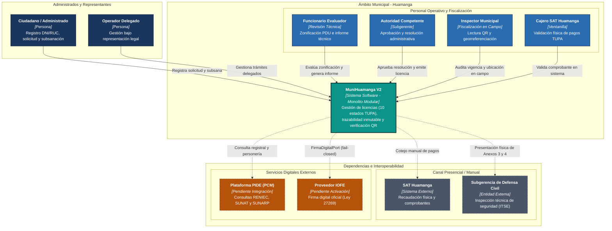
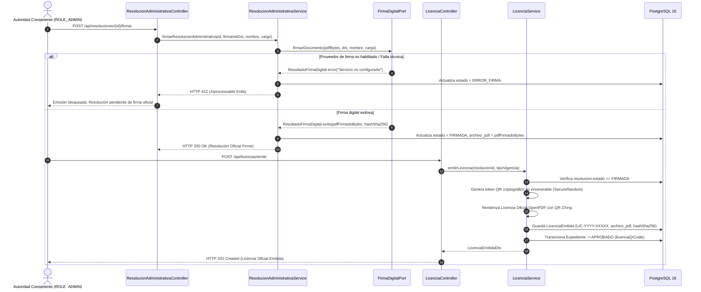

# Modelo de Arquitectura C4 — Sistema de Licencias de Funcionamiento
## MuniHuamanga V2 — Municipalidad Provincial de Huamanga (Ayacucho, Perú)

> **Marco Normativo:** Ley N° 28976 / TUO D.S. N° 046-2017-PCM / D.S. N° 002-2018-PCM / D.S. N° 163-2020-PCM / Ley N° 27269 / Ley N° 29733
> **Plataforma Tecnológica:** Java 21 LTS, Spring Boot 3.3.4, PostgreSQL 16, OpenPDF 2.0.3, ZXing 3.5.3
> **Estado:** Documento Canónico Vigente — MuniHuamanga V2
> **Ubicación:** `docs/arquitectura/c4-model.md`

---

## 1. Convenciones y Leyenda del Modelo C4

Para garantizar total transparencia técnica y fidelidad con la realidad del repositorio, los componentes se identifican bajo las siguientes categorías de estado:

| Distintivo Visual / Estado | Significado Técnico en MuniHuamanga V2 |
| :---: | :--- |
| **[IMPLEMENTADO]** | Código fuente, persistencia y pruebas automatizadas 100% funcionales en el repositorio. |
| **[PARCIAL]** | Backend implementado; interfaz de usuario o vinculación frontend en proceso de integración. |
| **[SIMULADO EN PRUEBAS]** | Mocks y adaptadores desacoplados empleados en suites de prueba unitarias/integración. |
| **[PENDIENTE INSTITUCIONAL]** | Requiere convenio, credenciales oficiales o infraestructura física municipal externa (IOFE, SAT, RENIEC). |

---

## 2. Nivel 1 — Diagrama de Contexto del Sistema

Describe las interacciones entre los usuarios (administrados, operadores, funcionarios e inspectores) y los sistemas externos del ecosistema municipal y gubernamental:

---

## 3. Nivel 2 — Diagrama de Contenedores

Ilustra la arquitectura técnica consolidada: clientes web ligeros, el contenedor backend Spring Boot 3.3.4 (Monolito Modular) y la persistencia en PostgreSQL 16:

```mermaid
graph TD
    %% ==========================================
    %% ESTILOS VISUALES C4
    %% ==========================================
    classDef person fill:#08427B,stroke:#052A4F,color:#FFFFFF,stroke-width:1.5px;
    classDef container fill:#1168BD,stroke:#0B4884,color:#FFFFFF,stroke-width:1.5px;
    classDef db fill:#1A5276,stroke:#113850,color:#FFFFFF,stroke-width:1.5px;
    classDef extManual fill:#718096,stroke:#4A5568,color:#FFFFFF,stroke-dasharray: 4 2;
    classDef extService fill:#D69E2E,stroke:#B7791F,color:#FFFFFF,stroke-dasharray: 4 2;

    %% ==========================================
    %% USUARIOS / ROLES
    %% ==========================================
    subgraph G_USERS["Usuarios e Interesados"]
        direction LR
        ciudadano["<b>Ciudadano / Operador</b><br/><i>[Persona]</i>"]:::person
        funcionario["<b>Personal Municipal</b><br/><i>[Evaluador / Subgerente / Cajero]</i>"]:::person
        inspector["<b>Inspector de Campo</b><br/><i>[Fiscalizador]</i>"]:::person
    end

    %% ==========================================
    %% LÍMITE DEL SISTEMA: MUNIHUAMANGA V2
    %% ==========================================
    subgraph B_SYSTEM["Límite de Sistema: MuniHuamanga V2"]
        direction TB

        subgraph G_CLIENTS["Capa de Presentación (Frontend)"]
            spaPortal["<b>Portal Ciudadano Web</b><br/><i>[Contenedor: SPA Web]</i><br/>Registro de trámites, carga de Anexos TUPA y subsanaciones"]:::container
            spaAdmin["<b>Portal Administrativo / Backoffice</b><br/><i>[Contenedor: SPA Web]</i><br/>Evaluación técnica, emisión de resoluciones y caja"]:::container
            pwaInspector["<b>Aplicación Móvil Inspector</b><br/><i>[Contenedor: PWA / Mobile]</i><br/>Escaneo de QR, cotejo offline-first y geolocalización"]:::container
        end

        apiGateway["<b>API Gateway / Reverse Proxy</b><br/><i>[Contenedor: Reverse Proxy / YARP]</i><br/>Enrutamiento, TLS termination, Rate Limiting y validación JWT"]:::container

        subgraph G_BACKEND["Capa de Aplicación y Lógica de Negocio"]
            backend["<b>MuniHuamanga Core API</b><br/><i>[Contenedor: Monolito Modular - .NET 10 / ASP.NET Core]</i><br/>Módulos: Licencias, Zonificación PDU, TUPA, Auditoría, Notificaciones y Trazabilidad"]:::container
            workerService["<b>Background Worker Service</b><br/><i>[Contenedor: Background Service]</i><br/>Generación asíncrona de expedientes en PDF, códigos QR y sincronización de eventos"]:::container
        end

        subgraph G_STORAGE["Capa de Persistencia y Almacenamiento"]
            sqlDb[("<b>Base de Datos Principal</b><br/><i>[Contenedor: SQL Server]</i><br/>Esquemas relacionales, estados normativos, expedientes y auditoría inmutable")]:::db
            cacheDb[("<b>Caché Distribuida</b><br/><i>[Contenedor: Redis]</i><br/>Sesiones de usuario, revocación de tokens y datos maestros PDU")]:::db
            blobStorage[("<b>Almacén de Archivos</b><br/><i>[Contenedor: Blob Storage]</i><br/>PDFs de expedientes, resoluciones firmadas y sustentos escaneados")]:::db
        end
    end

    %% ==========================================
    %% SISTEMAS EXTERNOS E INTEROPERABILIDAD
    %% ==========================================
    subgraph G_EXT["Sistemas e Integraciones Externas"]
        sat["<b>SAT Huamanga</b><br/><i>[Sistema Externo / Presencial]</i><br/>Ventanilla de pagos y liquidaciones"]:::extManual
        defensaCivil["<b>Subgerencia de Defensa Civil</b><br/><i>[Entidad Externa]</i><br/>Cotejo de inspección ITSE"]:::extManual
        pide["<b>Plataforma PIDE (PCM)</b><br/><i>[Servicio REST / SOAP]</i><br/>Validación RENIEC, SUNAT y SUNARP"]:::extService
        iofe["<b>Proveedor IOFE</b><br/><i>[Servicio PKI - Ley 27269]</i><br/>Firma digital y sellado de tiempo"]:::extService
    end

    %% ==========================================
    %% RELACIONES: USUARIOS A FRONTENDS
    %% ==========================================
    ciudadano   -->|"HTTPS"| spaPortal
    funcionario -->|"HTTPS"| spaAdmin
    inspector   -->|"HTTPS"| pwaInspector

    %% ==========================================
    %% RELACIONES: FRONTENDS AL GATEWAY
    %% ==========================================
    spaPortal    -->|"HTTPS / JSON REST"| apiGateway
    spaAdmin     -->|"HTTPS / JSON REST"| apiGateway
    pwaInspector -->|"HTTPS / JSON REST"| apiGateway

    %% ==========================================
    %% RELACIONES: GATEWAY A SERVICIOS INTERNOS
    %% ==========================================
    apiGateway -->|"HTTP / gRPC"| backend

    %% ==========================================
    %% RELACIONES: BACKEND A PERSISTENCIA Y ASÍNCRONO
    %% ==========================================
    backend -->|"TCP / EF Core"| sqlDb
    backend -->|"TCP / RESP"| cacheDb
    backend -->|"HTTPS / SDK"| blobStorage
    backend -.->|"Encola eventos / PubSub"| cacheDb
    workerService -.->|"Consume colas / eventos"| cacheDb
    workerService -->|"Actualiza estados y metadatos"| sqlDb
    workerService -->|"Almacena reportes generados"| blobStorage

    %% ==========================================
    %% RELACIONES: INTEROPERABILIDAD EXTERNA
    %% ==========================================
    backend -.->|"Consulta registros (FirmaDigitalPort / fail-closed)"| iofe
    backend -.->|"Cotejo de personería y RUC"| pide
    spaAdmin -.->|"Validación manual de comprobante físico"| sat
    backend -.->|"Copia informativa de expediente"| defensaCivil
```

---

## 4. Nivel 3 — Diagrama de Componentes: Monolito Modular

Detalla los componentes internos organizados según Clean Architecture dentro del backend `servicio-expedientes`:

```mermaid
graph TD
    %% ==========================================
    %% ESTILOS VISUALES C4
    %% ==========================================
    classDef boundary fill:#F8FAFC,stroke:#94A3B8,color:#0F172A,stroke-width:1.5px;
    classDef controller fill:#1E293B,stroke:#0F172A,color:#FFFFFF,stroke-width:1.5px;
    classDef usecase fill:#0284C7,stroke:#0369A1,color:#FFFFFF,stroke-width:1.5px;
    classDef domain fill:#0369A1,stroke:#075985,color:#FFFFFF,stroke-width:2px;
    classDef port fill:#0D9488,stroke:#115E59,color:#FFFFFF,stroke-width:1.5px;
    classDef adapter fill:#475569,stroke:#334155,color:#FFFFFF,stroke-width:1.5px;
    classDef external fill:#B45309,stroke:#78350F,color:#FFFFFF,stroke-dasharray: 4 2;
    classDef storage fill:#1E3A8A,stroke:#172554,color:#FFFFFF,stroke-width:1.5px;

    %% ==========================================
    %% ENTRADAS EXTERNAS AL CONTENEDOR
    %% ==========================================
    gateway["<b>API Gateway / Reverse Proxy</b><br/><i>[HTTP Requests / Bearer JWT]</i>"]:::controller

    %% ==========================================
    %% LÍMITE: CORE API (MONOLITO MODULAR)
    %% ==========================================
    subgraph B_CORE["Contenedor: MuniHuamanga Core API (.NET 10 / ASP.NET Core)"]
        direction TB

        %% ADAPTADORES CONDUCTORES (PRIMARY ADAPTERS)
        subgraph MOD_WEB["Capa de Entrada (Primary Adapters)"]
            licenciasCtrl["<b>LicenciasController</b><br/><i>[API Endpoint]</i><br/>Maneja POST, PUT y transiciones"]:::controller
            zonificacionCtrl["<b>ZonificacionController</b><br/><i>[API Endpoint]</i><br/>Consulta compatibilidad PDU"]:::controller
            inspeccionCtrl["<b>InspeccionController</b><br/><i>[API Endpoint]</i><br/>Lectura QR y actas de campo"]:::controller
        end

        %% ==========================================
        %% MÓDULO 1: TRÁMITE Y LICENCIAS (CORE DOMAIN)
        %% ==========================================
        subgraph MOD_LICENCIAS["Módulo: Trámites y Licencias de Funcionamiento"]
            subgraph APP_LIC["Capa de Aplicación (Use Cases)"]
                tramiteHandler["<b>ExpedienteCommandHandler</b><br/><i>[MediatR Handler]</i><br/>Orquesta registro, validación y transiciones"]:::usecase
            end

            subgraph DOM_LIC["Capa de Dominio"]
                licenciaAggregate["<b>ExpedienteLicencia</b><br/><i>[Aggregate Root]</i><br/>Máquina de 10 estados TUPA, reglas de negocio"]:::domain
            end

            subgraph PORTS_LIC["Puertos Secundarios (Outbound Interfaces)"]
                iExpedienteRepo["<b>IExpedienteRepository</b><br/><i>[Output Port]</i>"]:::port
                iFirmaDigitalPort["<b>IFirmaDigitalPort</b><br/><i>[Output Port - Fail Closed]</i>"]:::port
                iPidePort["<b>IPideIntegrationPort</b><br/><i>[Output Port]</i>"]:::port
                iUnitOfWork["<b>IUnitOfWork</b><br/><i>[Output Port]</i>"]:::port
            end
        end

        %% ==========================================
        %% MÓDULO 2: ZONIFICACIÓN Y PDU
        %% ==========================================
        subgraph MOD_ZONIFICACION["Módulo: Zonificación PDU"]
            evaluadorZonif["<b>ZonificacionQueryHandler</b><br/><i>[MediatR Handler]</i><br/>Evalúa compatibilidad de uso"]:::usecase
            reglaZonif["<b>MatrizCompatibilidadPDU</b><br/><i>[Domain Service]</i>"]:::domain
            iZonificacionRepo["<b>IZonificacionRepository</b><br/><i>[Output Port]</i>"]:::port
        end

        %% ==========================================
        %% MÓDULO 3: FISCALIZACIÓN Y TRAZABILIDAD
        %% ==========================================
        subgraph MOD_FISCALIZACION["Módulo: Fiscalización y Auditoría Inmutable"]
            qrService["<b>QrVerificationHandler</b><br/><i>[Use Case]</i><br/>Verifica hash criptográfico y token QR"]:::usecase
            iAuditTrailPort["<b>IAuditTrailPort</b><br/><i>[Output Port]</i>"]:::port
            iBlobStoragePort["<b>IBlobStoragePort</b><br/><i>[Output Port]</i>"]:::port
        end

        %% ==========================================
        %% ADAPTADORES GUIADOS (SECONDARY ADAPTERS)
        %% ==========================================
        subgraph MOD_INFRA["Capa de Infraestructura (Secondary Adapters)"]
            direction LR
            efCoreAdapter["<b>EfCoreExpedienteAdapter</b><br/><i>[EF Core / SQL Server]</i>"]:::adapter
            iofeAdapter["<b>IofeClientAdapter</b><br/><i>[PKI Client - Ley 27269]</i>"]:::adapter
            pideAdapter["<b>PideSoapRestClient</b><br/><i>[SUNAT / RENIEC Client]</i>"]:::adapter
            blobAdapter["<b>AzureBlobOrDiskAdapter</b><br/><i>[Storage Client]</i>"]:::adapter
            auditAdapter["<b>ImmutableAuditAdapter</b><br/><i>[Append-only Log]</i>"]:::adapter
        end
    end

    %% ==========================================
    %% PERSISTENCIA Y SERVICIOS EXTERNOS
    %% ==========================================
    sqlDb[("<b>SQL Server</b><br/><i>[Base de Datos Relacional]</i>")]:::storage
    blobDb[("<b>Blob Storage</b><br/><i>[Almacén de Documentos]</i>")]:::storage
    pideExt["<b>Plataforma PIDE (PCM)</b><br/><i>[Servicio Externo]</i>"]:::external
    iofeExt["<b>Servicio IOFE</b><br/><i>[Servicio PKI Externo]</i>"]:::external

    %% ==========================================
    %% CONEXIONES Y FLUJOS
    %% ==========================================
    %% Entrada al Controller
    gateway -->|"HTTP POST /licencias"| licenciasCtrl
    gateway -->|"HTTP GET /zonificacion"| zonificacionCtrl
    gateway -->|"HTTP POST /inspeccion/qr"| inspeccionCtrl

    %% Controladores a Casos de Uso
    licenciasCtrl -->|"Envía Command"| tramiteHandler
    zonificacionCtrl -->|"Envía Query"| evaluadorZonif
    inspeccionCtrl -->|"Envía Command"| qrService

    %% Casos de Uso a Dominio
    tramiteHandler -->|"Invoca reglas de transición"| licenciaAggregate
    evaluadorZonif -->|"Aplica matriz"| reglaZonif

    %% Casos de Uso a Puertos Secundarios
    tramiteHandler -->|"Usa"| iExpedienteRepo
    tramiteHandler -->|"Invoca firma en emisión"| iFirmaDigitalPort
    tramiteHandler -->|"Consulta personería"| iPidePort
    tramiteHandler -->|"Confirma transacción"| iUnitOfWork
    tramiteHandler -->|"Registra evento inmutable"| iAuditTrailPort

    evaluadorZonif -->|"Consulta parámetros"| iZonificacionRepo
    qrService -->|"Verifica archivo y acta"| iBlobStoragePort

    %% Implementación de Puertos por los Adaptadores (Realization)
    efCoreAdapter -.->|"Implementa"| iExpedienteRepo
    efCoreAdapter -.->|"Implementa"| iZonificacionRepo
    efCoreAdapter -.->|"Implementa"| iUnitOfWork
    iofeAdapter -.->|"Implementa"| iFirmaDigitalPort
    pideAdapter -.->|"Implementa"| iPidePort
    blobAdapter -.->|"Implementa"| iBlobStoragePort
    auditAdapter -.->|"Implementa"| iAuditTrailPort

    %% Adaptadores a Recursos Externos
    efCoreAdapter -->|"TCP / SQL Queries"| sqlDb
    auditAdapter -->|"Append-only Writes"| sqlDb
    blobAdapter -->|"HTTPS / File Upload"| blobDb
    pideAdapter -.->|"HTTPS / SOAP-REST"| pideExt
    iofeAdapter -.->|"HTTPS / MTLS (Fail-closed)"| iofeExt
```

---

## 4. Nivel 4 — Diagramas de Código y Flujos Críticos

### 4.1. Flujo Crítico de Emisión Oficial de Licencia (M08 -> M09 -> M10)
Demuestra el principio *fail-closed* donde ninguna licencia adquiere carácter oficial ni genera QR válido sin la firma digital de la resolución administrativa previa:

---

## 5. Resumen de Estados de Implementación

| Componente | Estado Arquitectónico | Evidencia en el Código |
| :--- | :---: | :--- |
| **M01: Cuentas y Operadores** | **IMPLEMENTADO** | `CuentaController`, `CuentaService`, `Cuenta`, `OperadorCuenta` (13 tests). |
| **M02: Establecimientos** | **IMPLEMENTADO** | `EstablecimientoController`, `EstablecimientoService`, `CatalogoCiiu` (11 tests). |
| **M03: Borradores** | **IMPLEMENTADO** | `SolicitudBorradorController`, `SolicitudBorradorService` (15 tests). |
| **M04: Documentación ITSE** | **IMPLEMENTADO** | `DocumentoVersionadoController`, generadores de Anexos 1, 3 y 4 (43 tests). |
| **M05: Pagos SAT** | **IMPLEMENTADO** | `PagoExpedienteController`, `PagoExpedienteService` (22 tests). |
| **M06: Expedientes** | **IMPLEMENTADO** | `ExpedienteController`, `ExpedienteService`, 10 estados (33 tests). |
| **M07: Zonificación** | **IMPLEMENTADO** | `EvaluacionZonificacionController`, `SolicitudRectificacionController` (17 tests). |
| **M08: Evaluación e Informes** | **IMPLEMENTADO** | `EvaluacionAdministrativaController`, `InformeAdministrativoService` (27 tests). |
| **M09: Resoluciones y Licencias** | **IMPLEMENTADO** | `ResolucionAdministrativaController`, `LicenciaService`, `FirmaDigitalPort` (22 tests). |
| **M10: Verificación QR e Inspector** | **IMPLEMENTADO** | `LicenciaController`, `InspectorLicenciasController`, Leaflet JS (17 tests). |
| **M11: Notificaciones** | **PARCIAL** | Solo JavaMail SMTP activo; WhatsApp pendiente de integración institucional. |
| **M12: Administración** | **PARCIAL** | Tarifas TUPA dinámicas implementadas; catálogos PDU pendientes de pantalla UI. |
