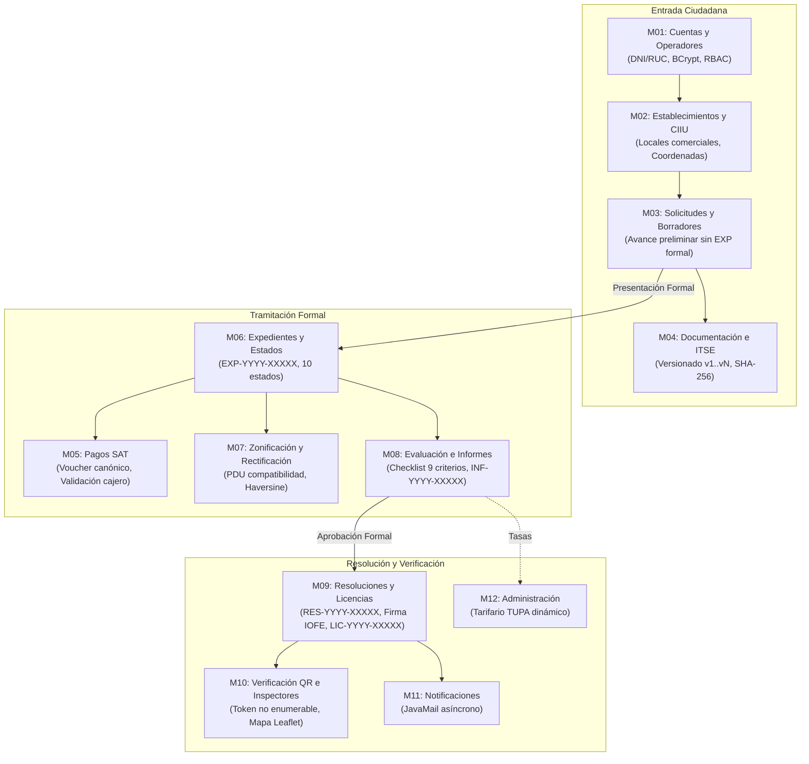
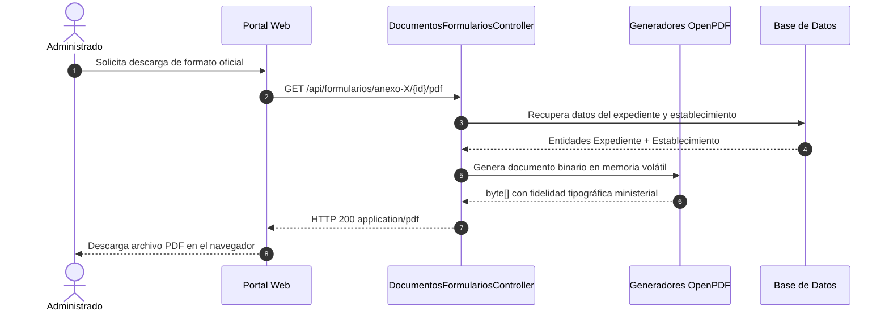

# Diseño Detallado de Componentes e Integración de Software
## MuniHuamanga V2 — Sistema de Licencias de Funcionamiento
### Municipalidad Provincial de Huamanga (Ayacucho, Perú)

> **Marco Normativo:** Ley N° 28976 / TUO D.S. N° 046-2017-PCM / D.S. N° 002-2018-PCM / D.S. N° 163-2020-PCM
> **Plataforma Tecnológica:** Java 21 LTS, Spring Boot 3.3.4, PostgreSQL 16, OpenPDF 2.0.3, ZXing 3.5.3
> **Referencias Canónicas:**
> - Estilo Arquitectónico: [estilo-arquitectonico.md](estilo-arquitectonico.md)
> - Enfoque Arquitectónico: [enfoque-arquitectonico.md](enfoque-arquitectonico.md)
> - Modelo de Arquitectura C4: [c4-model.md](c4-model.md)
> - Decisiones de Arquitectura (ADR): [../v2/DECISIONES_ARQUITECTURA.md](../v2/DECISIONES_ARQUITECTURA.md)
> **Ubicación:** `docs/arquitectura/diseno-arquitectonico-monolito-modular-clean-architecture.md`

---

## 1. Propósito y Alcance del Documento

Este documento complementa el **Estilo Arquitectónico** (Monolito Modular) y el **Enfoque Arquitectónico** (Clean Architecture y Ports & Adapters), detallando el **diseño de componentes internos, la interacción colaborativa entre módulos y los flujos documentales específicos** del sistema MuniHuamanga V2.

Para la definición del estilo de empaquetamiento global, remitirse a [estilo-arquitectonico.md](estilo-arquitectonico.md). Para las reglas de dependencia, capas concéntricas y principios SOLID, consultar [enfoque-arquitectonico.md](enfoque-arquitectonico.md).

---

## 2. Mapa de Colaboración entre Componentes y Módulos

El sistema orquesta 12 módulos funcionales comunicados en memoria con límites transaccionales rigurosos:

---

## 3. Diseño del Flujo Documental de Anexos ITSE (Anexos 1, 3 y 4)

Conforme a la normativa nacional y municipal (Ley N° 28976, D.S. N° 002-2018-PCM y D.S. N° 163-2020-PCM):
1. **Generación Vectorial Automática:** Los Anexos 1 (Declaración Jurada), 3 (Matriz de Riesgo ITSE) y 4 (Condiciones de Seguridad) se renderizan bajo demanda en memoria mediante OpenPDF 2.0.3 reutilizando la información maestra del administrado y del establecimiento.
2. **Descarga e Impresión:** El ciudadano descarga los documentos oficiales en formato PDF:
   - **Anexo 1:** Declaración Jurada oficial (2 páginas) presentada formalmente.
   - **Anexo 3:** Matriz de Riesgo ITSE (2 páginas) para tramitación ante Defensa Civil.
   - **Anexo 4:** Declaración Jurada de Condiciones de Seguridad (4 páginas) con firma manuscrita y huella digital del administrado y del profesional colegiado cuando corresponda.
3. **Mesa de Ayuda Contextual:** La interfaz incorpora ventanas modulares de orientación ciudadana que explican el llenado, las firmas técnicas exigidas y la sede física donde acudir.

---

## 4. Matriz de Trazabilidad entre Requisitos y Componentes

| Requisito Normativo / Calidad | Componente Responsable | Patrón de Diseño | Mecanismo de Validación |
| :--- | :--- | :--- | :--- |
| **RF-01 (Mesa de Partes)** | `SolicitudBorradorService`, `PresentacionFormalService` | State & Factory | Transición atómica de `BORRADOR` a `PRESENTADO` |
| **RF-02 (Gestión de 10 Estados)** | `ExpedienteService`, `EstadoExpedienteValidator` | State Machine | Validación estricta en `EstadoExpedienteValidatorTest` |
| **RF-03 (Formatos PDF)** | `Anexo1PdfGenerator`, `LicenciaPdfGenerator` | Adapter (OpenPDF) | Pruebas de renderizado en `LicenciaPdfServiceTest` |
| **RF-04 (Cálculo TUPA)** | `CalculadoraDeTasa`, `TarifaTupaService` | Strategy | `CalculadoraDeTasaTest` (desglose por riesgo) |
| **RF-05 (Seguridad RBAC)** | `SecurityConfig`, `JwtAuthenticationFilter` | Filter / Interceptor | `SeguridadEndToEndTest`, `ExpedienteSecurity` |
| **RF-06 (Auditoría Inmutable)** | `AuditoriaService`, `AuditoriaExpedienteRepository` | Append-Only Log | Verificación de trazabilidad en base de datos |
| **RF-07 (Firma Digital IOFE)** | `FirmaDigitalPort`, `FirmaDigitalAdapterService` | Ports & Adapters | Salvaguarda fail-closed si no hay proveedor |
| **RF-08 (Verificación QR)** | `LicenciaService`, `QrGeneratorService` | Token Criptográfico | Verificación no enumerable en `VerificacionQrI09Test` |
| **RF-09 (Geolocalización Inspector)** | `InspectorLicenciasController`, Leaflet JS | Driven Adapter | Consulta móvil con auditoría en `auditoria_consultas_inspeccion` |
