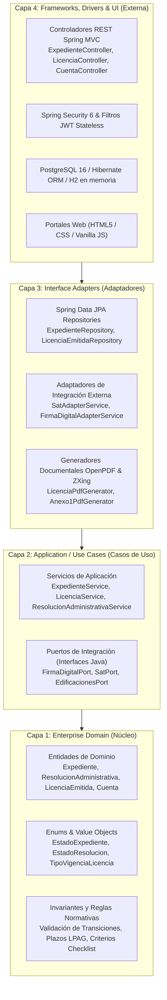
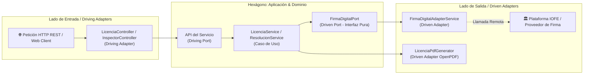

# Enfoque Arquitectónico: Clean Architecture y Ports & Adapters
## MuniHuamanga V2 — Sistema de Licencias de Funcionamiento
### Municipalidad Provincial de Huamanga (Ayacucho, Perú)

> **Marco Normativo:** Ley N° 28976 / TUO D.S. N° 046-2017-PCM / D.S. N° 002-2018-PCM / D.S. N° 163-2020-PCM / Ley N° 27269
> **Patrones Clave:** Clean Architecture (Robert C. Martin), Ports & Adapters / Hexagonal (Alistair Cockburn), Principios SOLID, DDD Táctico
> **Estado:** Documento Canónico Vigente
> **Ubicación:** `docs/arquitectura/enfoque-arquitectonico.md`

---

## 1. Definición del Enfoque Arquitectónico

Mientras que el **Estilo Arquitectónico** (Monolito Modular) define la topología global y el empaquetamiento del sistema, el **Enfoque Arquitectónico** determina la estructura interna de las clases, la separación de responsabilidades y la dirección de las dependencias en el código fuente.

En **MuniHuamanga V2**, la organización interna se fundamenta en los principios de **Clean Architecture** complementados con el patrón **Ports & Adapters (Arquitectura Hexagonal)**.

El propósito central es garantizar que la lógica de negocio y los procedimientos administrativos de la Municipalidad Provincial de Huamanga permanezcan **independientes de agentes externos, librerías gráficas, frameworks web y proveedores tecnológicos**, facilitando el mantenimiento y las pruebas automatizadas.

---

## 2. La Regla de Dependencia (The Dependency Rule)

> **Regla de Oro:**
> *Las dependencias en el código fuente solo pueden apuntar hacia adentro, hacia las capas de más alto nivel de abstracción de negocio.*
> El núcleo del dominio nunca debe conocer ni depender de controladores web, bases de datos relacionales ni servicios externos.



---

## 3. Desglose Concéntrico de Capas

### 3.1. Capa 1: Dominio Empresarial (Enterprise Domain)
Es el núcleo del sistema, libre de lógica de infraestructura. Modela las reglas fundamentales de la Ley N° 28976 y el TUO Ley N° 27444:
- **Entidades de Dominio:** `Expediente`, `Cuenta`, `Establecimiento`, `SolicitudBorrador`, `ResolucionAdministrativa`, `LicenciaEmitida`, `InformeAdministrativo`.
- **Enumeraciones y Tipos de Valor:** `EstadoExpediente` (10 estados oficiales), `NivelRiesgo` (BAJO, MEDIO, ALTO, MUY_ALTO), `EstadoResolucion`, `TipoVigenciaLicencia`, `ConclusionInforme`.
- **Invariantes de Negocio:** Lógica pura de validación que impide transiciones ilegales (e.g. no emitir licencia sin resolución en estado `FIRMADA`).

### 3.2. Capa 2: Aplicación y Casos de Uso (Application Business Rules)
Contiene la orquestación de flujos de trabajo específicos:
- **Servicios de Aplicación:**
  - `ExpedienteService`: Orquesta el ciclo de vida del trámite, evaluación y transiciones formales.
  - `ResolucionAdministrativaService`: Prepara resoluciones, gestiona la aprobación y coordina el ciclo de firma.
  - `LicenciaService`: Gestiona la emisión atómica de licencias oficiales, generación de token QR criptográfico y verificación pública.
  - `CalculadoraDeTasa`: Computa tasas exactas TUPA según riesgo ITSE.
  - `AuditoriaService`: Registra eventos inmutables de auditoría administrativa.
- **Puertos de Integración (Driven Ports):** Interfaces que definen los requerimientos de la aplicación hacia entidades externas (e.g. `FirmaDigitalPort`).

### 3.3. Capa 3: Adaptadores de Interfaz (Interface Adapters)
Traduce datos entre las capas de dominio/aplicación y la infraestructura tecnológica:
- **Adaptadores de Salida (Driven Adapters):**
  - `FirmaDigitalAdapterService`: Implementa `FirmaDigitalPort` para interactuar con proveedores IOFE de firma remota.
  - `SatAdapterService` y `EdificacionesAdapterService`: Adaptadores desacoplados para pagos y zonificación.
  - `LicenciaPdfGenerator`, `Anexo1PdfGenerator`: Adaptadores que renderizan entidades de dominio a binarios PDF vectoriales con OpenPDF.
- **Adaptadores de Persistencia:** Interfaces Spring Data JPA (`ExpedienteRepository`, `ResolucionAdministrativaRepository`) que traducen entidades a sentencias SQL sobre PostgreSQL 16.

### 3.4. Capa 4: Frameworks, Drivers y Presentación (Delivery Layer)
Es la capa periférica que conecta el sistema con usuarios y protocolos externos:
- **Controladores REST (Driving Adapters):** `ExpedienteController`, `ResolucionAdministrativaController`, `LicenciaController`, `InspectorLicenciasController`.
- **Seguridad:** Spring Security 6, filtros stateless JWT (`JwtAuthenticationFilter`), evaluadores BOLA/IDOR contextuales (`@expedienteSecurity`, `@licenciaSecurity`).
- **Interfaces Web:** Portales ligeros HTML5/CSS3/JavaScript (`portal-ciudadano.html`, `portal-interno.html`, `verificar-licencia.html`).

---

## 4. Patrón Ports & Adapters (Arquitectura Hexagonal)

La integración con entidades e infraestructuras externas se estructura mediante puertos y adaptadores:



### Ejemplo Real del Código: `FirmaDigitalPort`
El núcleo de la aplicación define el contrato de firma sin conocer detalles del proveedor de firma digital:

```java
// Puerto (Capa 2: Aplicación)
public interface FirmaDigitalPort {
    ResultadoFirmaDigital firmarDocumento(
        byte[] documentoPdf,
        String firmanteDni,
        String firmanteNombre,
        String firmanteCargo
    );
}

// Adaptador (Capa 3: Infraestructura/Integración)
@Service
@RequiredArgsConstructor
public class FirmaDigitalAdapterService implements FirmaDigitalPort {
    @Value("${munihuamanga.firma-digital.enabled:false}")
    private boolean firmaDigitalHabilitada;

    @Override
    public ResultadoFirmaDigital firmarDocumento(...) {
        if (!firmaDigitalHabilitada) {
            // Comportamiento fail-closed estricto
            return ResultadoFirmaDigital.error(
                "Servicio de firma digital institucional no configurado. Bloqueo fail-closed."
            );
        }
        // Integración con servicio oficial IOFE
        ...
    }
}
```

---

## 5. Aplicación Práctica de los Principios SOLID

1. **Single Responsibility Principle (SRP):**
   - `CalculadoraDeTasa` calcula exclusivamente tasas TUPA.
   - `AuditoriaService` gestiona únicamente la trazabilidad inmutable de eventos.
   - `RateLimiterService` se encarga exclusivamente de regular la frecuencia de consultas públicas.
2. **Open/Closed Principle (OCP):**
   - El puerto `FirmaDigitalPort` permite incorporar nuevos proveedores de firma digital (e.g. RENIEC, ONPE, certificados locales) implementando nuevos adaptadores sin alterar los servicios de resoluciones ni de licencias.
3. **Liskov Substitution Principle (LSP):**
   - Cualquier implementación de `FirmaDigitalPort` respeta las precondiciones y postcondiciones del contrato devolviendo un `ResultadoFirmaDigital` consistente.
4. **Interface Segregation Principle (ISP):**
   - Las interfaces de repositorios y servicios están segregadas por entidad y responsabilidad (`CuentaRepository`, `EstablecimientoRepository`, `LicenciaEmitidaRepository`), evitando interfaces monolíticas con métodos innecesarios.
5. **Dependency Inversion Principle (DIP):**
   - Los servicios de aplicación dependen de interfaces y abstracciones (`FirmaDigitalPort`, `ExpedienteRepository`), mientras que las implementaciones concretas residen en adaptadores inyectados por Spring.

---

## 6. Desviaciones Reales y Pragmatismo Técnico

En un análisis riguroso de arquitectura de software, es imprescindible documentar con total transparencia las **desviaciones existentes respecto del modelo canónico ideal de Clean Architecture**:

### 6.1. Entidades de Dominio Anotadas con JPA/Hibernate
- **Desviación:** En Clean Architecture pura, las entidades de dominio son clases Java POJO absolutamente libres de anotaciones de frameworks. En MuniHuamanga V2, entidades como `Expediente`, `ResolucionAdministrativa` y `LicenciaEmitida` contienen anotaciones `@Entity`, `@Table`, `@Column`, `@Id` y `@ManyToOne`.
- **Justificación Pragmática:** Mantener entidades de dominio separadas de entidades JPA duplicaría todas las clases del modelo, exigiendo capas redundantes de mapeadores objeto-objeto en un sistema mantenido por un equipo municipal compacto.
- **Riesgo y Control:** Se mitiga evitando que la lógica de negocio dependa de características específicas del proveedor ORM y asegurando que las reglas del dominio se validen antes de invocar la persistencia.

### 6.2. Uso de `@Transactional` de Spring en Servicios de Aplicación
- **Desviación:** Los servicios de casos de uso utilizan la anotación `@Transactional` de Spring Framework en lugar de implementar un control de transacciones puramente desacoplado mediante patrones Unit of Work abstractos.
- **Justificación Pragmática:** Aprovecha la robustez y optimización del gestor de transacciones de Spring y el pool HikariCP en PostgreSQL 16 sin reinventar la rueda.

### 6.3. Coexistencia de Servicios Consolidados en Lugar de Use Cases Atómicos
- **Desviación:** En lugar de crear una clase por cada caso de uso individual (e.g., `CrearExpedienteUseCase`, `AprobarExpedienteUseCase`), clases como `ExpedienteService` y `LicenciaService` agrupan varios casos de uso fuertemente relacionados con el ciclo de vida de la entidad.
- **Justificación Pragmática:** Mejora la cohesión y navegabilidad del código en un proyecto municipal sin dispersar la lógica en cientos de clases unitarias artificiales.
