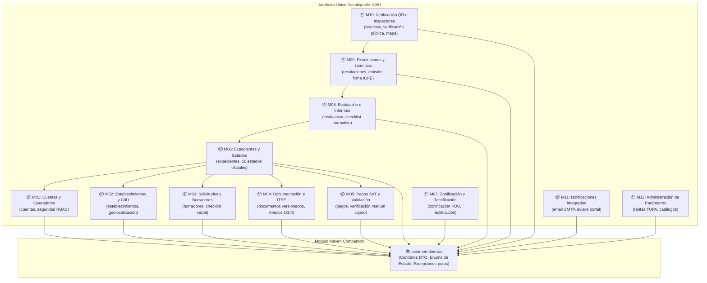

# Estilo Arquitectónico: Monolito Modular (Modular Monolith)
## MuniHuamanga V2 — Sistema de Licencias de Funcionamiento
### Municipalidad Provincial de Huamanga (Ayacucho, Perú)

> **Marco Normativo:** Ley N° 28976 / TUO D.S. N° 046-2017-PCM / D.S. N° 002-2018-PCM / D.S. N° 163-2020-PCM / Ley N° 29733
> **Plataforma Tecnológica:** Java 21 LTS, Spring Boot 3.3.4, PostgreSQL 16, OpenPDF 2.0.3, ZXing 3.5.3
> **Estado:** Documento Canónico Vigente
> **Ubicación:** `docs/arquitectura/estilo-arquitectonico.md`

---

## 1. Definición del Estilo Arquitectónico

El sistema **MuniHuamanga V2** adopta como estilo arquitectónico fundamental el **Monolito Modular (Modular Monolith)**.

Bajo este estilo, toda la solución backend se compila, empaqueta y despliega como una **única unidad de ejecución** (`servicio-expedientes.jar`), mientras que su diseño lógico interno está rigurosamente particionado en **módulos cohesivos y desacoplados** que representan los **Contextos Delimitados (Bounded Contexts)** del negocio de licencias de funcionamiento de la Municipalidad Provincial de Huamanga.



---

## 2. Justificación de la Elección vs. Microservicios

Durante el análisis preliminar de arquitectura se evaluó una topología distribuida de microservicios (`api-gateway`, `servicio-expedientes`, `servicio-formularios`, `servicio-verificacion-licencias`, `adaptador-integracion`). El análisis técnico y empírico determinó que dicha dispersión introducía riesgos y sobrecostos desproporcionados para la realidad municipal:

| Factor Evaluado | Enfoque Microservicios Distribuidos | Enfoque Monolito Modular V2 (Adoptado) | Impacto Institucional en Huamanga |
|---|---|---|---|
| **Latencia de Red** | Múltiples saltos HTTP inter-servicios (+150ms a +350ms de overhead). | Invocación en memoria JVM (< 0.05 ms por llamada directa). | Cumplimiento estricto del SLA $P_{95} \le 200$ ms en verificación. |
| **Consistencia Transaccional** | Transacciones distribuidas (Sagas / 2PC), riesgo de inconsistencia eventual. | Transaccionalidad local ACID con `@Transactional` en PostgreSQL 16. | Cero discrepancias en cobros TUPA, expedientes o licencias emitidas. |
| **Duplicación de Código** | Clases generadoras de PDF y QR replicadas en 3 repositorios. | Motores PDF y QR centralizados en paquetes dedicados reutilizables. | Eliminación de código duplicado y reducción drástica de deuda técnica. |
| **Consumo de Memoria** | $\ge 2.5$ GB de RAM (5 procesos JVM con Spring Boot embebido). | $\approx 350 - 500$ MB de RAM (un solo proceso JVM optimizado). | Despliegue económico y viable en servidores municipales on-premise. |
| **Complejidad Operativa** | Service Discovery, API Gateway, Distributed Tracing, Circuit Breakers. | Un solo contenedor Docker, un único pipeline CI/CD y logs unificados. | Mantenible por el equipo de TI de la Municipalidad de Huamanga. |

---

## 3. Organización de Módulos (Bounded Contexts)

Cada módulo en MuniHuamanga V2 representa un Bounded Context bien delimitado a nivel de paquetes dentro de `servicio-expedientes` y tipado en `common-domain`:

1. **M01: Cuentas y Operadores (`cuentas`):** Registro de personas naturales (DNI) y jurídicas (RUC), autenticación JWT, gestión de operadores delegados con permisos granulares.
2. **M02: Establecimientos y Catálogo CIIU (`establecimientos`):** Gestión de locales comerciales independientes, coordenadas oficiales (WGS84), giros económicos y zonificación preliminar.
3. **M03: Solicitudes y Borradores (`borradores`):** Avance progresivo de solicitudes con identificador UUID interno antes de generar número formal de expediente.
4. **M04: Documentación e ITSE (`documentos`):** Repositorio inmutable versionado v1..vN con cálculo de hash SHA-256, inspección de cabeceras binarias (*magic numbers*), mitigación de path traversal y generación nativa de formatos ministeriales Anexo 1, 3 y 4.
5. **M05: Pagos SAT y Validación Manual (`pagos`):** Declaración de vouchers bancarios SAT con código normalizado canónico, bandeja de validación manual por cajero municipal y bloqueo pesimista contra doble validación.
6. **M06: Expedientes y Estados (`expedientes`):** Orquestador del ciclo de vida formal, asignación transaccional única de número `EXP-YYYY-XXXXX` mediante secuencia anual pesimista y control de 10 estados normativos.
7. **M07: Zonificación y Rectificación (`zonificacion`, `rectificacion`):** Evaluación motivada de compatibilidad de uso según PDU y trámite de rectificación de coordenadas con cálculo geodésico Haversine.
8. **M08: Evaluación Administrativa e Informes (`evaluacion`):** Bandeja unificada, checklist de 9 criterios normativos, generación de informes técnicos (`INF-YYYY-XXXXX`), revisión, visado y aprobación con segregación estricta de funciones.
9. **M09: Resoluciones y Licencias (`resoluciones`, `licencias`):** Emisión de resoluciones administrativas (`RES-YYYY-XXXXX`), integración desacoplada de firma digital institucional (`FirmaDigitalPort`) con salvaguarda fail-closed, y generación de licencias inmutables (`LIC-YYYY-XXXXX`).
10. **M10: Verificación QR Diferenciada (`licencias`, `inspector`):** Endpoint público de verificación con minimización estricta de datos (sin DNI/RUC) y Rate Limiting por IP, junto a consulta móvil ampliada para inspectores con georreferenciación Leaflet y registro de auditoría inmutable.
11. **M11: Notificaciones Integradas (`service.NotificacionEmailService`):** Envío asíncrono de correos electrónicos transaccionales con adjuntos PDF.
12. **M12: Administración de Parámetros (`controller.TarifaTupaController`):** Mantenimiento en caliente del tarifario TUPA institucional y tasas por nivel de riesgo.

---

## 4. Comunicación Interna e Integridad Transaccional

### 4.1. Comunicación In-Process (En Memoria JVM)
La interacción entre los módulos se realiza mediante llamadas directas a interfaces de servicio Java dentro del mismo proceso de la JVM:
- Sin serialización JSON innecesaria ni sobrecarga de sockets de red locales.
- Tiempos de invocación menores a **0.05 ms** por llamada a método.
- Tipado fuerte garantizado por el compilador de Java 21.

### 4.2. Integridad Transaccional ACID
Toda operación que involucra cambios en el estado de un expediente, registro de auditoría o asignación de correlativos se ejecuta bajo transacciones relacionales ACID locales gestionadas por Spring `@Transactional`:
- **Atomicidad:** Si ocurre un fallo en cualquier etapa del registro (e.g., error en persistencia de documentos), toda la operación sufre rollback automático.
- **Consistencia:** Las reglas de integridad referencial (`ON DELETE RESTRICT`) y restricciones de unicidad (`uk_licencia_expediente`, `uk_pago_codigo_comprobante`) son impuestas directamente por el motor PostgreSQL 16.
- **Aislamiento:** Nivel de aislamiento estándar `READ_COMMITTED` reforzado con bloqueos pesimistas (`PESSIMISTIC_WRITE`) en secuencias anuales y presentaciones de borradores para impedir colisiones bajo concurrencia.
- **Durabilidad:** Confirmación física en el registro de transacciones (*Write-Ahead Logging* - WAL) de PostgreSQL 16.

---

## 5. Cohesión, Acoplamiento y Fronteras Modulares

Para evitar que el monolito degenere en un diseño desestructurado:
1. **Alta Cohesión:** Cada paquete funcional encapsula sus entidades, repositorios, servicios y controladores. La lógica de evaluación administrativa no reside en el paquete de pagos ni en el de cuentas.
2. **Bajo Acoplamiento:** Los módulos se comunican mediante identificadores inmutables (UUID) o invocaciones a contratos de servicio. No existen joins destructivos entre contextos que comprometan la independencia de datos.
3. **Contratos Compartidos:** El módulo Maven `common-domain` contiene únicamente DTOs, enumeraciones y excepciones puras, evitando que un módulo dependa directamente de los paquetes internos de otro.

---

## 6. Escalabilidad y Despliegue Físico

### 6.1. Despliegue Lógico y Físico
- **Artefacto:** Archivo JAR ejecutable autónomo con servidor web Tomcat embebido (`servicio-expedientes-1.0.0-SNAPSHOT.jar`).
- **Base de Datos:** Instancia relacional PostgreSQL 16 accesible vía pool de conexiones HikariCP.
- **Contenedorización:** Empaquetado estandarizado mediante `Dockerfile` multi-stage sobre imagen base ligera `eclipse-temurin:21-jre-alpine`.

```text
MuniHuamanga/
├── common-domain/                --> JAR compartido de contratos (common-domain-1.0.0-SNAPSHOT.jar)
└── servicio-expedientes/         --> Monolito ejecutable (servicio-expedientes-1.0.0-SNAPSHOT.jar)
```

### 6.2. Escalabilidad Vertical y Horizontal
- **Escalabilidad Vertical:** Gracias a la ligereza del monolito modular (~400 MB RAM base), una máquina virtual con 2 vCPU y 4 GB de RAM puede procesar cómodamente la carga proyectada de la Municipalidad Provincial de Huamanga (> 150 usuarios concurrentes sostenidos).
- **Escalabilidad Horizontal:** Al mantener la capa de aplicación sin estado de sesión en memoria (*Stateless JWT*), es posible desplegar múltiples instancias del JAR detrás de un balanceador de carga HTTP (Nginx / HAProxy), compartiendo la misma base de datos PostgreSQL 16. En tal escenario, las estructuras de control en memoria (como `RateLimiterService`) se desacoplan hacia un nodo Redis para coordinar cuotas globales de IP.

---

## 7. Ventajas y Limitaciones del Estilo Adoptado

### 7.1. Ventajas
1. **Simplicidad Operativa:** Un solo pipeline de despliegue, un solo log unificado y cero necesidad de orquestadores complejos como Kubernetes para la escala municipal.
2. **Rendimiento Excepcional:** Generación de PDFs y consultas de verificación en memoria sin latencia acumulada de red.
3. **Facilidad de Auditoría y Pruebas:** Ejecución de 301 pruebas automatizadas en menos de 50 segundos en un solo comando `mvn clean verify`.

### 7.2. Limitaciones y Mitigaciones
1. **Ciclo de Despliegue Compartido:** Un cambio en el módulo de pagos requiere redesplegar el artefacto completo.
   *Mitigación:* Se mitiga mediante suites de pruebas automatizadas exhaustivas y alta cobertura de regresión que aseguran que cambios en un módulo no impacten a los demás.
2. **Potencial Ruptura de Fronteras:** Existe el riesgo de que desarrolladores introduzcan dependencias cruzadas indebidas entre módulos.
   *Mitigación:* Control riguroso en revisiones de código, pruebas de arquitectura (ArchUnit) y separación estricta por paquetes de dominio.

---

## 8. Correspondencia con la Estructura Real del Repositorio

| Concepto Arquitectónico | Implementación Concreta en el Código |
| :--- | :--- |
| **Monolito Modular** | Módulos Maven `common-domain` y `servicio-expedientes` en `pom.xml` raíz. |
| **Módulos de Negocio** | Paquetes `cuentas`, `establecimientos`, `borradores`, `documentos`, `pagos`, `expedientes`, `zonificacion`, `rectificacion`, `evaluacion`, `resoluciones`, `licencias`. |
| **Contratos Compartidos** | `pe.gob.munihuamanga.licencias.common.dto.*` y `enums.*`. |
| **Persistencia ACID** | PostgreSQL 16 con JPA/Hibernate y scripts SQL en `docker/postgres/init/01..08`. |
| **Seguridad de Acceso** | Spring Security 6 stateless con filtros JWT en `pe.gob.munihuamanga.licencias.expedientes.config.SecurityConfig`. |
