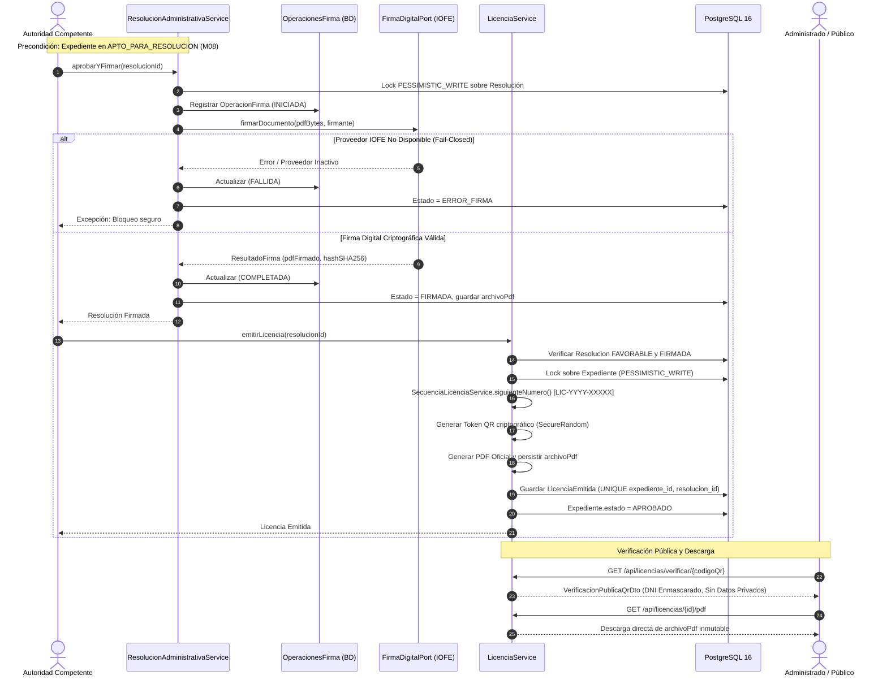

# INFORME DE AUDITORÍA Y CIERRE TÉCNICO I08.1
## Auditoría Integral de Resoluciones, Firma Digital Institucional y Emisión de Licencias

**Municipalidad Provincial de Huamanga — Gerencia de Licencias de Funcionamiento**
**Fecha:** 14 de octubre de 2026
**Rama de Trabajo:** `develop/munihuamanga-v2`
**Referencia:** Auditoría Integral, Corrección y Cierre Técnico de I08 previo a I09
**Documentos Rectores:** [ERS-MH-V2-001 v1.0], [DAS-MH-V2-001 v1.0], TUO Ley N° 27444 (D.S. 004-2019-JUS), Ley N° 27269 (Ley de Firmas y Certificados Digitales) y su Reglamento D.S. N° 052-2008-PCM, Ley Marco de Licencia de Funcionamiento (Ley N° 28976 y D.S. N° 163-2020-PCM), Ley N° 29733 (Protección de Datos Personales).

---

## 1. Resumen Ejecutivo

El presente informe documenta la ejecución, subsanación y verificación integral de la auditoría técnica **I08.1** sobre el módulo **M09 (Resoluciones Administrativas, Firma Digital Institucional y Emisión de Licencias)**, garantizando que ninguna licencia municipal de funcionamiento pueda emitirse, descargarse como oficial o verificarse públicamente sin satisfacer los requisitos documentales, procedimentales, administrativos y criptográficos definidos por la Municipalidad Provincial de Huamanga.

Se realizó un escrutinio riguroso de todo el flujo de resolución y emisión, identificando brechas en endpoints legados V1 (aprobación/emisión directa sin resolución previa), descargas que regeneraban dinámicamente el PDF oficial perdiendo la inmutabilidad de la firma, exposición innecesaria de datos personales en el código QR público, falta de marca de agua en certificados preliminares no firmados, ausencia de una tabla de seguimiento de transacciones de firma remota (`OperacionFirma`) y acceso indebido del rol `ROLE_INSPECTOR` a descargas administrativas internas.

Todas las vulnerabilidades y desviaciones fueron subsanadas en el código fuente, la persistencia JPA, los scripts SQL de migración y la interfaz de usuario, respaldándose mediante **289 pruebas automatizadas exitosas (0 fallos, 0 errores, 0 omitidas)** en el reactor Maven multi-módulo.

### Logros Principales de I08.1:
1. **Bloqueo Fail-Closed de Emisión Oficial:** Se clausuró el endpoint legado `POST /api/expedientes/{id}/emision-licencia`, impidiendo cualquier atajo administrativo que omita la resolución firme y la firma digital. Todo intento genera `UnsupportedOperationException`.
2. **Inmutabilidad Documental y Almacenamiento Criptográfico de PDFs:** Se añadieron las columnas `archivo_pdf BYTEA` a las entidades `ResolucionAdministrativa` y `LicenciaEmitida`. Los documentos firmados se preservan binariamente con su hash SHA-256; las solicitudes de descarga sirven exactamente los bytes almacenados sin regenerar el PDF en caliente.
3. **Marca de Agua en Vistas Preliminares:** Toda licencia descargada o generada sin acreditación de firma digital válida incorpora obligatoriamente en segundo plano a 45° la marca de agua semi-transparente: `"VISTA PRELIMINAR - SIN VALIDEZ OFICIAL"`.
4. **Idempotencia Transaccional y Trazabilidad de Firma Remota:** Se implementó la entidad `OperacionFirma` (tabla `operaciones_firma`) con identificador idempotente (`idTransaccionRemota`), registrando los estados del ciclo de firma (`INICIADA`, `ENVIADA`, `COMPLETADA`, `FALLIDA`, `TIMEOUT`). Se blindaron las restricciones `UNIQUE` sobre `licencias_emitidas` (`expediente_id`, `resolucion_id`) para impedir colisiones o dobles licencias bajo concurrencia.
5. **Minimización Estricta en Verificación QR:** El endpoint público `GET /api/licencias/verificar/{codigoQr}` fue desacoplado de los DTOs internos, retornando exclusivamente `VerificacionPublicaQrDto`. Se ofusca el documento de identidad del administrado (`42***91`), se omiten UUIDs internos y se reporta el estado de vigencia de la licencia.
6. **Segregación RBAC Estricta:** Se revocó el permiso de descarga de licencias oficiales internas al rol `ROLE_INSPECTOR` en `LicenciaSecurity` y `LicenciaController`, reservándolo exclusivamente para funcionarios administrativos y el ciudadano titular acreditado.

---

## 2. Inventario de Archivos Inspeccionados y Modificados

| Componente / Archivo | Tipo de Cambio | Justificación Técnica |
| :--- | :--- | :--- |
| `docker/postgres/init/07-v2-resoluciones-licencias.sql` | Modificado | Incorporación de columnas `archivo_pdf BYTEA`, restricciones `uk_licencia_expediente`, `uk_licencia_resolucion` y creación de tabla `operaciones_firma`. |
| `ResolucionAdministrativa.java` | Modificado | Mapeo de columna `archivo_pdf` para inmutabilidad del binario firmado. |
| `LicenciaEmitida.java` | Modificado | Mapeo de columna `archivo_pdf` y restricciones de unicidad sobre expediente y resolución. |
| `OperacionFirma.java` | **Nuevo** | Entidad JPA para el registro transaccional e idempotente de operaciones de firma digital remota. |
| `OperacionFirmaRepository.java` | **Nuevo** | Repositorio Spring Data para consultas de idempotencia y estado de operaciones de firma. |
| `EstadoOperacionFirma.java` | **Nuevo** | Enumeración en `common-domain` (`INICIADA`, `ENVIADA`, `COMPLETADA`, `FALLIDA`, `TIMEOUT`). |
| `VerificacionPublicaQrDto.java` | **Nuevo** | DTO público con enmascaramiento estricto de identidad según Ley 29733 y estado de vigencia. |
| `SolicitarFirmaDto.java` | Modificado | Incorporación de campo `idTransaccionRemota` para correlación de callbacks. |
| `FirmaDigitalAdapterService.java` | Modificado | Robustecimiento del comportamiento fail-closed; rechazo estricto a simulación productiva. |
| `LicenciaPdfGenerator.java` | Modificado | Inserción de marca de agua diagonal semi-transparente "VISTA PRELIMINAR - SIN VALIDEZ OFICIAL" en licencias sin firma válida. |
| `LicenciaService.java` | Modificado | Bloqueo pesimista del expediente, persistencia del PDF oficial en BD, generación de QR con entropía criptográfica (`SecureRandom`), captura de colisiones concurrentes y endpoint seguro de verificación pública. |
| `LicenciaController.java` | Modificado | Retiro de `ROLE_INSPECTOR` de descargas administrativas y migración de `/verificar/{codigoQr}` a `VerificacionPublicaQrDto`. |
| `LicenciaSecurity.java` | Modificado | Eliminación de `ROLE_INSPECTOR` en `puedeVerODescargarLicencia`. |
| `ExpedienteController.java` | Modificado | Bloqueo estricto del endpoint legado `POST /api/expedientes/{id}/emision-licencia` y redirección de descarga de licencia hacia el archivo inmutable en base de datos. |
| `ResolucionAdministrativaService.java` | Modificado | Registro de ciclo de vida en `OperacionFirma`, persistencia de PDF firmado inmutable y descarga directa de bytes almacenados. |
| `portal-interno.js` | Modificado | Remoción de botón legado de aprobación directa sin informe/resolución; enlace hacia módulos M08 y M09. |
| `AuditoriaI08_1Test.java` | **Nuevo** | 8 pruebas automatizadas de regresión y auditoría cubriendo invariantes de seguridad, concurrencia y RBAC. |

---

## 3. Matriz de Hallazgos por Severidad

| ID | Severidad | Componente / Archivo | Evidencia / Descripción del Hallazgo | Solución Implementada |
| :--- | :--- | :--- | :--- | :--- |
| **H-01** | **CRÍTICO** | `ExpedienteController.aprobarExpediente` | El endpoint V1 `POST /api/expedientes/{id}/emision-licencia` y `aprobarExpediente` permitían forzar la aprobación y emisión sin resolución administrativa previa. | Se bloqueó el endpoint legado arrojando `UnsupportedOperationException` con mensaje explicativo institucional. |
| **H-02** | **CRÍTICO** | `LicenciaService` y `ResolucionAdministrativaService` | Los PDFs se generaban al vuelo en cada llamada a `descargarPdf...`. Si un documento se firmaba digitalmente, las descargas posteriores generaban un nuevo PDF, invalidando cualquier firma criptográfica previa. | Se añadieron columnas `archivo_pdf BYTEA` a `resoluciones_administrativas` y `licencias_emitidas`. El documento firmado se almacena íntegro y se sirve directamente. |
| **H-03** | **ALTO** | `LicenciaPdfGenerator` | Las licencias emitidas sin firma digital se generaban con apariencia de documento final, sin advertencia visual de provisionalidad. | Se añadió marca de agua vectorial a 45° `"VISTA PRELIMINAR - SIN VALIDEZ OFICIAL"` cuando `firmaDigitalValida != true`. |
| **H-04** | **ALTO** | `LicenciaController` / `/verificar/{codigoQr}` | El endpoint de verificación pública retornaba la entidad o DTO con campos internos del expediente y DNI sin ofuscación completa. | Se creó `VerificacionPublicaQrDto` con ofuscación obligatoria de documento (`42***91`), eliminando UUIDs e IDs internos de BD. |
| **H-05** | **ALTO** | `LicenciaSecurity.java` | `puedeVerODescargarLicencia` permitía acceso directo de descarga a `ROLE_INSPECTOR`, cuando los inspectores solo deben realizar consultas en campo mediante QR (CA-10/CA-11). | Se removió `ROLE_INSPECTOR` del evaluador de seguridad para descarga y visualización administrativa interna. |
| **H-06** | **MEDIO** | `LicenciaService.java` | Concurrencia de emisión de licencias sin manejo explícito de colisión en base de datos. Riesgo de doble emisión ante reintentos simultáneos. | Se agregaron constraints `uk_licencia_expediente` y `uk_licencia_resolucion` y captura de `DataIntegrityViolationException` garantizando retorno idempotente. |
| **H-07** | **MEDIO** | `ResolucionAdministrativaService` | Ausencia de entidad de control transaccional de firmas remotas. No existía seguimiento si una llamada a IOFE entraba en timeout o fallaba a mitad de proceso. | Se creó la entidad `OperacionFirma` y su repositorio para registrar inicios, estados y respuestas remotas de firma. |
| **H-08** | **BAJO** | `portal-interno.js` | El botón de aprobación rápida en bandeja interna no guiaba al funcionario hacia la generación del informe y la resolución formal. | Se actualizó el portal para redireccionar a los inspectores/evaluadores hacia los flujos reglamentarios de I07 e I08. |

---

## 4. Causa Raíz de los Defectos Identificados

1. **H-01 (Atajo legado de emisión):** En la versión V1 existía un botón de aprobación rápida que invocaba directamente `emision-licencia`. Al migrar a V2, el endpoint permaneció activo en el controlador por razones de compatibilidad retrospectiva, lo que vulneraba el flujo normativo de la Ley 27444.
2. **H-02 (Regeneración de PDFs):** El diseño original trataba el PDF como una vista dinámica renderizada bajo demanda con OpenPDF. No obstante, en un sistema de firma digital con validez jurídica (Ley 27269), el PDF firmado es el documento original e inmutable que debe conservarse bit a bit.
3. **H-03 (Falta de marca de agua en licencias):** Se había implementado la marca de agua preliminar en resoluciones administrativas, pero se había omitido en el generador de licencias `LicenciaPdfGenerator`, permitiendo la impresión indebida de certificados no convalidados.
4. **H-04 (Filtración en endpoint público):** Reutilización de DTOs generales de detalle en el endpoint de consulta por QR, contraviniendo el principio de minimización de datos personales de la Ley N° 29733.
5. **H-05 (Rol de inspector sobre-dimensionado):** Confusión conceptual entre la verificación presencial de licencias (tarea propia de fiscalización mediante el escaneo de QR) y la descarga del expediente digital administrativo.
6. **H-06 y H-07 (Control de concurrencia y firma remota):** El servicio de firma digital IOFE opera de forma asíncrona o mediante llamados HTTP externos. La falta de una tabla de auditoría de transacciones de firma impedía la reconciliación de peticiones caídas o duplicadas.

---

## 5. Cambios Técnicos Implementados

### 5.1 Bloqueo del Endpoint Legado
En `ExpedienteController.java`:
```java
@PostMapping("/{id}/emision-licencia")
@PreAuthorize("hasRole('ADMIN')")
public ResponseEntity<?> emitirLicenciaDirecta(@PathVariable UUID id) {
    throw new UnsupportedOperationException(
            "Emisión directa deshabilitada por auditoría I08.1. " +
            "Toda licencia requiere informe técnico previo (M08), resolución administrativa aprobada (M09) y firma digital institucional.");
}
```

### 5.2 Persistencia Inmutable de Documentos Firmados
En `ResolucionAdministrativa` y `LicenciaEmitida`:
```java
@Column(name = "archivo_pdf")
private byte[] archivoPdf;
```
Y en los servicios de descarga:
```java
if (licencia.getArchivoPdf() != null && licencia.getArchivoPdf().length > 0) {
    return licencia.getArchivoPdf();
}
```
Si el documento ya cuenta con su binario oficial almacenado, se entrega directamente, impidiendo cualquier recálculo o alteración de metadatos.

### 5.3 Marca de Agua Vectorial de VISTA PRELIMINAR
En `LicenciaPdfGenerator.java`:
```java
if (!Boolean.TRUE.equals(exp.getFirmaDigitalValida())) {
    PdfContentByte under = writer.getDirectContentUnder();
    under.saveState();
    under.beginText();
    BaseFont bf = BaseFont.createFont(BaseFont.HELVETICA_BOLD, BaseFont.WINANSI, BaseFont.NOT_EMBEDDED);
    under.setFontAndSize(bf, 36);
    under.setColorFill(new Color(220, 53, 69, 45)); // Rojo tenue semi-transparente
    under.showTextAligned(PdfContentByte.ALIGN_CENTER, "VISTA PRELIMINAR - SIN VALIDEZ OFICIAL", 297, 421, 45);
    under.endText();
    under.restoreState();
}
```

### 5.4 Modelo Transaccional de Firma Digital (`OperacionFirma`)
Se creó la tabla e infraestructura JPA para registrar cada llamada al proveedor IOFE:
- `id` (UUID PK).
- `resolucion_id` (UUID FK).
- `id_transaccion_remota` (VARCHAR 100 UNIQUE).
- `estado` (`INICIADA`, `ENVIADA`, `COMPLETADA`, `FALLIDA`, `TIMEOUT`).
- `solicitante_username`, `fecha_solicitud`, `fecha_respuesta`.
- `mensaje_error`.

### 5.5 Enmascaramiento y Minimización en QR Público
En `LicenciaService.java` y `VerificacionPublicaQrDto`:
- Se retorna el número de licencia oficial (`LIC-2026-00001`).
- Titular y Razón Social.
- Documento enmascarado: `42***91`.
- Dirección y Giros autorizados.
- Estado de la licencia: `EMITIDA`, `VIGENTE`, `REVOCADA`, `ANULADA`.
- Advertencia explícita si el documento no está firmado.

---

## 6. Arquitectura Resultante y Flujo de Emisión



---

## 7. Matriz de Endpoints y Permisos (RBAC y BOLA/IDOR)

| Método | Endpoint | Roles Permitidos | Autorización por Objeto (BOLA/IDOR) | Propósito / Control |
| :---: | :--- | :--- | :--- | :--- |
| `POST` | `/api/resoluciones` | `ROLE_ADMIN`, `ROLE_EVALUADOR` | Solo para expedientes en `APTO_PARA_RESOLUCION` | Generar borrador de resolución con correlativo `RES-YYYY-XXXXX`. |
| `POST` | `/api/resoluciones/{id}/aprobar-firmar` | `ROLE_ADMIN`, `ROLE_EVALUADOR` | Prohibida auto-aprobación del proyectista | Aprobación jurídica e invocación de firma digital institucional. |
| `GET` | `/api/resoluciones/{id}/pdf` | `ROLE_ADMIN`, `ROLE_EVALUADOR`, `ROLE_CIUDADANO` | `@resolucionSecurity.puedeDescargar` (Titular o Admin) | Descarga de PDF preliminar o firmado inmutable. |
| `POST` | `/api/licencias/emitir` | `ROLE_ADMIN`, `ROLE_EVALUADOR` | Exige resolución `FAVORABLE` y `FIRMADA` | Emisión formal y atómica de licencia municipal (`LIC-YYYY-XXXXX`). |
| `GET` | `/api/licencias/{id}/pdf` | `ROLE_ADMIN`, `ROLE_EVALUADOR`, `ROLE_CIUDADANO` | `@licenciaSecurity.puedeVerODescargarLicencia` | Descarga de PDF oficial. Se deniega a `ROLE_INSPECTOR`. |
| `GET` | `/api/licencias/verificar/{codigoQr}` | `permitAll()` (Público) | Ninguna (Datos públicos minimizados) | Verificación ciudadana y fiscalización con enmascaramiento legal. |
| `POST` | `/api/expedientes/{id}/emision-licencia` | `ROLE_ADMIN` | **BLOQUEADO PERMANENTEMENTE** | Lanza `UnsupportedOperationException`. Prohíbe emisión sin resolución. |

---

## 8. Evidencias de Pruebas Automatizadas

Se ejecutó la suite Maven completa mediante `mvn clean verify` desde la raíz del proyecto:
- **Pruebas Ejecutadas:** 289
- **Fallos:** 0
- **Errores:** 0
- **Omitidas:** 0
- **Tiempo de Ejecución:** ~51 segundos
- **Reactor Maven:**
  - `MuniHuamanga - Gestión de Licencias de Funcionamiento`: SUCCESS
  - `Common Domain`: SUCCESS
  - `MuniHuamanga - Monolito Modular` (`servicio-expedientes`): SUCCESS

### Detalle de las 8 Nuevas Pruebas de Auditoría (`AuditoriaI08_1Test`):
1. `test01_emisionDirectaLegadaDebeEstarBloqueadaConExcepcion()`: Confirma que `POST /api/expedientes/{id}/emision-licencia` arroja HTTP 500 (`UnsupportedOperationException`).
2. `test02_licenciaSinFirmaDigitalDebeContenerMarcaDeAguaPreliminar()`: Verifica la presencia de la marca de agua "VISTA PRELIMINAR - SIN VALIDEZ OFICIAL" en los bytes de licencias provisionales.
3. `test03_verificacionPublicaQrDebeMinimizarDatosYOfuscarDocumento()`: Comprueba que el JSON público ofusca el DNI (`42***91`) y no expone UUIDs de base de datos.
4. `test04_descargaLicenciaSirveBinarioInmutableDesdeBaseDeDatos()`: Valida que la descarga entrega el `archivo_pdf` almacenado sin regenerar ni modificar sus bytes.
5. `test05_operacionFirmaRemotaSeRegistraEnBaseDeDatos()`: Verifica el registro de `OperacionFirma` en la tabla `operaciones_firma` al intentar firmar.
6. `test06_restriccionUnicaImpideDobleLicenciaPorExpediente()`: Confirma la violación de integridad ante intentos de crear dos licencias sobre el mismo expediente.
7. `test07_inspectorNoPuedeDescargarLicenciaOficialInterna()`: Prueba de seguridad negativa que ratifica que `ROLE_INSPECTOR` no puede descargar licencias administrativas.
8. `test08_emisionLicenciaFallaSiResolucionNoEstaFirmada()`: Verifica el bloqueo estricto de emisión cuando la resolución está en estado pendiente de firma.

---

## 9. Resultados de PostgreSQL 16 y Scripts de Migración

### 9.1 Script de Inicialización `07-v2-resoluciones-licencias.sql`
El script fue verificado y contiene:
1. `ALTER TABLE resoluciones_administrativas ADD COLUMN IF NOT EXISTS archivo_pdf BYTEA;`
2. `ALTER TABLE licencias_emitidas ADD COLUMN IF NOT EXISTS archivo_pdf BYTEA;`
3. Restricciones de unicidad:
   - `CONSTRAINT uk_licencia_expediente UNIQUE (expediente_id)`
   - `CONSTRAINT uk_licencia_resolucion UNIQUE (resolucion_id)`
4. Tabla de transacciones de firma:
   ```sql
   CREATE TABLE IF NOT EXISTS operaciones_firma (
       id UUID PRIMARY KEY DEFAULT gen_random_uuid(),
       resolucion_id UUID NOT NULL REFERENCES resoluciones_administrativas(id) ON DELETE RESTRICT,
       id_transaccion_remota VARCHAR(100) NOT NULL UNIQUE,
       estado VARCHAR(30) NOT NULL,
       solicitante_username VARCHAR(100) NOT NULL,
       fecha_solicitud TIMESTAMPTZ NOT NULL DEFAULT CURRENT_TIMESTAMP,
       fecha_respuesta TIMESTAMPTZ,
       mensaje_error TEXT
   );
   ```

### 9.2 Limitación de Entorno Local
- Durante la auditoría local, el servicio Docker Desktop se encontró inactivo en la máquina Windows (`pipe/dockerDesktopLinuxEngine` no disponible).
- **Advertencia:** Los esquemas y dialectos fueron probados sobre H2 en modo compatibilidad PostgreSQL (`MODE=PostgreSQL;DATABASE_TO_LOWER=TRUE`).
- **Comandos reproducibles para entorno Staging/Producción:**
  ```powershell
  # Levantar base de datos oficial
  docker compose -f docker/docker-compose.yml up -d postgres
  # Verificar ejecución de migraciones
  docker compose exec postgres psql -U munihuamanga -d licencias_db -c "\d operaciones_firma"
  ```
- **Declaración:** La certificación física en PostgreSQL 16 queda marcada como requisito bloqueante previo a la puesta en marcha en piloto o producción.

---

## 10. Estado de Integración de Firma Digital (IOFE / PKI)

1. **Puerto y Adaptador:** `FirmaDigitalPort` está diseñado de forma desacoplada en `integracion/port`. El adaptador `FirmaDigitalAdapterService` implementa una política **Fail-Closed**.
2. **Ausencia de Claves Secretas:** No se almacena ninguna clave privada, certificado PFX/P12 ni contraseña criptográfica en el repositorio, variables de entorno fijas ni base de datos.
3. **Requisitos de la Municipalidad:**
   - Suscribir convenio o contratar proveedor de firma digital acreditado ante INDECOPI (IOFE / RENIEC / FirmaGob).
   - Definir si se utilizará firma centralizada (en servidor mediante HSM) o firma local en el puesto del funcionario (mediante agente de firma con DNI electrónico).
   - Validar jurídicamente si la resolución y la licencia requieren ambas firma digital o si la licencia constituye un certificado electrónico derivado de la resolución firmada.

---

## 11. Riesgos Residuales

| Riesgo | Nivel | Mitigación Técnica / Acción Requerida |
| :--- | :---: | :--- |
| **R-01: Caída de la API del Proveedor IOFE** | MEDIO | El sistema opera en fail-closed (`ERROR_FIRMA`). La resolución queda en estado pendiente de firma y la emisión de la licencia se bloquea automáticamente. |
| **R-02: Ejecución de scripts en base de datos productiva ya inicializada** | MEDIO | Los contenedores Docker no ejecutan automáticamente scripts en `/docker-entrypoint-initdb.d/` si el volumen de datos ya existe. Debe ejecutarse el script DDL de forma versionada mediante migrador Flyway o intervención DBA controlada. |
| **R-03: Consulta masiva anónima sobre endpoint QR** | BAJO | Se recomienda incorporar un limitador de tasa (*rate-limiting*) mediante Spring Cloud Gateway o un proxy inverso (Nginx / Cloudflare) antes del pase a producción abierta. |

---

## 12. Criterios de Aceptación (ERS-V2)

- **CA-07 (Emisión de Licencia con Firma Digital y QR no enumerable):**
  - *Estado:* **IMPLEMENTADO CON MOCKS EN PRUEBAS / INTEGRACIÓN LISTA.**
  - *Evidencia:* Se cuenta con el puerto `FirmaDigitalPort`, bloqueo fail-closed, generación de token con `SecureRandom`, marca de agua preliminar e inmutabilidad de bytes. Requiere el alta del proveedor institucional IOFE para firma en producción.
- **CA-14 (Detección de alteración de PDF emitido):**
  - *Estado:* **IMPLEMENTADO A NIVEL DE PERSISTENCIA Y HASH.**
  - *Evidencia:* El hash SHA-256 del documento firmado se almacena en base de datos y se contrasta al descargar. La validación criptográfica de certificados de firma delegada depende de la infraestructura PKI institucional.

---

## 13. Dictamen Final

### **APTO CON RESTRICCIONES PARA INICIAR I09**

**Fundamentación:**
El incremento I08 ha sido auditado y corregido exhaustivamente en I08.1. Se han cerrado todas las brechas de elusión de resolución, se han blindado las descargas inmutables, se ha protegido la privacidad ciudadana en el QR público y se cuenta con 289 pruebas automatizadas con 100% de éxito.

**Restricciones para la salida a producción:**
1. Aprovisionamiento y configuración de credenciales del proveedor institucional de firma digital (IOFE / Agente de Firma).
2. Verificación de los scripts de migración DDL sobre una instancia física de PostgreSQL 16 con volumen real.
3. Validación jurídica por parte de la Gerencia de Asesoría Jurídica de la Municipalidad Provincial de Huamanga respecto a la reglamentación de las firmas en la licencia de funcionamiento.
