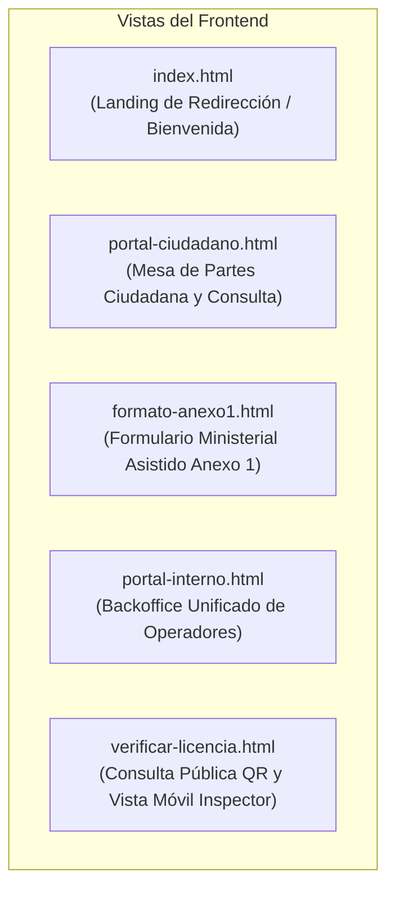

# Guía de Interfaces de Usuario (Frontend) — MuniHuamanga V2
## Manual de Diseño Visual, Componentes Web e Integración con APIs

**Proyecto:** Sistema de Gestión de Licencias de Funcionamiento
**Entidad:** Municipalidad Provincial de Huamanga (Ayacucho, Perú)
**Fecha:** 14 de octubre de 2026
**Documento Canónico:** Especificación de Frontend V2
**Código:** DAS-MH-V2-001 • UI-FRONTEND-V2

---

## 1. Identidad Visual y Sistema de Diseño

El frontend de MuniHuamanga V2 está implementado con **HTML5 semántico, CSS3 Vanilla (tokens con variables CSS) y JavaScript Vanilla moderno**, optimizado para carga rápida en cualquier navegador web sin sobrecargas de frameworks pesados de renderizado.

### 1.1. Paleta de Colores Institucional

Inspirada en los símbolos heráldicos de la Municipalidad Provincial de Huamanga y los estándares de gobierno digital del Perú:

| Token CSS | Código Hex | Muestra | Significado / Uso |
|---|:---:|:---:|---|
| `--primary` | `#003366` | 🟦 | Azul Marino Institucional (Cabeceras y botones principales) |
| `--primary-dark` | `#001f3f` | 🟦 | Azul Huamanga Profundo (Gradientes de fondo y contraste) |
| `--huamanga-red` | `#991b1b` | 🟥 | Rojo Carmesí Oficial de Huamanga (Acentos institucionales) |
| `--huamanga-gold` | `#d97706` | 🟨 | Dorado Heráldico (Líneas divisorias y estados de advertencia) |
| `--success` | `#059669` | 🟩 | Verde Esmeralda (Aprobado, pagado, validado con éxito) |
| `--danger` | `#dc2626` | 🟥 | Rojo Alerta (Rechazado, error de firma, anulado) |
| `--warning` | `#eab308` | 🟨 | Amarillo Ámbar (Pendiente de pago, observado) |
| `--bg-main` | `#f8fafc` | ⬜ | Gris Claro Pizarra (Fondo general de la aplicación) |
| `--surface` | `#ffffff` | ⬜ | Blanco Puro (Tarjetas, modales y tablas) |
| `--text-main` | `#0f172a` | ⬛ | Gris Oscuro Casi Negro (Tipografía principal de alto contraste) |
| `--text-muted` | `#64748b` | ◻️ | Gris Neutro (Metadatos, subtítulos y fechas) |

### 1.2. Tipografía y Estilo Base
- **Familia Tipográfica:** `'Segoe UI', system-ui, -apple-system, sans-serif`.
- **Escala Modular:** Encabezados (`1.5rem` a `2rem`), cuerpo de texto (`0.95rem`), metadatos y badges (`0.75rem` a `0.85rem`).
- **Contraste de Accesibilidad:** Cumple WCAG 2.1 nivel AA con ratios de contraste superiores a 4.5:1 en textos principales.

---

## 2. Inventario de Páginas y Vistas

### 2.1. Portal Ciudadano (`portal-ciudadano.html` / `portal-ciudadano.js`)
* **Propósito:** Permitir a los administrados registrar solicitudes, consultar el estado de su trámite mediante su código de expediente (`EXP-YYYY-XXXXX`), subir documentos de subsanación y descargar formatos oficiales en PDF.
* **Componentes:**
  - Hero banner con accesos rápidos ("Nuevo Trámite" y "Seguimiento de Expediente").
  - Formulario de consulta con tarjeta de resultados en tiempo real.
  - Modal de mesa de ayuda ("¿Cómo se tramita?").
* **Brecha Identificada en Fase A:** Actualmente invoca `POST /api/expedientes` directo; está pendiente la conexión con la API de Borradores V2 (`POST /api/borradores`).

### 2.2. Formulario Asistido Anexo 1 (`formato-anexo1.html` / `formato-anexo1.js`)
* **Propósito:** Formulario interactivo por pasos para la captura de los 45 campos normativos del Anexo 1 (D.S. N° 163-2020-PCM).
* **Componentes:**
  - Barra de progreso por pasos (Paso 1: Solicitante, Paso 2: Establecimiento y Zonificación, Paso 3: Anexo 4 y Declaración Jurada).
  - Autocalculadora del nivel de riesgo ITSE en cliente según función de edificación y área ($m^2$).
  - Validadores sintácticos de DNI (8 dígitos) y RUC (11 dígitos, prefijo 10 o 20).

### 2.3. Portal Interno de Gestión (`portal-interno.html` / `portal-interno.js`)
* **Propósito:** Consola web unificada para funcionarios municipales con control de acceso por roles (RBAC).
* **Pestañas de Navegación:**
  1. **Expedientes:** Bandeja maestra con filtros por estado, búsqueda textual y tabla con badges de los 10 estados V2.
  2. **Pagos:** Módulo SAT para calificación manual de abonos (`VALIDADO_MANUALMENTE`, `OBSERVADO`, `RECHAZADO`).
  3. **Evaluación:** Registro de dictamen técnico y elaboración de informes administrativos previos.
  4. **Zonificación:** Verificación de compatibilidad de uso PDU y gestión de solicitudes de rectificación de ubicación.
  5. **Resoluciones:** Bandeja de emisión y firma digital de actos resolutivos con política fail-closed.
  6. **Licencias:** Generación y descarga del Certificado Oficial con código QR.
  7. **TUPA:** Edición en caliente de tasas y conceptos arancelarios.
  8. **Operadores:** Alta de cuentas institucionales para evaluadores, cajeros e inspectores (`ROLE_ADMIN`).
* **Seguridad:** Gestión de token JWT en `localStorage`; interceptación de respuestas 401/403 con redirección al modal de login.

### 2.4. Módulo de Verificación Móvil (`verificar-licencia.html` / `verificar-licencia.js`)
* **Propósito:** Verificación en campo de licencias comerciales escaneando el código QR impreso en el certificado físico.
* **Comportamiento Diferenciado:**
  - **Vista Pública (Anónimo):** Extrae el token de la URL (`?token=...`), invoca `GET /api/public/licencias/{token}` y muestra exclusivamente datos no sensibles (razón social, giro, dirección pública, estado de vigencia).
  - **Vista de Inspector Municipal:** Botón de autenticación institucional en la esquina superior. Tras iniciar sesión con `ROLE_INSPECTOR`, invoca `GET /api/licencias/inspeccion/{token}` y despliega:
    - Coordenadas geográficas exactas (latitud, longitud).
    - Mapa interactivo integrado con **Leaflet 1.9.4** y OpenStreetMap.
    - Marcador de localización con popup de información técnica.

---

## 3. Estados Visuales y Badges de Expedientes

La interfaz interna estandariza los colores de los 10 estados de V2 para rápida identificación visual:

| Estado del Expediente | Color de Fondo | Color de Texto | Significado Operativo |
|---|:---:|:---:|---|
| `REGISTRADO` | `#e2e8f0` | `#334155` | Recibido en mesa de partes |
| `PENDIENTE_PAGO` | `#fef9c3` | `#854d0e` | A la espera del comprobante SAT |
| `PAGO_OBSERVADO` | `#ffedd5` | `#9a3412` | Comprobante observado en caja |
| `EN_EVALUACION` | `#dbeafe` | `#1e40af` | En revisión técnica y zonificación |
| `OBSERVADO` | `#fee2e2` | `#991b1b` | Observación formal (plazo 5 días) |
| `APROBADA_CON_RESOLUCION` | `#f3e8ff` | `#6b21a8` | Resolución firmada digitalmente |
| `EMITIDO` | `#dcfce7` | `#166534` | Licencia oficial emitida |
| `ENTREGADO` | `#d1fae5` | `#065f46` | Certificado puesto a disposición |
| `DENEGADO` | `#fecaca` | `#7f1d1d` | Trámite desestimado por resolución |
| `ANULADO` | `#f1f5f9` | `#64748b` | Desistimiento o nulidad de oficio |

---

## 4. Estándares de Accesibilidad y Responsividad

1. **Diseño Adaptativo (Mobile-First y Desktop):**
   - Vistas móviles optimizadas (`@media (max-width: 768px)`) con menús colapsables y tablas con scroll horizontal asistido.
   - La vista de verificación QR está diseñada específicamente para pantallas de smartphones en campo.
2. **Componentes Accesibles:**
   - Formularios con etiquetas explícitas `<label for="...">`.
   - Modales con captura de foco y cierre accesible mediante tecla `Escape`.
   - Mensajes de retroalimentación inmediata (Toasts y Alerts) con roles ARIA.
3. **Manejo de Errores y Carga:**
   - Spinners visuales durante llamadas asíncronas con `fetch`.
   - Manejo de excepciones RFC-7807 retornadas por Spring Boot (`GlobalExceptionHandler`).
