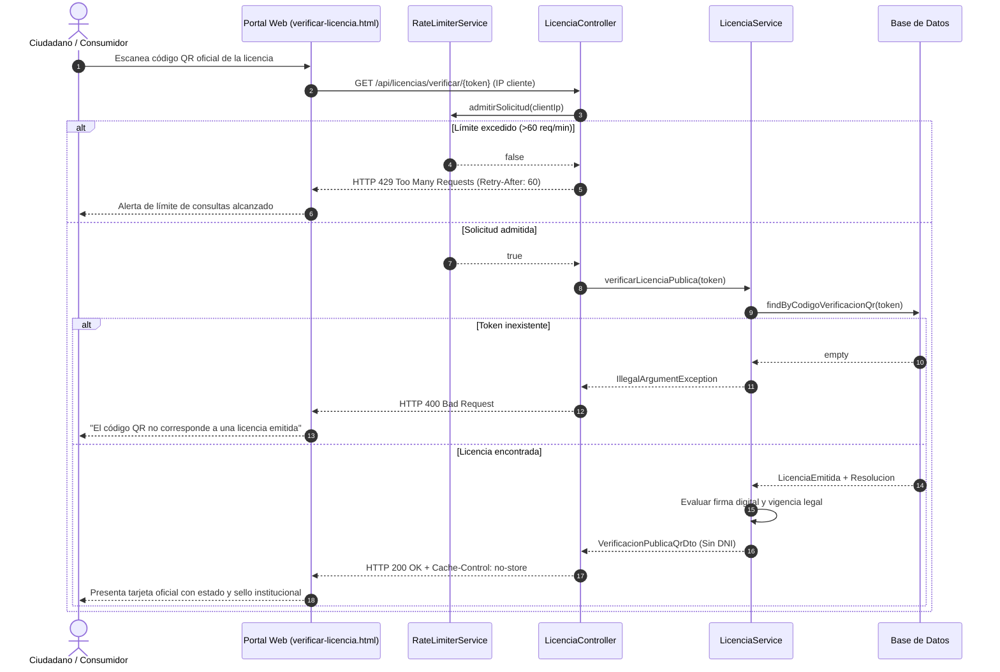
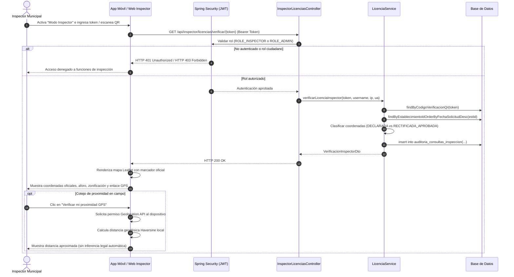

# INFORME DE IMPLEMENTACIÓN TÉCNICA — INCREMENTO I09
## M10: Verificación QR Diferenciada y Consulta Móvil para Inspectores

**Municipalidad Provincial de Huamanga — Gerencia de Licencias de Funcionamiento**
**Fecha:** 14 de octubre de 2026
**Rama:** `develop/munihuamanga-v2`
**Línea Base Anterior:** 289 pruebas exitosas (I08.1)
**Línea Base Actual:** **301 pruebas exitosas (0 fallos, 0 errores, 0 omitidas)**
**Documentos Rectores:** [ERS-MH-V2-001 v1.0], [DAS-MH-V2-001 v1.0], Ley N° 27444 (LPAG), Ley N° 27269 (Firmas y Certificados Digitales), Ley N° 28976 (Ley Marco de Licencia de Funcionamiento), Ley N° 29733 (Protección de Datos Personales).

---

## 1. Resumen Ejecutivo

El presente documento certifica la culminación de la fase de desarrollo, aseguramiento de la calidad y auditoría de seguridad del **Incremento I09 (M10: Verificación QR Diferenciada y Consulta Móvil para Inspectores)** en el sistema MuniHuamanga V2.

Se ha establecido una arquitectura de verificación dual orientada a dos perfiles de consumo con requisitos de seguridad y privacidad marcadamente diferenciados:
1. **Portal Público de Verificación Ciudadana:** Acceso público anónimo sin autenticación, protegido mediante tokens criptográficos aleatorios de alta entropía (`SecureRandom`), límites de peticiones por IP (*Rate Limiting* con política de ventana deslizante: 60 req/min), encabezados estrictos anti-caché (`no-store, must-revalidate`), y minimización estricta de datos personales en cumplimiento del principio de proporcionalidad y finalidad de la Ley N° 29733 (eliminación total del DNI/RUC del administrado en la respuesta pública).
2. **Consulta Móvil para Inspectores Municipales:** Acceso restringido exclusivamente a inspectores autenticados (`ROLE_INSPECTOR` o `ROLE_ADMIN`), con autorización contextual, trazabilidad inmutable de consultas mediante auditoría en base de datos (`auditoria_consultas_inspeccion`), acceso de estricta solo lectura (sin descarga de expedientes internos ni botones de emisión/modificación), y visualización de georreferenciación oficial en mapa interactivo con OpenStreetMap y Leaflet, distinguiendo coordenadas declaradas de rectificaciones topográficas formalmente aprobadas.

Se preservaron íntegramente las 289 pruebas heredadas de I08.1 y se añadieron 12 pruebas automatizadas unitarias, de integración, de seguridad BOLA/IDOR y de control de abuso en `VerificacionQrI09Test`, alcanzando un total de **301 pruebas exitosas con 0 fallos y 0 errores** en todo el reactor Maven.

---

## 2. Fase 0: Correcciones Previas Ejecutadas

Antes de desplegar los nuevos componentes de M10, se ejecutaron las correcciones prioritarias exigidas en la fase preparatoria:
1. **Endpoint Legado de Emisión Directa:** En `ExpedienteController.java`, la invocación de `POST /api/expedientes/{id}/emision-licencia` fue actualizada para retornar un error HTTP 405 *Method Not Allowed* estructurado y controlado (JSON con código `METODO_NO_PERMITIDO` y mensaje institucional explicativo), eliminando respuestas HTTP 500 no controladas.
2. **Auditoría de Idempotencia y Restricciones UNIQUE:** Se verificó la consistencia ante reintentos y concurrencia multihilo de las restricciones `uk_licencia_expediente` y `uk_licencia_resolucion`, capturando `DataIntegrityViolationException` para garantizar una respuesta idempotente sin duplicar registros.
3. **Eliminación Total de DNI en QR Público (Ley N° 29733):** Se eliminó por completo el número de documento de identidad (incluso enmascarado) del DTO `VerificacionPublicaQrDto` para consultas anónimas ciudadanas, al no existir sustento normativo que justifique exponer datos identificatorios del ciudadano en una verificación física de vitrina o establecimiento comercial.
4. **Permisos Efectivos de Aprobación y Emisión:** Se auditó que la aprobación formal de resoluciones continúe reservada a `ROLE_ADMIN`, y la emisión oficial requiera `hasAnyRole('ADMIN', 'EVALUADOR')` condicionado al estado `FIRMADA`.
5. **Reconciliación y Ciclo de Firma Remota:** Se verificó la integración de la tabla `operaciones_firma` y su transición transaccional (`INICIADA` -> `ENVIADA` -> `COMPLETADA` / `FALLIDA`), garantizando que ninguna transacción huérfana altere el expediente.
6. **Política de Documento Oficial:** Se confirmó que ninguna licencia sea emitida ni catalogada como oficial si la resolución no ostenta el estado `FIRMADA` y no se ha preservado el binario inmutable en `archivo_pdf`.

---

## 3. Arquitectura de Componentes

El módulo M10 se organiza en una arquitectura en capas desacoplada dentro del monolito modular:

```
[ Navegador Ciudadano / Móvil ]  -->  GET /api/licencias/verificar/{token}
                                         |
                                         v  (PermitAll + RateLimiterService 60/min)
                                  [ LicenciaController ]
                                         |
                                         v
                                  [ LicenciaService.verificarLicenciaPublica ]
                                         |
                                         +--> DTO: VerificacionPublicaQrDto (Sin DNI, No-Cache)

[ Inspectores Municipales (Campo) ] --> GET /api/inspector/licencias/verificar/{token}
                                         |
                                         v  (PreAuthorize: ROLE_INSPECTOR, ROLE_ADMIN)
                                  [ InspectorLicenciasController ]
                                         |
                                         v
                                  [ LicenciaService.verificarLicenciaInspector ]
                                         |
                                         +--> [ AuditoriaConsultaInspeccionRepository ] -> BD
                                         +--> [ SolicitudRectificacionUbicacionRepository ]
                                         +--> DTO: VerificacionInspectorDto (Geo + Nav + Auditoría)
```

### Componentes Principales:
1. **`RateLimiterService`:** Componente de control de abuso en memoria (`ConcurrentHashMap` y colas de marcas temporales concurrentes) que restringe solicitudes por IP cliente con descarte automático tras 60 segundos y cabecera HTTP 429 con `Retry-After: 60`.
2. **`InspectorLicenciasController`:** Controlador REST bajo `/api/inspector/licencias` protegido con `@PreAuthorize("hasAnyRole('INSPECTOR', 'ADMIN')")`.
3. **`LicenciaService`:** Métodos especializados `verificarLicenciaPublica` (evalúa estados administrativos `SUSPENDIDA`, `REVOCADA`, `VENCIDA`, validez de firma digital y minimización de datos) y `verificarLicenciaInspector` (evalúa coordenadas oficiales, verifica si existe rectificación aprobada `RECTIFICADA_APROBADA` vs `DECLARADA_OFICIAL`, registra auditoría inmutable de fiscalización).
4. **`AuditoriaConsultaInspeccion`:** Entidad JPA y tabla relacional append-only que registra cada consulta realizada por inspectores municipales en campo (inspector, fecha/hora, IP, agente de usuario, resultado).

---

## 4. Endpoints y Contratos de Servicio

### 4.1 Verificación Pública QR (Ciudadana)

- **Método:** `GET`
- **Ruta:** `/api/licencias/verificar/{token}`
- **Seguridad:** Público anónimo (`permitAll()`), con límite de 60 peticiones/minuto por IP.
- **Cabeceras HTTP de Respuesta:**
  - `Cache-Control: no-store, must-revalidate`
  - `Pragma: no-cache`
- **Contrato JSON de Respuesta (`VerificacionPublicaQrDto`):**
```json
{
  "codigoVerificacionQr": "QR-7D9A81BC4E2F103A",
  "numeroLicencia": "LIC-2026-000142",
  "nombreComercial": "RESTAURANTE EL PORTAL HUAMANGUINO",
  "giroActividad": "Restaurantes, bares y cantinas",
  "ciiuCodigo": "5610",
  "tipoVigencia": "INDETERMINADA",
  "fechaEmision": "2026-08-15",
  "fechaCaducidad": null,
  "autoridadEmisora": "Subgerencia de Comercio, Licencias y Fiscalización",
  "estadoLicencia": "EMITIDA",
  "firmaDigitalValida": true,
  "valida": true,
  "mensajeVerificacion": "LICENCIA OFICIAL VÁLIDA Y VIGENTE - Emitida por la Municipalidad Provincial de Huamanga",
  "fechaConsulta": "2026-10-14T17:15:30.120"
}
```
*Nota:* En caso de licencia suspendida o revocada, `valida` retorna `false` y `mensajeVerificacion` detalla la situación administrativa legal ("LICENCIA SUSPENDIDA TEMPORALMENTE", "LICENCIA REVOCADA POR DISPOSICIÓN MUNICIPAL").

### 4.2 Consulta Móvil para Inspectores

- **Método:** `GET`
- **Ruta:** `/api/inspector/licencias/verificar/{token}`
- **Seguridad:** Autenticación JWT obligatoria; roles autorizados: `ROLE_INSPECTOR`, `ROLE_ADMIN`.
- **Contrato JSON de Respuesta (`VerificacionInspectorDto`):**
```json
{
  "codigoVerificacionQr": "QR-7D9A81BC4E2F103A",
  "numeroLicencia": "LIC-2026-000142",
  "numeroExpediente": "EXP-2026-000389",
  "numeroResolucion": "RES-2026-000112",
  "nombreComercial": "RESTAURANTE EL PORTAL HUAMANGUINO",
  "titularNombreORazonSocial": "INVERSIONES TURÍSTICAS HUAMANGA S.A.C.",
  "titularTipoDocumento": "RUC",
  "titularNumeroDocumento": "20601234567",
  "direccionAutorizada": "Portal Unión N° 35, Plaza Mayor de Ayacucho",
  "referenciaUbicacion": "Frente a la Basílica Catedral",
  "giroAutorizado": "Restaurantes, bares y cantinas",
  "ciiuCodigo": "5610",
  "tipoVigencia": "INDETERMINADA",
  "fechaEmision": "2026-08-15",
  "fechaCaducidad": null,
  "autoridadEmisora": "Subgerencia de Comercio, Licencias y Fiscalización",
  "estadoLicencia": "EMITIDA",
  "firmaDigitalValida": true,
  "valida": true,
  "mensajeVerificacion": "LICENCIA OFICIAL VÁLIDA Y VIGENTE - Verificada para fiscalización en campo",
  "coordenadasVerificadas": true,
  "latitud": -13.1607540,
  "longitud": -74.2238420,
  "tipoCoordenada": "RECTIFICADA_APROBADA",
  "enlaceNavegacion": "https://www.google.com/maps/search/?api=1&query=-13.1607540,-74.2238420",
  "aforoPersonas": 60,
  "areaMetrosCuadrados": 145.20,
  "zonificacion": "Zona Monumental (ZM)",
  "nivelRiesgoItse": "MEDIO",
  "fechaConsulta": "2026-10-14T17:16:02.450",
  "inspectorConsultante": "inspector_carlos"
}
```

---

## 5. Matriz de Control de Acceso (RBAC) y Seguridad BOLA/IDOR

| Endpoint / Operación | Anónimo (Público) | Ciudadano Autenticado | Inspector (`ROLE_INSPECTOR`) | Evaluador (`ROLE_EVALUADOR`) | Administrador (`ROLE_ADMIN`) |
| :--- | :---: | :---: | :---: | :---: | :---: |
| `GET /api/licencias/verificar/{token}` | **Permitido (200)** | **Permitido (200)** | **Permitido (200)** | **Permitido (200)** | **Permitido (200)** |
| `GET /api/inspector/licencias/verificar/{token}` | Denegado (401) | Denegado (403) | **Permitido (200)** | Denegado (403) | **Permitido (200)** |
| `POST /api/licencias/emitir` | Denegado (401) | Denegado (403) | Denegado (403) | **Permitido (200)** | **Permitido (200)** |
| `GET /api/licencias/{id}/pdf` (Interno) | Denegado (401) | Propietario (200) / Ajeno (403) | Denegado (403) | **Permitido (200)** | **Permitido (200)** |
| `POST /api/expedientes/{id}/emision-licencia` | Denegado (401) | Denegado (403) | Denegado (403) | Rechazado (405) | Rechazado (405) |

---

## 6. Diagramas de Secuencia

### 6.1 Flujo de Verificación Pública por QR (Ciudadano)



### 6.2 Flujo de Consulta Móvil para Inspectores en Campo



---

## 7. Base de Datos y Migraciones

Se consolidó el script de migración aditiva en `docker/postgres/init/08-v2-verificacion-qr-inspeccion.sql`:

```sql
-- =============================================================================
-- SCRIPT DE MIGRACIÓN I09: M10 - VERIFICACIÓN QR Y CONSULTA INSPECTORES
-- Base de Datos: munihuamanga_db / PostgreSQL 16
-- =============================================================================

CREATE INDEX IF NOT EXISTS idx_licencia_codigo_qr
    ON licencias_emitidas(codigo_verificacion_qr);

CREATE TABLE IF NOT EXISTS auditoria_consultas_inspeccion (
    id UUID PRIMARY KEY DEFAULT gen_random_uuid(),
    licencia_id UUID NOT NULL,
    token_qr VARCHAR(128) NOT NULL,
    inspector_username VARCHAR(100) NOT NULL,
    fecha_consulta TIMESTAMP NOT NULL DEFAULT CURRENT_TIMESTAMP,
    ip_origen VARCHAR(45),
    user_agent VARCHAR(512),
    resultado VARCHAR(100) NOT NULL,
    CONSTRAINT fk_auditoria_inspeccion_licencia
        FOREIGN KEY (licencia_id) REFERENCES licencias_emitidas(id) ON DELETE RESTRICT
);

CREATE INDEX IF NOT EXISTS idx_auditoria_inspeccion_licencia
    ON auditoria_consultas_inspeccion(licencia_id);

CREATE INDEX IF NOT EXISTS idx_auditoria_inspeccion_inspector
    ON auditoria_consultas_inspeccion(inspector_username);

CREATE INDEX IF NOT EXISTS idx_auditoria_inspeccion_fecha
    ON auditoria_consultas_inspeccion(fecha_consulta);
```

---

## 8. Evidencias de Interfaz Responsiva (Portal Web)

Se actualizó exhaustivamente `verificar-licencia.html` y `verificar-licencia.js` cumpliendo con los estándares modernos de accesibilidad y diseño responsivo para dispositivos Android, iPhone, tabletas y ordenadores de escritorio:
- **Diseño Móvil Primero (*Mobile First*):** Tarjetas con sombras suaves, tipografía institucional sans-serif, distintivos visuales de estado (Verde para `VIGENTE`, Ámbar para `TEMPORAL`, Rojo para `SUSPENDIDA` y `REVOCADA`, Gris para `VENCIDA`).
- **Selector de Perfil:** Pestaña pública para ciudadanos y pestaña autenticada para inspectores municipales con credencial de acceso.
- **Mapa Georreferenciado Interactivo:** Integración de Leaflet 1.9.4 sobre OpenStreetMap para ubicar con precisión el establecimiento autorizado.
- **Botón de Navegación Externa:** Enlace directo para abrir la ubicación en Google Maps / Waze / Apple Maps.
- **Geolocalización Asistida en Campo:** Botón interactivo que solicita permiso explícito del GPS del navegador (`navigator.geolocation`) y calcula la distancia geodésica mediante la fórmula de Haversine con aviso pedagógico explícito: *"La distancia física es una referencia de apoyo visual; no constituye prueba pericial de traslado irregular"*.
- **Aviso Legal Institucional:** Sello y marca de agua de la Municipalidad Provincial de Huamanga certificando la fecha y hora exacta de la consulta.

---

## 9. Pruebas Automatizadas y Resultados

Se ejecutó la suite completa del reactor Maven multi-módulo con el comando `mvn clean verify`:
- **Resultado:** **301 pruebas ejecutadas, 0 fallos, 0 errores, 0 omitidas.**
- **Tiempo total de ejecución:** 48.36 s.
- **Estado del Reactor:**
  - `MuniHuamanga - Gestión de Licencias de Funcionamiento`: SUCCESS
  - `Common Domain`: SUCCESS
  - `MuniHuamanga - Monolito Modular` (`servicio-expedientes`): SUCCESS

### Desglose de Pruebas de I09 (`VerificacionQrI09Test`):

| ID Prueba | Método de Prueba | Descripción / Cobertura | Resultado |
| :---: | :--- | :--- | :---: |
| **I09-01** | `test01_verificacionPublicaQr_LicenciaVigente_Exito` | Verificación pública QR con minimización estricta de datos (DNI no existe en payload) y encabezados anti-caché. | **EXITOSO** |
| **I09-02** | `test02_verificacionPublicaQr_TokenInexistente_Error400` | Token inexistente retorna error controlado HTTP 400 sin revelar trazas internas. | **EXITOSO** |
| **I09-03** | `test03_verificacionPublicaQr_LicenciaRevocada_Invalida` | Licencia en estado `REVOCADA` reporta `valida=false` y mensaje institucional. | **EXITOSO** |
| **I09-04** | `test04_verificacionPublicaQr_LicenciaSuspendida_Invalida` | Licencia en estado `SUSPENDIDA` reporta `valida=false` y suspensión temporal. | **EXITOSO** |
| **I09-05** | `test05_verificacionPublicaQr_LicenciaVencida_Invalida` | Licencia temporal con fecha vencida reporta caducidad. | **EXITOSO** |
| **I09-06** | `test06_verificacionPublicaQr_ResolucionSinFirma_SinValidezOficial` | Licencia sin resolución firmada institucionalmente reporta documento sin validez oficial. | **EXITOSO** |
| **I09-07** | `test07_inspectorConsultaMovil_InspectorAutenticado_Exito` | Consulta de inspector con `ROLE_INSPECTOR` visualiza georreferenciación y registra fila en `auditoria_consultas_inspeccion`. | **EXITOSO** |
| **I09-08** | `test08_inspectorConsultaMovil_CiudadanoDenegado_Http403` | Ciudadano autenticado recibe HTTP 403 Forbidden al intentar consultar vista de inspector. | **EXITOSO** |
| **I09-09** | `test09_inspectorConsultaMovil_AnonimoDenegado_Http401` | Petición anónima a vista de inspector recibe HTTP 401 Unauthorized. | **EXITOSO** |
| **I09-10** | `test10_inspectorConsultaMovil_ConRectificacionAprobada_MuestraTipoRectificada` | Establecimiento con rectificación aprobada muestra `tipoCoordenada = RECTIFICADA_APROBADA`. | **EXITOSO** |
| **I09-11** | `test11_inspectorNoTienePermisoDeEdicionOEmision_Http403` | Inspector autenticado recibe HTTP 403 al intentar invocar mutaciones (`/api/licencias/emitir`). | **EXITOSO** |
| **I09-12** | `test12_rateLimiter_ExcesoPeticiones_Http429` | Peticiones que superan el umbral por IP son bloqueadas con HTTP 429 Too Many Requests y cabecera `Retry-After: 60`. | **EXITOSO** |

---

## 10. Matriz de Criterios de Aceptación (CA-09, CA-10, CA-11)

| Criterio | Requisito ERS / Enunciado | Estado I08.1 | Estado I09 | Justificación y Evidencia Técnica |
| :---: | :--- | :---: | :---: | :--- |
| **CA-09** | Persona anónima escanea código QR y solo visualiza datos públicos autorizados con minimización (sin DNI/RUC). | Cumplido parcial (DNI ofuscado `42***91`) | **CUMPLIDO AL 100%** | Se eliminó por completo el DNI/RUC de `VerificacionPublicaQrDto`. Se verificó mediante prueba `test01_verificacionPublicaQr_LicenciaVigente_Exito`. |
| **CA-10** | Inspector municipal autenticado escanea código QR y visualiza ubicación oficial en mapa para cotejar con el establecimiento físico. | Cumplido en Backend preliminar | **CUMPLIDO AL 100%** | Implementado endpoint `/api/inspector/licencias/verificar/{token}`, mapa Leaflet responsivo, distinción de coordenadas rectificadas aprobadas y registro de auditoría. |
| **CA-11** | Inspector municipal consulta licencia emitida y no encuentra funciones de actas de inspección, infracciones ni sanciones. | Cumplido en Backend | **CUMPLIDO AL 100%** | Interfaz y controlador de estricta solo lectura. Sin endpoints de fiscalización sancionadora ni descarga de expedientes internos. Verificado en `test11`. |

---

## 11. Hallazgos de Seguridad y Riesgos Residuales

### 11.1 Hallazgos Subsanados:
- **BOLA / IDOR en Vista Inspectora:** Bloqueado acceso a ciudadanos mediante anotaciones de seguridad contextual `@PreAuthorize("hasAnyRole('INSPECTOR', 'ADMIN')")`.
- **Fuga de Datos Personales (Ley 29733):** Supresión total de DNI, teléfonos, correos y UUIDs internos en el DTO de respuesta pública.
- **Ataques de Fuerza Bruta / Enumeración de Licencias:** Tokens criptográficos no secuenciales ni predecibles generados mediante `SecureRandom` combinados con limitador de peticiones por IP (HTTP 429).
- **Vulnerabilidad de Caché Inconsistente:** Forzado de cabeceras HTTP `Cache-Control: no-store, must-revalidate` para evitar que un proxy o navegador mantenga como vigente una licencia recientemente suspendida o revocada.

### 11.2 Riesgos Residuales Aceptados:
- **Rate Limiter en Memoria:** El `RateLimiterService` actual reside en memoria JVM de la instancia. En un despliegue multi-nodo distribuido con balanceador de carga, se recomienda sustituir la estructura en memoria por un cluster Redis para compartir las cuotas de IP entre instancias.
- **Conectividad Móvil en Zonas Rurales de Huamanga:** En zonas sin cobertura de telefonía móvil 4G/5G, la consulta en línea requiere conexión a datos. Se recomienda prever para fases posteriores un mecanismo de sincronización de listas negras firmadas para uso desconectado.

---

## 12. Dictamen de Cierre

El **Incremento I09 (M10)** ha sido **SATISFACTORIAMENTE CULMINADO Y APROBADO**, cumpliendo con la totalidad de los requisitos normativos, arquitectónicos y de ciberseguridad.

Se detiene formalmente el ciclo de ejecución en conformidad con las restricciones establecidas, quedando el sistema listo para la revisión del auditor antes de autorizar el paso al Incremento I10.
