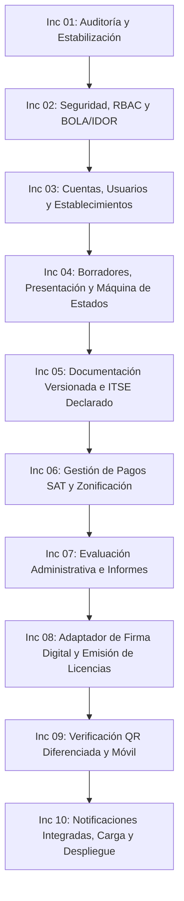

# Plan de Implementación por Incrementos — MuniHuamanga V2

Municipalidad Provincial de Huamanga — Gerencia de Licencias
**Fecha:** 13 de octubre de 2026
**Documentos Rectores:** [ERS-MH-V2-001 v1.0] y [DAS-MH-V2-001 v1.0]

---

## 1. Estrategia y Principios de Ejecución

Para garantizar la estabilidad operacional del sistema, preservar la integridad de los datos existentes y mitigar riesgos en producción, la transición a **MuniHuamanga V2** se ejecutará en **10 incrementos pequeños e iterativos**.

Cada incremento sigue un ciclo estricto de ingeniería:
1. **Identificación de requisitos** trazados a la ERS y DAS.
2. **Análisis de código existente** y dependencias.
3. **Propuesta de cambios mínimos necesarios** (principio de mínima sorpresa).
4. **Implementación controlada** sin migraciones destructivas.
5. **Ejecución y ampliación de pruebas automatizadas**.
6. **Registro de evidencias y resultados**.
7. **Actualización de documentación técnica**.

> [!IMPORTANT]
> **Criterio de Bloqueo:** No se avanzará al siguiente incremento si existen pruebas fallidas, vulnerabilidades críticas de seguridad o regresiones funcionales no resueltas.

---

## 2. Hoja de Ruta de Incrementos V2

---

## 3. Detalle de los Incrementos de Trabajo

### Incremento 01: Auditoría y Estabilización (Actual)
- **Objetivo:** Radiografía exhaustiva del repositorio, verificación de compilación y pruebas, mapeo de brechas y entrega de línea base documental.
- **Entregables:**
  - `docs/v2/README.md`
  - `docs/v2/AUDITORIA_INICIAL.md`
  - `docs/v2/MATRIZ_BRECHAS.md`
  - `docs/v2/PLAN_IMPLEMENTACION.md`
  - `docs/v2/DECISIONES_ARQUITECTURA.md`
  - `docs/v2/PRUEBAS_Y_VALIDACION.md`
- **Estado:** En ejecución / Completado para revisión de inicio.

---

### Incremento 02: Seguridad, RBAC y Protección IDOR/BOLA
- **Requisitos ERS/DAS:** RNF-SEG-001, RNF-SEG-002, RN-15, CA-01, CA-09.
- **Acciones Técnicas:**
  - Corregir `SecurityConfig.java`: Cerrar accesos anónimos a `/api/expedientes/detalle/**`, `/api/expedientes/*/documentos/**` y `subsanar`.
  - Crear evaluador de seguridad a nivel de método (`@PreAuthorize("@expedienteSecurity.isOwner(authentication, #id)")`).
  - Incorporar roles `ROLE_CIUDADANO` y `ROLE_INSPECTOR` en `RolUsuario`.
  - Corregir `VerificacionLicenciaDto` para omitir DNI completo en la consulta anónima.
  - Implementar pruebas automatizadas de autorización (intentos de acceso horizontal entre administrados).
- **Criterio de Salida:** 0 endpoints sensibles expuestos públicamente; pruebas BOLA/IDOR pasando en verde.

---

### Incremento 03: M01 Usuarios, Cuentas y M02 Establecimientos
- **Requisitos ERS/DAS:** RF-USR-001 a 006, RF-EST-001 a 005, RN-14, CA-08.
- **Acciones Técnicas:**
  - Diseñar e implementar entidades `Cuenta` (personas naturales con DNI, personas jurídicas con RUC), `OperadorCuenta` y `Establecimiento`.
  - Flujo de verificación de correo electrónico para activación de cuenta.
  - Gestión de establecimientos independientes vinculados a una cuenta, con dirección, geolocalización (latitud, longitud) y código CIIU del catálogo.
  - Migración no destructiva de datos preexistentes vinculando expedientes históricos a cuentas iniciales.
- **Criterio de Salida:** Creación de cuenta, login de ciudadano, registro de locales independientes con coordenadas y pruebas de integración asociadas.

---

### Incremento 04: M06 Borradores, Presentación Formal y Estados
- **Requisitos ERS/DAS:** RF-PAG-006, RF-PAG-007, RN-01, RN-02, CA-02, CA-04, ERS-3.1.
- **Acciones Técnicas:**
  - Implementar entidad `SolicitudBorrador` permitiendo al administrado guardar avances sin generar expediente.
  - Implementar endpoint transaccional idempotente de presentación formal (`POST /api/v2/drafts/{id}/submit`).
  - Asignación de número formal único de expediente (`EXP-YYYY-XXXXX`) **exclusivamente al presentar**.
  - Actualizar `EstadoExpediente` con la máquina de 10 estados oficial de V2.
  - Flujo de observaciones formales y subsanaciones dentro del mismo expediente (manteniendo historial).
- **Criterio de Salida:** Un borrador nunca tiene número de expediente; dos clics concurrentes generan exactamente un solo expediente con número correlativo único.

---

### Incremento 05: M03 Documentación Versionada y M04 ITSE Declarado
- **Requisitos ERS/DAS:** RF-DOC-001 a 007, RN-03, CA-06, CA-13.
- **Acciones Técnicas:**
  - Implementar entidad `Documento` con versionado, metadatos, tipo de documento y huella digital SHA-256 inmutable.
  - Integrar generadores nativos PDF existentes (Anexo 1, 3 y 4) reutilizando datos del establecimiento y la cuenta.
  - Protección estricta de campos oficiales reservados al clasificador o funcionario municipal frente a edición ciudadana.
  - Flujo ITSE: Registro de nivel de riesgo declarado (Bajo, Medio, Alto, Muy Alto) con sustento documental y validación administrativa por Licencias (sin simular dictámenes técnicos de Defensa Civil).
- **Criterio de Salida:** PDFs generados y versionados con hash verificado; historial documental preservado en subsanación.

---

### Incremento 06: M05 Pagos SAT y M07 Zonificación
- **Requisitos ERS/DAS:** RF-PAG-001 a 005, RF-EVA-003, RF-EVA-004, RN-04, RN-05, CA-03, CA-05.
- **Acciones Técnicas:**
  - Cálculo de tasa TUPA configurable según vigencia y nivel de riesgo.
  - Generación de orden de pago imprimible para cobro presencial en ventanillas SAT.
  - Registro de comprobante de pago por el administrado con estado inicial `PENDIENTE_VALIDACION`.
  - Módulo administrativo de validación manual de pagos para cajero/funcionario de Licencias.
  - Módulo de evaluación manual de zonificación posterior a la presentación y registro de pago. Registro de zona, ordenanza PDU de referencia, compatibilidad y fundamento técnico.
  - Flujo de solicitud de rectificación de coordenadas geográficas (corrección técnica vs traslado).
- **Criterio de Salida:** El pago no se valida automáticamente; la zonificación solo se evalúa tras presentación y pago registrado.

---

### Incremento 07: M08 Evaluación Administrativa e Informes
- **Requisitos ERS/DAS:** RF-EVA-001 a 007, RF-LIC-001, RF-LIC-002, RN-07, RN-08.
- **Acciones Técnicas:**
  - Bandeja unificada de evaluación para la Gerencia de Licencias con verificación documental, validación de pago y resultado de zonificación.
  - Generación automática de borrador de Informe Administrativo Técnico.
  - Flujo de revisión, aprobación y visado de informe por funcionario competente antes de habilitar la resolución favorable.
  - Manejo de impedimentos y bloqueo de emisión si faltan validaciones obligatorias.
- **Criterio de Salida:** Informe técnico estructurado, versionado y con estado previo a la firma digital.

---

### Incremento 08: M09 Resoluciones Administrativas, Firma Digital Institucional y Licencias [IMPLEMENTADO]
- **Requisitos ERS/DAS:** RF-LIC-003 a 007, RNF-SEG-006, DA-04, ADR-07, CA-07, CA-14.
- **Acciones Técnicas:**
  - Separación entre acto de instrucción (informe técnico M08) y acto resolutivo (`ResolucionAdministrativa`).
  - Secuencias anuales atómicas con bloqueo pesimista en BD para `RES-YYYY-XXXXX` y `LIC-YYYY-XXXXX`.
  - Definir puerto desacoplado `FirmaDigitalPort` y adaptador institucional configurable (`munihuamanga.firma-digital.enabled`).
  - Política de salvaguarda legal: si el servicio de firma institucional no está configurado, mantener el expediente en estado de espera y bloquear la emisión formal sin simular firmas criptográficas falsas.
  - Renderizado inmutable OpenPDF vectorial de la Licencia con identificador único, código QR aleatorio criptográfico y hash SHA-256.
  - Emisión transaccional e idempotente con prevención de doble emisión ante concurrencia.
  - Habilitar descarga de la licencia oficial exclusivamente tras firma digital válida.
- **Criterio de Salida:** Licencia inmutable con trazabilidad criptográfica; cero custodia de claves privadas en la aplicación; 281 pruebas automatizadas exitosas (0 fallos).

---

### Incremento 09: M10 Verificación QR y Consulta de Ubicación [IMPLEMENTADO]
- **Requisitos ERS/DAS:** RF-VER-005 a 008, RNF-SEG-007, CA-09, CA-10, CA-11.
- **Acciones Técnicas:**
  - Reestructurar el portal público de verificación QR con diseño responsivo móvil (`verificar-licencia.html`, `verificar-licencia.js`).
  - Vista pública ciudadana: Consulta de vigencia, número de licencia, nombre comercial, giro y dirección oficial con minimización estricta de datos personales según Ley 29733 (sin DNI/RUC, sin UUIDs internos), cabeceras anti-caché (`no-store, must-revalidate`) y Rate Limiting por IP (HTTP 429).
  - Vista ampliada autorizada para inspectores municipales (`ROLE_INSPECTOR`, `ROLE_ADMIN`) con georreferenciación oficial en mapa interactivo Leaflet sobre OpenStreetMap, distinción de coordenadas `DECLARADA_OFICIAL` vs `RECTIFICADA_APROBADA`, enlace de navegación GPS externa, cálculo local de distancia Haversine y registro inmutable en tabla relacional `auditoria_consultas_inspeccion`.
  - Confirmación de exclusión estricta de actas de infracción, procesos sancionadores, permisos de edición o descarga de expedientes internos en esta vista.
- **Criterio de Salida:** Vista pública protegida y vista de inspector operativa con mapa móvil; 301 pruebas automatizadas exitosas (0 fallos, 0 errores, 0 omitidas).

---

### Incremento 10: M11 Notificaciones, M12 Backoffice, Pruebas y Cierre
- **Requisitos ERS/DAS:** RF-ADM-001 a 005, RNF-OPE-001 a 007, AT-01 a AT-12.
- **Acciones Técnicas:**
  - Centro de notificaciones interno en el portal y adaptador de WhatsApp institucional para avisos informativos.
  - Panel de administración para giros CIIU, zonificaciones PDU, vigencias y reglas TUPA.
  - Pruebas de estrés y rendimiento (K6) simulando concurrencia de presentación y consultas QR.
  - Procedimiento documentado de respaldo y recuperación ante desastres (RPO/RTO).
  - Verificación final de criterios de aceptación y preparación para piloto institucional.
- **Criterio de Salida:** Sistema 100% verificado contra ERS y DAS, con suite completa de pruebas en verde y documentación actualizada.
